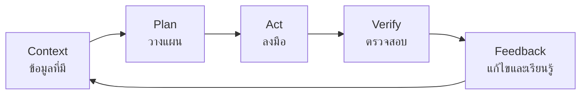
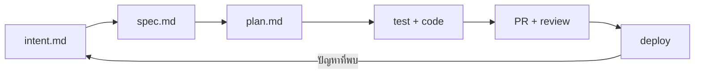

# SDPX-AI

**Software Development Process in Practice — AI-Assisted**

วิชานี้สอน *กระบวนการ* พัฒนาซอฟต์แวร์ในยุคที่ AI agent เขียน code ได้เองแล้ว
เมื่อการเขียน code ใช้เวลาเพียงไม่กี่นาที ข้อจำกัดของทีมจึงเปลี่ยนจาก "เขียนไม่ทัน" เป็น "ตรวจไม่ทัน"
สิ่งที่ทำให้วิศวกรซอฟต์แวร์มีค่าคือความสามารถในการ **ออกแบบวงจรที่ทำให้รู้เร็วที่สุดว่าอะไรถูกอะไรผิด**
และกำหนดว่าคนต้องตัดสินใจตรงจุดใด

---

## แนวคิดหลักของวิชา

### Loop Engineering

> **Loop Engineering** คือการออกแบบวงจร feedback ให้สั้น เชื่อถือได้ และทำซ้ำได้
> เพื่อให้ทั้งผู้พัฒนาและ AI agent ทราบโดยเร็วว่าสิ่งที่เพิ่งทำไปถูกต้องหรือไม่



AI coding agent ทำงานเป็น loop นี้อยู่แล้ว คุณภาพของงานที่ agent ทำได้จึงขึ้นอยู่กับคุณภาพของขั้น Verify ที่เราเตรียมให้
ทุกบทวัด loop ของตนด้วยเกณฑ์เดียวกัน

| เกณฑ์ | คำถาม |
|---|---|
| **Latency** | ใช้เวลาเท่าใดจึงทราบผล |
| **Fidelity** | ผลที่ได้สะท้อนความจริงเพียงใด |
| **Coverage** | ตรวจพบข้อผิดพลาดได้กี่ประเภท |

### Artifact chain

แนวทางของวิชามาจาก [*The AI-native SDLC playbook*](https://claude.com/resources/articles/the-ai-native-sdlc-playbook) ของ Anthropic
แต่ละขั้นของการพัฒนาจบด้วยไฟล์ที่ commit เข้า repository และขั้นถัดไปเริ่มจากการอ่านไฟล์นั้น
AI ทำงานภายในแต่ละขั้น ส่วนคนตรวจและอนุมัติที่จุดเชื่อมระหว่างขั้น



---

## Project

ทุกกลุ่มพัฒนาระบบเดียวกันตลอดภาคการศึกษา คือ **ระบบลงทะเบียนกิจกรรมที่มีที่นั่งจำกัด** พร้อมคิวสำรอง
รายละเอียด ผู้ใช้ ข้อมูล กฎ R1–R6 หน้าจอ และงานของแต่ละบทอยู่ใน [`PROJECT.md`](PROJECT.md)
lab ทุกบทคือการพัฒนา project นี้ต่อจากบทก่อนหน้าใน repository เดียวกันของกลุ่ม

- **Stack:** Next.js 16 บน Vercel, PostgreSQL (ตั้งแต่ WS-05), Vitest, Playwright, k6
- **Repository:** repository แบบ public ในบัญชี GitHub ส่วนตัวของสมาชิก 1 คน และสมาชิกคนอื่นเป็น collaborator

---

## Workshop ทั้ง 8 บท

| บท | โฟลเดอร์ | Loop | สิ่งที่ตรวจซ้ำได้ซึ่งเพิ่มในบทนี้ | ไฟล์ใน artifact chain | feature ที่ควรเสร็จ |
|---|---|---|---|---|---|
| 01 | [`WS-01-deploy`](WS-01-deploy/) | Deploy | CI ตรวจ build และ deploy อัตโนมัติ | `AGENTS.md` | หน้าแรกขึ้นเว็บจริง |
| 02 | [`WS-02-spec`](WS-02-spec/) | Spec | lint ของ `openapi.yaml` ใน CI | `intent.md`, `spec.md`, ADR-001 | spec ของ 01-events และ 02-register |
| 03 | [`WS-03-unit-test`](WS-03-unit-test/) | Unit Test | unit test ของกฎ R1, R3, R4, R5 โดยเขียน test ก่อน code | `plan.md`, ADR-002 | 01-events และ 02-register |
| 04 | [`WS-04-cicd`](WS-04-cicd/) | CI/CD | ruleset ที่ทุก PR ต้องผ่าน CI และการอนุมัติ และ AI review | `REVIEW.md` | 03-cancel (R2) |
| 05 | [`WS-05-docker`](WS-05-docker/) | Environment | `docker compose up` เหมือนกันทุกเครื่อง, integration test กับ PostgreSQL และ guard ของ AI agent | `.agents/guards/`, ADR-003 | ทั้งระบบรันด้วย `docker compose up` |
| 06 | [`WS-06-e2e`](WS-06-e2e/) | E2E | E2E test ของ journey หลักใน CI และ verifier ที่ตรวจด้วยบทสนทนาใหม่ | `.agents/verifier.md` | 04-access และหน้าจอครบ 5 หน้า |
| 07 | [`WS-07-perf`](WS-07-perf/) | Performance | load test ผู้ใช้ 300 คนตรวจ R6 และ p95 ของหน้ารายการกิจกรรม | `ops/bands.yaml` | p95 ไม่เกิน 500 ms |
| 08 | [`WS-08-quality`](WS-08-quality/) | Quality | access test, CodeQL, `npm audit` และ security review ด้วย skill | `SKILL.md`, `LESSONS.md` | ผ่าน security checklist ทุกข้อ |

### ไฟล์ในแต่ละบท

```
WS-0X-[หัวข้อ]/
├── 0-Before.md    ← ทำก่อนเข้าคาบ: keyword, ติดตั้งและตรวจเครื่องมือ, สิ่งที่ต้องเตรียมใน repository
├── 1-Lecture.md   ← อธิบายเฉพาะสิ่งที่ Before ไม่ได้ตอบ พร้อมตัวอย่างที่ดีและไม่ดี และตัวอย่างจากการทำงานจริง
├── 2-Lab.md       ← ทำกับ project ของกลุ่ม แต่ละขั้นมี ทำ / ผลที่ควรเห็น / หากติดปัญหา และจบด้วย Retro
└── 3-Present.md   ← demo กลุ่มละ 5 นาที ตามตาราง 7 ขั้น ขั้นละ 1 เกณฑ์ผ่าน
```

`0-Before.md` เป็นเงื่อนไขก่อนเข้าคาบ ไม่ใช่ของเสริม lab หยิบสิ่งที่เตรียมมาไปใช้ต่อทันที
และ lecture เริ่มจากผลที่นักศึกษาได้จาก Before

ตัวอย่างใน lecture ใช้ feature "แจ้งเตือนเมื่อได้ที่นั่งจากคิวสำรอง" ซึ่งอยู่นอกขอบเขตของ project
ตัวอย่างจึงไม่ใช่คำตอบของ lab

### Present

ผู้ตรวจ (ผู้สอนหรือผู้ที่ได้รับมอบหมาย) ให้กลุ่มทำตามตารางใน `3-Present.md` ทีละขั้น และตรวจเกณฑ์ผ่านของแต่ละขั้นระหว่าง demo
ทุกบทตั้งแต่ WS-01 มี **PR break-it-live** ซึ่งกลุ่มตั้งใจทำให้ผิดเพื่อแสดงว่าขั้นตรวจของบทนั้นจับได้จริง
แล้วปิดโดยไม่ merge

---

## สิ่งที่สะสมใน repository ของกลุ่ม

```
sdpx-[ชื่อกลุ่ม]/
├── AGENTS.md                     ← 01 กติกาที่ AI agent อ่านทุกครั้ง และเพิ่มขึ้นทุกบท
├── REVIEW.md                     ← 04 เกณฑ์ของ AI review และผู้อนุมัติ
├── LESSONS.md                    ← 08 บทเรียนที่ผูกกับสิ่งที่ป้องกัน
├── compose.yaml, Dockerfile      ← 05
├── .agents/
│   ├── guards/                   ← 05 script ที่ขวางคำสั่งอันตรายและค่าความลับ
│   ├── verifier.md               ← 06
│   └── skills/security-review/   ← 08 SKILL.md
├── docs/
│   ├── openapi.yaml              ← 02 API contract
│   ├── adr/                      ← 02, 03, 05 ADR-001 ถึง ADR-003
│   ├── features/[feature]/       ← 02 intent.md, spec.md · 03 plan.md
│   └── security-checklist.md     ← 08
├── db/schema.sql, db/seed.sql    ← 05
├── src/
│   ├── domain/                   ← 03 กฎ R1–R5 และ unit test
│   ├── data/                     ← 03, 05, 07 ที่เก็บข้อมูล และ integration test
│   ├── lib/                      ← 03 ผู้ใช้ปัจจุบันแบบชั่วคราว · 06 session
│   └── app/                      ← หน้าจอและ route handler
├── e2e/                          ← 06 journey · 08 access test
├── load/                         ← 07 load test ของ k6
├── ops/bands.yaml                ← 07
├── evidence/ws-0X.md             ← หลักฐานและ Retro ของทุกบท
└── .github/workflows/ci.yml      ← 01 แล้วเพิ่มขั้นตรวจทุกบท
```

---

## Course Outline

| Week | Topic | Workshop |
| :--- | :--- | :--- |
| 01 | Introduction | — |
| 02 | IT Project Management 101 | — |
| 03 | First Deploy + Loop Engineering | [WS-01 Deploy](WS-01-deploy/) |
| 04 | Analysis and Design | [WS-02 Spec](WS-02-spec/) |
| 05 | Software Testing | — |
| 06 | *Midterm Exam* | — |
| 07 | Unit Testing | [WS-03 Unit Test](WS-03-unit-test/) |
| 08 | CI/CD | [WS-04 CI/CD](WS-04-cicd/) |
| 09 | Software Architecture | — |
| 10 | Docker | [WS-05 Environment](WS-05-docker/) |
| 11 | End-to-End Testing | — |
| 12 | End-to-End Testing | [WS-06 E2E](WS-06-e2e/) |
| 13 | Performance Testing | [WS-07 Performance](WS-07-perf/) |
| 14 | Code Quality and Security | [WS-08 Quality](WS-08-quality/) |
| 15 | Presentation | — |
| 16 | Summary | — |
| 17 | *Final Exam* | — |

เอกสารอ่านประกอบอยู่ใน [`readings/`](readings/)

---

## กติกาสำคัญของวิชา

1. **AI เสนอ คนตัดสิน** ทุก artifact ที่ AI สร้างต้องมีสมาชิกที่อธิบายได้ และ agent ที่เขียน code ต้องไม่เป็นผู้อนุมัติ code นั้น
2. **ถ้าอธิบายไม่ได้ ห้าม merge** ผู้ตรวจถามระหว่าง present ได้ทุกขั้น
3. **ห้ามส่งค่าความลับเข้า AI tool หรือเข้า repository** ไม่ว่ากรณีใด ค่าของเว็บจริงอยู่ใน Vercel เท่านั้น
4. **Verify ก่อนเชื่อ** ทั้ง output ของ AI และผลลัพธ์ของตนเอง หลักฐานต้องมาจากคำสั่งที่รันจริง
5. **ทำด้วยมือก่อน แล้วจึงทำให้อัตโนมัติ** ขั้นตอนใดที่ยังไม่เคยทำด้วยมือจนเข้าใจ ไม่ควรให้ระบบทำแทน

---

## Scoring

- [40] Lab
- [10] Presentation
- [20] Midterm Exam
- [30] Final Exam

รายละเอียดการให้คะแนนของแต่ละบทผู้สอนจะประกาศแยก ไฟล์ใน workshop จึงไม่มีคะแนนกำกับ
