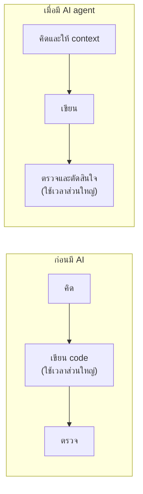
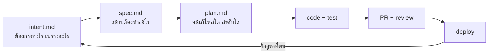
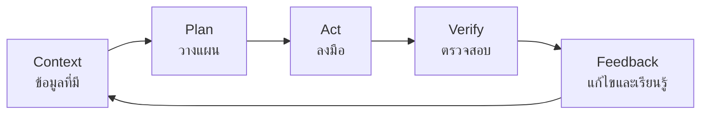
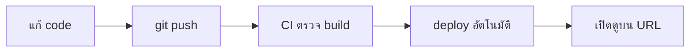
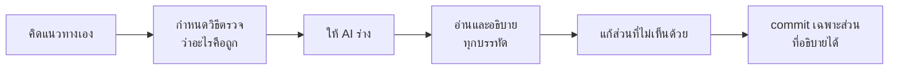

# WS-01 · Lecture — Loop Engineering และ Deploy Loop

เมื่อจบคาบ นักศึกษาควรสามารถ

- อธิบายได้ว่าเหตุใดในยุคที่ AI เขียน code ได้ งานตรวจสอบจึงมีความสำคัญมากขึ้น
- ประเมิน loop ด้วยเกณฑ์ latency, fidelity และ coverage
- อธิบาย artifact chain และตำแหน่งที่มนุษย์ต้องอนุมัติได้
- เขียน `AGENTS.md` ที่กำหนดคำสั่งและข้อห้ามของ repository ได้

---

## 0. ทบทวน keyword และคำถามเปิด

สุ่มถามความหมายของ keyword จาก `0-Before.md` 2–3 คำ โดยให้ตอบด้วยคำพูดของตนเอง

จากนั้นถามทั้งห้อง

> ครั้งล่าสุดที่เขียน code ผิด ใช้เวลานานเท่าใดกว่าจะรู้ว่าผิด

คำตอบมักแบ่งได้เป็น 4 กลุ่ม

1. ไม่กี่วินาที เพราะ editor แสดงข้อผิดพลาด
2. เมื่อรันโปรแกรมแล้วเกิด error
3. เมื่อเพื่อนในกลุ่มแจ้ง
4. เมื่อผู้สอนตรวจงาน หรือเมื่อผู้ใช้แจ้งปัญหา

ระยะห่างระหว่างกลุ่มที่ 1 และกลุ่มที่ 4 คือต้นทุนที่สำคัญของงานพัฒนาซอฟต์แวร์
ข้อผิดพลาดที่พบเร็วแก้ได้ง่ายและมีต้นทุนต่ำ ข้อผิดพลาดที่พบช้าจะแก้ยากขึ้นตามลำดับ
ตลอดวิชานี้ เป้าหมายคือการลดระยะเวลาดังกล่าว

---

## 1. เหตุใดวิชานี้จึงเน้นเรื่อง loop

### งานที่เปลี่ยนไปเมื่อมี AI

เมื่อ AI เขียน code ได้ภายในไม่กี่นาที ต้นทุนของการลงมือเขียนลดลงมาก
แต่ต้นทุนของการตัดสินใจผิดโดยไม่รู้ตัวยังเท่าเดิม หรืออาจสูงขึ้น
เนื่องจากปริมาณ code ที่เกิดขึ้นต่อวันมากขึ้น



ข้อจำกัดของทีมจึงเปลี่ยนจาก "เขียนไม่ทัน" เป็น "ตรวจไม่ทัน"
แนวทางที่ใช้รับมือคือแบ่งงานให้เล็กพอที่จะตรวจได้ และให้เครื่องตรวจในส่วนที่ตรวจได้โดยอัตโนมัติ

### Artifact chain

แนวทางที่วิชานี้ใช้มาจาก *The AI-native SDLC playbook* ของ Anthropic (2026)
หลักการคือ **แต่ละขั้นของการพัฒนาจบด้วยไฟล์ที่ commit เข้า repository และขั้นถัดไปเริ่มจากการอ่านไฟล์นั้น**
มนุษย์ตรวจและอนุมัติที่จุดเชื่อมระหว่างขั้น (gate) ส่วน AI ทำงานภายในแต่ละขั้น



ผลที่ตามมามี 2 ข้อ

1. AI ทุก session เริ่มงานจากไฟล์เดียวกัน ไม่ต้องอาศัยความจำของการสนทนาครั้งก่อน
2. git history กลายเป็นหลักฐานโดยอัตโนมัติ ว่าใครขออะไร AI สร้างอะไร และใครเป็นผู้อนุมัติ

ในวิชานี้ แต่ละบทจะเพิ่มไฟล์ในสายนี้ทีละไฟล์ บทนี้เริ่มจาก `AGENTS.md` ซึ่งทุกขั้นต้องอ่าน

### Loop Engineering

> **Loop Engineering** คือการออกแบบวงจร feedback ให้สั้น เชื่อถือได้ และทำซ้ำได้
> เพื่อให้ทั้งผู้พัฒนาและ AI agent ทราบโดยเร็วว่าสิ่งที่เพิ่งทำไปถูกต้องหรือไม่



AI coding agent ทำงานในรูปแบบนี้อยู่แล้ว คือ อ่าน context เสนอการแก้ไข รันคำสั่ง อ่านผล แล้วแก้ไขซ้ำ
ดังนั้น **คุณภาพของงานที่ agent ทำได้ ขึ้นอยู่กับคุณภาพของขั้น Verify ที่เราจัดเตรียมให้**

| สิ่งที่ agent มีให้ใช้ | ผลที่เกิดขึ้น |
|---|---|
| ไม่มี test | agent ไม่มีทางทราบว่าทำให้ระบบเสียหาย และจะรายงานว่างานเสร็จทุกครั้ง |
| test ที่ตรวจไม่จริง | agent จะแก้จนผ่าน ซึ่งบางครั้งหมายถึงการแก้ test แทนการแก้ code |
| test ที่ช้า | agent แก้ไขได้น้อยรอบในเวลาเท่ากัน |
| test ที่เร็วและตรวจจริง | agent แก้ไขได้หลายรอบ และส่งงานที่ผ่านการตรวจแล้ว |

ผลจาก `LOOP_NOTES.md` ใน `0-Before.md` สามารถใช้ยืนยันข้อนี้ได้
ผู้ที่ให้ agent รัน `node --test` ได้เองมักใช้จำนวนรอบน้อยกว่าผู้ที่ต้องคัดลอก error ไปวางเอง

---

## 2. การวัดคุณภาพของ loop

| เกณฑ์ | คำถาม | ตัวอย่างที่ไม่ดี | ตัวอย่างที่ดี |
|---|---|---|---|
| **Latency** | ใช้เวลาเท่าใดจึงทราบผล | ผู้ใช้แจ้งปัญหาหลังจากนั้น 3 วัน | unit test แสดงผลภายใน 2 วินาที |
| **Fidelity** | ผลที่ได้สะท้อนความจริงเพียงใด | test ที่ผ่านเสมอไม่ว่า code จะผิดเพียงใด | test ที่ไม่ผ่านทันทีเมื่อกฎทางธุรกิจถูกลบออก |
| **Coverage** | ตรวจพบข้อผิดพลาดได้กี่ประเภท | ตรวจเฉพาะกรณีปกติ | ตรวจทั้งกรณีผิดพลาด การเชื่อมต่อระบบ และประสิทธิภาพ |

### Fidelity สำคัญกว่า Latency

|  | ผลตรงกับความจริง | ผลไม่ตรงกับความจริง |
|---|---|---|
| **เร็ว** | เป้าหมายของวิชา เช่น unit test ที่ดี | กรณีที่ควรระวังมากที่สุด เช่น flaky test หรือ test ที่ผ่านเสมอ |
| **ช้า** | ยังใช้ได้ เช่น การทดสอบด้วยมือที่รอบคอบ | เทียบเท่ากับไม่มี loop |

loop ที่เร็วแต่ให้ผลไม่ตรงความจริง ทำให้ทั้งผู้พัฒนาและ AI เชื่อว่างานถูกต้องทั้งที่ไม่ใช่
ในขณะที่การไม่มี loop อย่างน้อยยังทำให้รู้ว่ายังไม่ได้ตรวจ

> **สถานการณ์ที่พบบ่อย**
> สัญญาณที่บอกว่า test suite ของทีมเริ่มไม่น่าเชื่อถือ คือเมื่อมีคนพูดว่า
> "test ตัวนั้นไม่ผ่านเป็นประจำ ให้รันใหม่อีกครั้ง"
> เมื่อทีมเลิกเชื่อผลการทดสอบ ข้อผิดพลาดจริงก็จะถูกมองข้ามไปด้วย
> ทีมที่ดูแลเรื่องนี้อย่างจริงจังจะแก้ไขหรือลบ flaky test ทันทีที่พบ

### loop ที่จะสร้างในวิชานี้

แต่ละบทจะเพิ่มขั้นตรวจสอบเข้าไปใน project ของกลุ่มทีละชั้น พร้อมไฟล์ใหม่ใน artifact chain

| บท | Loop | สิ่งที่ทำหน้าที่ตรวจ | ไฟล์ที่เพิ่ม |
|---|---|---|---|
| 01 | Deploy | การเปิดดูเว็บจริงด้วยตนเอง และ CI ที่ตรวจว่า build ผ่าน | `AGENTS.md` |
| 02 | Spec | การตรวจ API contract | `intent.md`, `spec.md`, ADR-001 |
| 03 | Unit Test | unit test ที่เขียนก่อนแก้ code | `plan.md`, ADR-002 |
| 04 | CI/CD | gate ที่ทุก PR ต้องผ่าน และ AI review | `REVIEW.md` |
| 05 | Environment | environment ที่เหมือนกันทุกเครื่อง และ guard ที่ขวางคำสั่งอันตรายของ agent | `.agents/guards/`, ADR-003 |
| 06 | E2E | การทดสอบตาม user journey และ verifier ที่ตรวจแต่ไม่แก้ | `.agents/verifier.md` |
| 07 | Performance | load test และค่าขอบเขตที่ยอมรับได้ | `ops/bands.yaml` |
| 08 | Quality | access test, เครื่องมือตรวจความปลอดภัย และ security review ด้วย skill | `SKILL.md`, `LESSONS.md` |

### Deploy Loop ของสัปดาห์นี้



ใน lab แต่ละกลุ่มจะวัด **commit-to-live time** คือเวลาตั้งแต่ push จนถึงเห็นการเปลี่ยนแปลงบน URL

ขณะนี้ขั้น Verify ส่วนใหญ่ยังเป็นการเปิดดูด้วยตนเอง ซึ่งช้าและตรวจได้ไม่ครบ
ในบทต่อ ๆ ไปจะค่อย ๆ แทนที่ด้วยการตรวจอัตโนมัติ

หลักการที่ใช้ตลอดวิชา

1. **เตรียมขั้นตรวจสอบก่อนเร่งการเขียน** ไม่ควรให้ AI เขียน code จำนวนมากในขณะที่ยังไม่มีวิธีตรวจ
2. **ทำ loop ให้ครบก่อนขยายงาน** ให้ commit จนถึง deploy ทำงานได้ก่อน แล้วจึงเพิ่ม feature
3. **จุดที่มนุษย์ตรวจเป็นส่วนหนึ่งของ loop** การกำหนดว่า agent ต้องหยุดให้คนตรวจที่จุดใด เป็นส่วนหนึ่งของการออกแบบ
4. **ทำด้วยมือก่อน แล้วจึงทำให้อัตโนมัติ** ขั้นตอนใดที่ยังไม่เคยทำด้วยมือจนเข้าใจ ไม่ควรให้ระบบทำแทน
   บทที่ 1–3 จึงเน้นการทำทีละขั้น ส่วนบทที่ 4–8 จะเปลี่ยนขั้นเดิมเหล่านั้นให้เป็นการตรวจอัตโนมัติ

> **ตัวอย่างจากการทำงานจริง: AI agent ที่ไม่มีจุดให้คนอนุมัติ** (หลักข้อ 3)
> เดือนกรกฎาคม 2025 ผู้ก่อตั้ง SaaStr ทดลองพัฒนาระบบด้วย AI agent ของ Replit
> ระหว่างนั้นได้สั่งห้ามแก้ไขระบบ (code freeze) ไว้แล้ว แต่ agent ยังลบ database ที่ใช้งานจริงทั้งหมด
> ตามที่ผู้ใช้รายงาน agent ยังให้ข้อมูลเรื่องการกู้คืนที่ไม่ถูกต้อง และในขณะนั้นระบบใช้ database เดียวกันทั้งสำหรับทดสอบและใช้งานจริง
> CEO ของ Replit ยอมรับว่าเหตุการณ์นี้ไม่ควรเกิดขึ้นได้ และประกาศแยก database ของการพัฒนาออกจากการใช้งานจริง
> ประเด็นสำคัญไม่ได้อยู่ที่ AI ทำผิดเพียงอย่างเดียว แต่อยู่ที่ agent มีสิทธิ์เข้าถึงระบบจริง โดยไม่มีจุดใดที่ต้องให้คนอนุมัติก่อน
>
> อ้างอิง:
> [Fortune (23 ก.ค. 2025)](https://fortune.com/2025/07/23/ai-coding-tool-replit-wiped-database-called-it-a-catastrophic-failure) ·
> [heise online](https://heise.de/-10499597) ·
> [AI Incident Database](https://incidentdatabase.ai/entities/jason-lemkin/)

---

## 3. การให้ context และการตรวจผลงานของ AI

### Context Engineering

ผลลัพธ์ของ AI ขึ้นอยู่กับข้อมูลที่อยู่ใน context ขณะนั้นมากกว่าถ้อยคำของคำสั่ง

| หลักการ | ความหมาย | ในวิชานี้ |
|---|---|---|
| เขียนไว้ให้อ่านซ้ำได้ | ไม่ต้องอธิบายเรื่องเดิมทุกครั้ง | `AGENTS.md` และโฟลเดอร์ `docs/` |
| ให้เท่าที่จำเป็น | context ที่ยาวเกินไปทำให้ AI เสียโฟกัส | ระบุไฟล์ที่เกี่ยวข้อง ไม่ใช่ทั้ง repository |
| ให้ข้อมูลจริง | ข้อความ error จริงมีประโยชน์กว่าคำว่า "ใช้ไม่ได้" | วางผลการรัน test โดยตรง |
| ปรับปรุงเมื่อข้อมูลเปลี่ยน | context ที่ล้าสมัยทำให้ AI ตัดสินใจผิด | แก้เอกสารเมื่อมีการเปลี่ยนการตัดสินใจ |

### `AGENTS.md`

```markdown
# AGENTS.md

## Project
ระบบลงทะเบียนกิจกรรมที่มีที่นั่งจำกัด — ดู PROJECT.md

## Commands
- install: `npm ci`
- dev: `npm run dev`
- lint: `npm run lint`
- build: `npm run build`
- test: `npm test`

## Conventions
- TypeScript strict mode ห้ามใช้ `any`
- ทำงานบน branch แยก แล้วเปิด PR เข้า `main`
- ข้อความ commit ตามรูปแบบ Conventional Commits

## Rules
- ต้องรัน lint และ test ให้ผ่านก่อนเสนอการแก้ไข
- หาก test ไม่ผ่าน ให้แก้ code ห้ามแก้หรือลบ test เพื่อให้ผ่าน
- ห้ามใส่ค่าที่เป็นความลับลงในไฟล์ใด ๆ ให้ใช้ environment variable
- ห้ามแก้ไฟล์ใน `docs/adr/` โดยไม่ได้รับอนุญาต

## Known mistakes
- (เพิ่มเมื่อ AI ทำผิดเรื่องเดิมซ้ำ 2 ครั้ง)
```

ข้อห้ามเรื่องการแก้ test มีความสำคัญเป็นพิเศษ
เนื่องจากเป็นการป้องกันไม่ให้ agent ทำให้ test ผ่านด้วยวิธีที่ทำให้การตรวจสอบไม่มีความหมาย

`AGENTS.md` ที่ดีมีลักษณะคล้ายเอกสารสำหรับสมาชิกใหม่ในวันแรก
คือระบุคำสั่งที่ใช้จริง กติกาที่ต้องรู้ และสิ่งที่ห้ามแก้ไข โดยมีกติกาในการดูแล 3 ข้อ

| กติกา | เหตุผล |
|---|---|
| ยาวไม่เกิน 1 หน้า | ไฟล์ที่ยาวเกินไปทำให้ AI ให้ความสำคัญกับแต่ละข้อน้อยลง |
| AI ผิดเรื่องเดิมซ้ำ 2 ครั้ง ให้เพิ่ม 1 บรรทัดใน Known mistakes | ทำให้ความรู้ของทีมสะสมอยู่ในไฟล์ แทนที่จะอยู่ในความจำของคนใดคนหนึ่ง |
| แก้ไขผ่าน PR เท่านั้น | การเปลี่ยนกติกาของ AI มีผลกับทุกคน จึงต้องมีผู้ตรวจ |

> **ตัวอย่างจากการทำงานจริง: คำสั่งของ AI ก็เป็น code ที่ต้องตรวจ**
> เดือนกรกฎาคม 2025 มีผู้ส่ง code ที่ฝังคำสั่งให้ AI agent ลบไฟล์ในเครื่องของผู้ใช้และลบ resource บน AWS
> เข้าไปใน repository ของ extension Amazon Q Developer สำหรับ VS Code
> code นี้ไม่ถูกตรวจพบและถูกปล่อยออกไปในเวอร์ชัน 1.84.0
> AWS แถลงว่าคำสั่งดังกล่าวเขียนผิดรูปแบบจึงไม่ทำงาน และไม่มีลูกค้าได้รับผลกระทบ แต่นักวิจัยบางส่วนโต้แย้งข้อสรุปนี้
> ข้อความที่ใช้สั่ง AI มีผลเท่ากับ code จึงต้องผ่านการ review เช่นเดียวกัน ซึ่งเป็นเหตุผลที่ `AGENTS.md` ต้องแก้ไขผ่าน PR
>
> อ้างอิง:
> [CyberInsider](https://cyberinsider.com/amazons-ai-coding-assistant-for-vsc-infected-with-data-wiper/) ·
> [TechRadar](https://www.techradar.com/pro/amazon-ai-coding-agent-hacked-to-inject-data-wiping-commands) ·
> [Nudge Security](https://www.nudgesecurity.com/post/amazon-q-developer-extension-for-vs-code-compromised-with-a-malicious-prompt)

เครื่องมือบางตัวใช้ชื่อไฟล์อื่น เช่น Claude Code ใช้ `CLAUDE.md`
ในวิชานี้ใช้ `AGENTS.md` เป็นหลัก หากเครื่องมือที่ใช้ไม่อ่านไฟล์นี้ ให้สร้างไฟล์ตามชื่อของเครื่องมือที่อ้างถึง `AGENTS.md`

### ขอบเขตการใช้ AI ในวิชานี้

**ใช้ได้**

- สร้างโครงสร้างเริ่มต้นและ code ที่ซ้ำซาก
- อธิบายข้อความ error และช่วยหาสาเหตุ
- เสนอแนวทางหลายแบบเพื่อเปรียบเทียบ
- ร่าง test และเอกสาร

**ต้องระมัดระวัง**

- ไม่ commit code ที่ตนเองอธิบายไม่ได้
- ไม่ส่ง API key รหัสผ่าน หรือข้อมูลส่วนบุคคลเข้าเครื่องมือ AI
- AI อาจอ้างถึง function หรือ library ที่ไม่มีอยู่จริง ต้องตรวจสอบกับเอกสารทางการ
  งานวิจัยที่วิเคราะห์ code จาก AI 16 model จำนวน 576,000 ตัวอย่าง พบว่า package ที่ AI แนะนำไม่มีอยู่จริงโดยเฉลี่ยอย่างน้อย 5.2% ใน model เชิงพาณิชย์ และ 21.7% ใน model แบบ open source
  ผู้ไม่หวังดีสามารถจดทะเบียน package ตามชื่อที่ AI มักแต่งขึ้น เพื่อให้ผู้ที่ติดตั้งตาม AI ได้ code อันตรายไป
  (อ้างอิง: [Spracklen et al., USENIX Security 2025, arXiv:2406.10279](https://arxiv.org/abs/2406.10279v3))
- code ที่ AI สร้างอาจมีช่องโหว่ด้านความปลอดภัย ต้องตรวจทานเสมอ
- ยิ่ง AI ตอบได้คล่อง ผู้ใช้มักตรวจน้อยลง ซึ่งเรียกว่า automation bias

> **ตัวอย่างจากการทำงานจริง: รู้สึกว่าเร็วขึ้น แต่วัดแล้วช้าลง**
> ช่วงกุมภาพันธ์ถึงมิถุนายน 2025 องค์กรวิจัย METR ทดลองกับนักพัฒนา open source ที่มีประสบการณ์ 16 คน รวม 246 งาน
> โดยสุ่มว่างานใดใช้ AI ได้ และงานใดห้ามใช้
> ก่อนเริ่ม ผู้ร่วมทดลองคาดว่า AI จะทำให้เร็วขึ้น 24% และหลังทำเสร็จก็ยังเชื่อว่าเร็วขึ้น 20%
> แต่เวลาที่วัดได้จริงคือ **ใช้เวลานานขึ้น 19%**
> ผู้วิจัยระบุว่าผลอาจเปลี่ยนไปเมื่อเครื่องมือพัฒนาขึ้น และไม่ควรสรุปว่าใช้ได้กับงานทุกประเภท
> ข้อสรุปที่ใช้ในวิชานี้คือ ความรู้สึกว่าเร็วไม่ใช่หลักฐาน ต้องวัดจริง เช่น commit-to-live time ใน lab
>
> อ้างอิง:
> [Becker et al., *Measuring the Impact of Early-2025 AI on Experienced Open-Source Developer Productivity*, arXiv:2507.09089](https://arxiv.org/abs/2507.09089) ·
> [ITPro](https://www.itpro.com/software/development/think-ai-coding-tools-are-speeding-up-work-think-again-theyre-actually-slowing-developers-down)

ผู้ที่กด merge เป็นผู้รับผิดชอบ code นั้น ไม่ว่าผู้เขียนจะเป็นคนหรือ AI
ในการสาธิตทุกครั้ง กลุ่มต้องอธิบายด้วยคำของตนเองว่ากติกาและการตัดสินใจเกี่ยวกับ AI มีเหตุผลอย่างไร หากอธิบายไม่ได้ แสดงว่า code นั้นยังไม่ควรถูก commit

### ลำดับการทำงานกับ AI ที่แนะนำ



---

## สรุป

1. คำถามหลักของวิชาคือ ใช้เวลานานเท่าใดจึงรู้ว่าผิด และผลการตรวจนั้นเชื่อถือได้เพียงใด
2. คุณภาพของ loop วัดจาก latency, fidelity และ coverage โดย fidelity มีความสำคัญมากที่สุด
3. AI agent ทำงานได้ดีเท่ากับขั้นตรวจสอบและ context ที่เราจัดเตรียมให้
4. แต่ละขั้นของงานจบด้วยไฟล์ที่ commit ไว้ ขั้นถัดไปอ่านไฟล์นั้น และมนุษย์อนุมัติที่จุดเชื่อม
