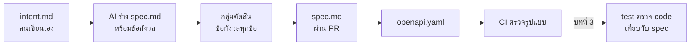

# WS-02 · Lecture — Spec Loop

เมื่อจบคาบ นักศึกษาควรสามารถ

- อธิบายได้ว่าเหตุใด AI จึงทำงานได้ตรงขึ้นเมื่อมี spec ที่ตรวจได้
- แยกได้ว่า intent, spec และ OpenAPI ตอบคำถามใด และใครเป็นผู้เขียนแต่ละไฟล์
- เขียนข้อกำหนดที่ test ตรวจได้ และระบุ edge case ได้
- บันทึกการตัดสินใจทางเทคนิคเป็น ADR

---

## 0. ทบทวน keyword และคำถามเปิด

สุ่มถามความหมายของ keyword จาก `0-Before.md` 2–3 คำ โดยให้ตอบด้วยคำพูดของตนเอง

จากนั้นถามทั้งห้อง

> ครั้งล่าสุดที่ AI สร้างสิ่งที่ไม่ตรงกับที่ต้องการ สาเหตุคือ AI ทำผิด หรือคำสั่งของเราไม่ได้บอกเรื่องนั้น

คำตอบส่วนใหญ่มักเป็นแบบที่สอง เมื่อคำสั่งไม่ได้บอกบางเรื่อง AI จะเลือกคำตอบให้เอง
คำตอบที่เลือกมักดูสมเหตุสมผล จึงตรวจพบได้ยาก และมักพบเมื่อผู้ใช้เจอปัญหาแล้ว

ผลจากส่วน C ของ `0-Before.md` ใช้ยืนยันข้อนี้ได้
กรณีที่ AI พบว่ากฎใน `PROJECT.md` ยังไม่ได้บอก คือกรณีที่ AI จะต้องเดาหากไม่มีใครตัดสินให้

---

## 1. เหตุใด spec จึงสำคัญขึ้นเมื่อใช้ AI

### ช่องว่างที่ AI เติมให้เอง

เมื่อเขียน code เอง ผู้เขียนจะเจอเรื่องที่ไม่ชัดระหว่างทาง และหยุดถามผู้อื่น
AI ไม่หยุด แต่เลือกทางหนึ่งแล้วเขียนต่อจนเสร็จ

ตัวอย่างจากกฎ R4 ใน `PROJECT.md`: "ยกเลิกได้จนถึง 24 ชั่วโมงก่อนเวลาเริ่ม"

- หากเหลือเวลา 24 ชั่วโมงพอดี ยกเลิกได้หรือไม่
- เวลาที่ใช้เทียบเป็นเวลาของ server หรือเวลาที่ผู้ใช้เห็นบนหน้าจอ
- หากยกเลิกไม่ได้ ระบบตอบกลับอย่างไร

หากไม่มีใครตัดสิน AI จะเลือกให้ทั้ง 3 ข้อ และแต่ละครั้งที่สั่งอาจเลือกไม่เหมือนกัน
test ที่เขียนภายหลังก็จะตรวจตามสิ่งที่ AI เลือก ไม่ใช่สิ่งที่กลุ่มต้องการ

### Spec Loop



บทนี้เพิ่ม 2 ไฟล์ใน artifact chain ที่เรียนใน WS-01 คือ `intent.md` และ `spec.md`
ขั้นตรวจสอบของบทนี้มี 2 ส่วน

| ส่วน | ผู้ตรวจ | ตรวจอะไรได้ | ตรวจอะไรไม่ได้ |
|---|---|---|---|
| PR ของ intent และ spec | สมาชิกอีกคนในกลุ่ม | ความเข้าใจตรงกัน และข้อกังวลที่ยังไม่ได้ตัดสิน | ว่าการตัดสินใจนั้นดีหรือไม่ในระยะยาว |
| lint ของ `openapi.yaml` ใน CI | เครื่อง | รูปแบบไฟล์ถูกต้อง และไม่ขาดส่วนที่จำเป็น | ว่า API ทำตามกฎ R1–R6 จริงหรือไม่ |

lint ตรวจได้เฉพาะรูปแบบ จึงเป็นขั้นตรวจที่เร็วแต่ครอบคลุมน้อย
การตรวจว่าระบบทำตาม spec จริงจะเริ่มในบทที่ 3 เมื่อมี code และ unit test

> **ตัวอย่างจากการทำงานจริง: เครื่องมือที่เริ่มจาก spec**
> ปี 2025 GitHub เผยแพร่ Spec Kit เป็นชุดเครื่องมือแบบ open source ที่จัดลำดับงานให้เริ่มจาก specification
> แล้วจึงทำ technical plan และแตกเป็นงานย่อยที่ทดสอบได้ให้ AI agent ลงมือ
> เครื่องมือ Kiro ของ AWS ก็ใช้แนวทางเดียวกัน โดยสร้างไฟล์ `requirements.md`, `design.md` และ `tasks.md` ต่อ feature
> และให้ผู้ใช้ตรวจเอกสารแต่ละขั้นก่อนไปขั้นถัดไป
> ผู้รีวิวรายหนึ่งชี้ว่าเอกสารเหล่านี้ไม่ได้ปรับตามเองเมื่อ code เปลี่ยน spec กับ code จึงค่อย ๆ ไม่ตรงกัน
> ข้อนี้เป็นเหตุผลของกติกาในวิชานี้ว่า หาก code ต้องต่างจาก spec ให้แก้ spec ก่อน
>
> อ้างอิง:
> [GitHub Spec Kit](https://github.github.com/spec-kit/) ·
> [DevOps.com](https://devops.com/githubs-spec-kit-puts-the-spec-back-in-software-development/) ·
> [Kiro Docs — Specs](https://kiro.dev/docs/specs/) ·
> [Amazon Kiro review](https://pasqualepillitteri.it/en/news/6370/amazon-kiro-ide-spec-driven-review)

---

## 2. intent, spec และ OpenAPI

| ไฟล์ | ตอบคำถาม | ผู้เขียน | ผู้ตรวจ |
|---|---|---|---|
| `intent.md` | ต้องการอะไร เพื่อใคร เพราะอะไร และเมื่อใดจึงถือว่าสำเร็จ | สมาชิกกลุ่ม เขียนเอง ไม่ใช้ AI | สมาชิกอีกคนผ่าน PR |
| `spec.md` | ระบบต้องทำอะไรในแต่ละกรณี รวมถึงกรณีผิดพลาดและสิทธิ์ | AI ร่าง กลุ่มตัดสินข้อกังวล | สมาชิกอีกคนผ่าน PR |
| `openapi.yaml` | endpoint ใดรับและตอบข้อมูลอะไร | AI แปลงจาก spec | lint ใน CI |

### เหตุใด intent ต้องเขียนเอง

intent เป็นจุดเริ่มของทุกไฟล์ที่ตามมา หาก AI เขียน intent ด้วย
ทุกไฟล์ในสายจะมาจากสิ่งที่ AI คาดเดาว่าผู้ใช้ต้องการ และไม่มีใครในกลุ่มเป็นเจ้าของความต้องการนั้น
*The AI-native SDLC playbook* จึงให้บันทึก intent ด้วยคำของผู้ที่ต้องการเอง แล้ว commit ไว้เป็นจุดเริ่ม

intent ที่ดีไม่มีชื่อ endpoint ชื่อตาราง หรือชื่อ library
หากมีเรื่องเหล่านี้ แสดงว่ากำลังเขียน spec ไม่ใช่ intent

### ข้อกังวลที่ AI ต้องบอก แต่ไม่ตัดสิน

เมื่อให้ AI ร่าง spec ให้สั่งให้แยก **ข้อกังวล (open questions)** ออกมาเป็นรายการ และห้ามตัดสินเอง
จากนั้นกลุ่มเป็นผู้ตัดสินทุกข้อ และบันทึกไว้ในตารางการตัดสินใจ

| คำถาม | ตัดสินใจ | เหตุผล | ผู้ตัดสิน |
|---|---|---|---|
| เหลือ 24 ชั่วโมงพอดี ยกเลิกได้หรือไม่ | ไม่ได้ ต้องเหลือมากกว่า 24 ชั่วโมง | เขียน test ได้ชัดว่าเส้นแบ่งอยู่ตรงไหน | [ชื่อ] |

ตารางนี้เป็นจุดที่มนุษย์ตรวจและอนุมัติในบทนี้ ตามหลักข้อ 3 ของ WS-01

---

## 3. เขียน spec ให้ตรวจได้

### หลักการ

ข้อกำหนดทุกข้อต้องตอบได้ว่า **test จะตรวจข้อนี้อย่างไร**

| ไม่ชัด | ตรวจได้ |
|---|---|
| ระบบต้องป้องกันการลงทะเบียนซ้ำ | เมื่อผู้ใช้ที่มีรายการสถานะ `CONFIRMED` หรือ `WAITLISTED` ของกิจกรรมนี้อยู่แล้วส่งคำขอลงทะเบียนอีก ระบบตอบ `409` พร้อม code `ALREADY_REGISTERED` และไม่สร้างรายการใหม่ (R3) |
| ยกเลิกได้ก่อนกิจกรรมเริ่มพอสมควร | ยกเลิกได้เมื่อเวลาปัจจุบันของ server ห่างจาก `starts_at` มากกว่า 24 ชั่วโมง มิฉะนั้นตอบ `409` พร้อม code `CANCEL_TOO_LATE` (R4) |
| หน้ารายการกิจกรรมต้องเร็ว | หน้ารายการกิจกรรมมี p95 ไม่เกิน 500 ms (ตรวจในบทที่ 7) |

### Given / When / Then

เขียนพฤติกรรมของแต่ละกฎในรูปแบบเดียวกัน เพื่อให้แปลงเป็น test ได้ตรงตัว

```
R1 — ที่นั่งยังไม่เต็ม
Given กิจกรรมมี capacity 2 และมีผู้ได้ที่นั่งแล้ว 1 คน
When  ผู้เข้าร่วมอีกคนลงทะเบียน
Then  ระบบตอบ 201 และรายการใหม่มีสถานะ CONFIRMED

R1 — ที่นั่งเต็มแล้ว
Given กิจกรรมมี capacity 2 และมีผู้ได้ที่นั่งแล้ว 2 คน
When  ผู้เข้าร่วมอีกคนลงทะเบียน
Then  ระบบตอบ 201 และรายการใหม่มีสถานะ WAITLISTED
```

### Edge case

edge case คือกรณีที่อยู่ตรงขอบของกฎ ซึ่ง AI มักไม่เขียนถึงหากไม่ได้สั่ง ตัวอย่างใน project นี้

- ที่นั่งเหลือ 1 ที่ แล้วมีผู้ลงทะเบียน 2 คนในเวลาเดียวกัน (R6 ทดสอบจริงในบทที่ 7)
- ผู้ที่อยู่ในคิวสำรองเป็นผู้ยกเลิกเอง คิวต้องเลื่อนหรือไม่ (R2)
- ผู้ใช้มีรายการ 3 กิจกรรมแล้ว และกิจกรรมหนึ่งเพิ่งเริ่ม ลงทะเบียนกิจกรรมที่ 4 ได้หรือไม่ (R5)

### ตารางสิทธิ์

ระบุให้ชัดว่าผู้ใช้แต่ละบทบาทเรียก endpoint ใดได้ ตารางนี้จะใช้ตรวจเรื่อง security ในบทที่ 8

| endpoint | ผู้จัด | ผู้เข้าร่วม | ยังไม่เข้าสู่ระบบ |
|---|---|---|---|
| `GET /api/events` | ได้ | ได้ | `401` |
| `POST /api/events` | ได้ | `403` | `401` |
| `POST /api/events/{eventId}/registrations` | `403` | ได้ | `401` |

### status code และรูปแบบ error

ใช้รูปแบบ error เดียวกันทั้งระบบ เช่น `{ "code": "ALREADY_REGISTERED", "message": "..." }`
โดย `code` ใช้ให้ test และหน้าจอตรวจ ส่วน `message` ใช้ให้คนอ่าน

| status code | ใช้เมื่อ |
|---|---|
| `200` / `201` | สำเร็จ / สร้างรายการใหม่สำเร็จ |
| `400` | ข้อมูลที่ส่งมาผิดรูปแบบ เช่น ไม่มีชื่อกิจกรรม |
| `401` | ยังไม่ได้เข้าสู่ระบบ |
| `403` | เข้าสู่ระบบแล้ว แต่บทบาทนี้ไม่มีสิทธิ์ |
| `404` | ไม่พบสิ่งที่ขอ |
| `409` | คำขอขัดกับสถานะปัจจุบัน เช่น ลงทะเบียนซ้ำ |

บางทีมใช้ `422` แทน `409` สำหรับกรณีที่ผิดกฎทางธุรกิจ ทั้งสองแบบใช้ได้
ให้เลือกแบบเดียวและบันทึกไว้ในตารางการตัดสินใจ

### OpenAPI และการตรวจด้วยเครื่อง

`openapi.yaml` คือ spec ในรูปแบบที่เครื่องอ่านได้ ตัวอย่างบางส่วน

```yaml
paths:
  /api/events:
    get:
      operationId: listEvents
      summary: แสดงรายการกิจกรรมพร้อมที่นั่งคงเหลือ
      responses:
        "200":
          description: รายการกิจกรรม
          content:
            application/json:
              schema:
                type: array
                items:
                  $ref: "#/components/schemas/Event"
        "401":
          $ref: "#/components/responses/Error"
```

คำสั่ง `npx --yes @redocly/cli@2 lint docs/openapi.yaml` ตรวจว่าไฟล์มีรูปแบบถูกต้อง
เช่น หากพิมพ์ `responses` ผิดเป็น `respones` คำสั่งนี้จะไม่ผ่าน และในบทนี้จะนำไปไว้ใน CI

Next.js ไม่ได้สร้าง OpenAPI จาก code ให้อัตโนมัติ การเขียน spec ก่อนจึงเป็นลำดับปกติของ project นี้
แต่ก็หมายความว่าไม่มีเครื่องมือใดเตือนเมื่อ code เปลี่ยนไปจาก spec กติกาใน `AGENTS.md` จึงต้องกำหนดเรื่องนี้ไว้

---

## 4. ADR

### ADR คืออะไร และเขียนเมื่อใด

ADR บันทึกการตัดสินใจทางเทคนิค 1 เรื่องต่อ 1 ไฟล์ พร้อมทางเลือกที่พิจารณาและเหตุผล
เขียนเมื่อการตัดสินใจนั้นเปลี่ยนภายหลังได้ยาก หรือมีผลกับงานของสมาชิกหลายคน

ADR ที่ตัดสินแล้วไม่แก้ไข หากเปลี่ยนการตัดสินใจ ให้เขียน ADR ฉบับใหม่ที่อ้างถึงฉบับเดิม
ประวัติของการตัดสินใจจึงยังอยู่ครบ

```markdown
# ADR-001: [หัวข้อการตัดสินใจ]

สถานะ: ใช้อยู่ / ถูกแทนที่ด้วย ADR-00X
วันที่: [วันที่]

## บริบท
[ปัญหาที่ต้องตัดสินใจ และข้อจำกัดที่มีอยู่]

## ทางเลือกที่พิจารณา
1. [ทางเลือก] — ข้อดี / ข้อเสีย
2. [ทางเลือก] — ข้อดี / ข้อเสีย

## การตัดสินใจ
[เลือกทางใด]

## ผลที่ตามมา
[สิ่งที่ง่ายขึ้น สิ่งที่ยากขึ้น และความเสี่ยงที่ยอมรับ]
```

### ADR-001 ของบทนี้: เก็บข้อมูลอย่างไรก่อนถึงบทที่ 5

บทที่ 3 และ 4 จะเริ่มเขียน code ของการลงทะเบียน ซึ่งต้องเก็บข้อมูลไว้ที่ใดที่หนึ่ง
ส่วนบทที่ 5 จะใช้ PostgreSQL ผ่าน Docker ในเครื่อง ระหว่างนี้กลุ่มต้องตัดสินใจเอง

| ทางเลือก | ข้อดี | ข้อจำกัดที่ต้องรู้ |
|---|---|---|
| เก็บในหน่วยความจำ | ง่ายที่สุด เหมาะกับ unit test | ข้อมูลหายเมื่อ server เริ่มใหม่ และบน Vercel แต่ละ instance ไม่ได้เห็นข้อมูลชุดเดียวกัน |
| SQLite | เป็นฐานข้อมูลจริงในไฟล์เดียว | Vercel ระบุว่าใช้ SQLite บนบริการของตนไม่ได้ เนื่องจากพื้นที่เก็บไฟล์ของ function ไม่ถาวร |
| PostgreSQL ที่ให้บริการภายนอกตั้งแต่ตอนนี้ | เว็บจริงเก็บข้อมูลได้ถาวร | ต้องสมัครบริการเพิ่ม และต้องจัดการค่า `DATABASE_URL` อย่างปลอดภัยตั้งแต่บทนี้ |

ไม่มีทางเลือกที่ถูกเพียงทางเดียว สิ่งที่ตรวจในบทนี้คือกลุ่มเขียนเหตุผลและผลที่ตามมาได้
อ้างอิงข้อจำกัดของ Vercel: [Is SQLite supported in Vercel?](https://vercel.com/guides/is-sqlite-supported-in-vercel)

การแบ่งชั้นของ code ใน `src/` จะเป็น ADR-002 ในบทที่ 3 เมื่อเริ่มเขียน code จริง

---

## สรุป

1. เมื่อคำสั่งไม่ได้บอกบางเรื่อง AI จะเลือกให้เอง spec มีไว้เพื่อให้กลุ่มเป็นผู้เลือก ไม่ใช่ AI
2. intent เขียนเอง spec ให้ AI ร่างได้ แต่ข้อกังวลทุกข้อต้องมีคนในกลุ่มตัดสิน
3. ข้อกำหนดที่ดีตอบได้ว่า test จะตรวจอย่างไร และครอบคลุม error, สิทธิ์ และ edge case
4. การตัดสินใจที่เปลี่ยนภายหลังได้ยาก บันทึกเป็น ADR พร้อมทางเลือกที่ไม่ได้เลือก
