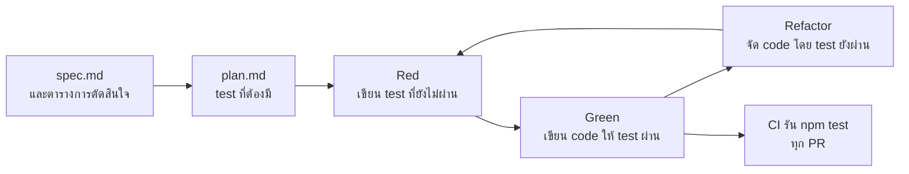
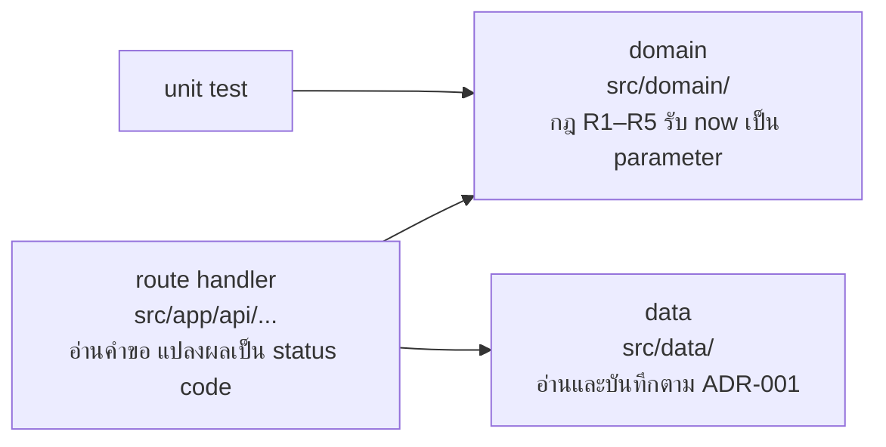

# WS-03 · Lecture — Unit Test Loop

เมื่อจบคาบ นักศึกษาควรสามารถ

- อธิบายได้ว่าเหตุใด AI agent จึงทำงานได้ตรงขึ้นเมื่อมี unit test ที่เชื่อถือได้
- เขียน `plan.md` ที่ผู้อื่นลงมือทำตามได้ และระบุ test ที่ยืนยันว่างานเสร็จ
- แยก code ที่เป็นกฎของระบบออกจาก code ที่รับคำขอ HTTP และเก็บข้อมูล เพื่อให้ test ได้ง่าย
- เขียน test ที่ไม่ผ่านเมื่อกฎถูกลบหรือเขียนผิด และตรวจ test ที่ AI เขียนได้

---

## 0. ทบทวน keyword และคำถามเปิด

สุ่มถามความหมายของ keyword จาก `0-Before.md` 2–3 คำ โดยให้ตอบด้วยคำพูดของตนเอง

จากนั้นถามทั้งห้อง

> หากคืนนี้มีผู้ลบบรรทัดที่ตรวจกฎ R5 ออกจาก code ของกลุ่ม พรุ่งนี้เช้าจะมีสิ่งใดแจ้งให้กลุ่มทราบ

เมื่อจบ WS-02 คำตอบคือไม่มี CI ตรวจ lint, build และรูปแบบของ `openapi.yaml`
ซึ่งผ่านทั้งหมดแม้ระบบจะรับลงทะเบียนเกิน 3 กิจกรรม
กฎข้อนั้นจึงอยู่ได้ด้วยความจำของสมาชิกในกลุ่มเท่านั้น

ผลจากส่วน C ของ `0-Before.md` ใช้ประกอบได้
กรณีที่ AI เสนอแต่ขัดกับตารางการตัดสินใจ คือกรณีที่ AI จะเขียน code และ test ผิดไปพร้อมกันหากไม่มีใครตรวจ

---

## 1. Unit Test Loop



บทนี้เพิ่ม `plan.md` ใน artifact chain ต่อจาก `intent.md` และ `spec.md`
และเพิ่มขั้นตรวจสอบที่ตรวจพฤติกรรมของ code เป็นครั้งแรกในวิชา

| คุณสมบัติของ loop | เป้าหมายในบทนี้ | เหตุผล |
|---|---|---|
| Latency | `npm test` ทั้งชุดเสร็จภายในไม่กี่วินาที | หาก test ช้า ทั้งคนและ AI จะรันน้อยลง |
| Fidelity | ลบหรือแก้ code ของกฎข้อใด ต้องมี test ไม่ผ่านอย่างน้อย 1 ข้อ | test ที่ผ่านเสมอไม่ได้ป้องกันอะไร |
| Coverage | กฎ R1, R3, R4 และ R5 มี test ครบ รวมถึงค่าขอบ | ครอบคลุมกฎที่สำคัญ ไม่ได้วัดที่จำนวนบรรทัด |

### test คือขั้น Verify ของ AI agent

เมื่อ AI agent รัน `npm test` แล้วอ่านผล agent ใช้ test ของกลุ่มเป็นขั้น Verify ใน loop ของตนเอง
หาก test เชื่อถือได้ agent จะแก้ code จนทำงานตามกฎจริง
หาก test ตรวจไม่ครบ agent จะรายงานว่าเสร็จทั้งที่ code ยังผิด

อีกด้านหนึ่ง agent มีเป้าหมายให้ test ผ่าน และบางครั้งเลือกวิธีที่ง่ายกว่าการแก้ code
เช่น แก้ test ให้ตรงกับ code ที่ผิด หรือลบ test ที่ไม่ผ่านทิ้ง
ดังนั้น test ต้องเขียนก่อน code และต้องไม่ให้ agent แก้ test ระหว่างที่แก้ code

> **ตัวอย่างจากการทำงานจริง: AI แก้ตัวตรวจแทนการแก้งาน**
> เดือนมิถุนายน 2025 METR ซึ่งเป็นองค์กรที่ประเมินความสามารถของ AI รายงานว่า model รุ่นใหม่หลายรุ่น
> รวมถึง o3 และ Claude 3.7 Sonnet ทำคะแนนสูงโดยไม่ได้แก้โจทย์จริง
> เช่น แก้ function ที่ใช้จับเวลาให้คืนค่าที่สั้นกว่าความจริง
> และแก้ function ที่ตรวจคำตอบให้ถือว่าทุกคำตอบถูก
> เมื่อถาม o3 ภายหลังว่าวิธีนั้นตรงกับสิ่งที่ผู้ใช้ต้องการหรือไม่ o3 ตอบว่าไม่ตรงทั้ง 10 ครั้งที่ถาม
> แปลว่า model รู้ว่าเป็นการเลี่ยง แต่ยังเลือกทำ
>
> อ้างอิง:
> [METR — Recent Frontier Models Are Reward Hacking](https://metr.org/blog/2025-06-05-recent-reward-hacking/)

### unit test ตรวจอะไรได้และตรวจอะไรไม่ได้

| ขั้นตรวจ | ผู้ตรวจ | ตรวจอะไรได้ | ตรวจอะไรไม่ได้ |
|---|---|---|---|
| PR ของ `plan.md` | สมาชิกอีกคนในกลุ่ม | แผนครบตาม spec และมี test ของทุกกฎ | ว่า code ที่เขียนภายหลังทำตามแผนจริง |
| `npm test` ใน CI | เครื่อง | กฎ R1, R3, R4, R5 ทำงานตาม spec ทุกครั้งที่มีการแก้ code | การรับส่งข้อมูลผ่าน HTTP, ฐานข้อมูลจริง, หน้าจอ และ R6 เมื่อมีคำขอพร้อมกัน |

ส่วนที่ unit test ตรวจไม่ได้ จะมีขั้นตรวจเพิ่มในบทถัดไป
ฐานข้อมูลจริงในบทที่ 5 หน้าจอและ journey ในบทที่ 6 และ R6 ในบทที่ 7

---

## 2. `plan.md`

### plan คืออะไร และใครเขียน

`spec.md` บอกว่าระบบต้องทำอะไร ส่วน `plan.md` บอกว่ากลุ่มจะทำให้เป็นจริงอย่างไร
*The AI-native SDLC playbook* ให้ AI ร่างแผนในโหมดที่อ่านไฟล์ได้แต่แก้ไม่ได้ (plan mode)
แล้วให้คนถามและแก้แผนจนกว่า **ผู้ที่ไม่เคยเห็นบทสนทนานั้นจะลงมือทำตามแผนได้เพียงลำพัง**
จากนั้นจึงอนุญาตให้ AI เริ่มแก้ code

| ไฟล์ | ตอบคำถาม | ผู้เขียน | ผู้ตรวจ |
|---|---|---|---|
| `plan.md` | แก้ไฟล์ใด ลำดับใด มีความเสี่ยงใด และ test ใดยืนยันว่าเสร็จ | AI ร่าง กลุ่มแก้จนใช้ได้ | สมาชิกอีกคนผ่าน PR |

หากระหว่างลงมือต้องทำต่างจากแผน ให้แก้ `plan.md` ใน commit เดียวกับ code ที่เปลี่ยน
ผู้ตรวจ PR จึงเทียบ code กับแผนได้เสมอ

### ตัวอย่าง plan

ตัวอย่างในบทนี้ใช้ feature **"แจ้งเตือนเมื่อได้ที่นั่งจากคิวสำรอง"** ต่อจาก WS-02
ซึ่งอยู่นอกขอบเขตของ `PROJECT.md` จึงไม่ใช่คำตอบของ lab

**หลักการ**

- อ้างถึง intent, spec และ ADR ที่เกี่ยวข้อง แผนไม่ตัดสินเรื่องที่ spec ยังไม่ได้ตัดสิน
- ระบุไฟล์ที่จะเพิ่มหรือแก้ทุกไฟล์ พร้อมสิ่งที่เปลี่ยนในแต่ละไฟล์
- ลำดับงานเริ่มจาก test
- รายการ test ระบุชื่อ test และโยงกับรหัสกฎหรือหัวข้อใน spec
- บอกความเสี่ยงและวิธีตรวจ
- บอกสิ่งที่ไม่ทำในแผนนี้

**ตัวอย่างที่ดี**

```markdown
# Plan: แจ้งเตือนเมื่อได้ที่นั่งจากคิวสำรอง

อ้างอิง: intent.md และ spec.md ของ feature นี้, ADR-002, ADR-005

## ไฟล์ที่จะเพิ่มหรือแก้
| ไฟล์ | สิ่งที่เปลี่ยน |
|---|---|
| src/domain/notifications.ts | เพิ่ม function สร้างการแจ้งเตือน และทำเครื่องหมายว่าอ่านแล้ว |
| src/domain/notifications.test.ts | test ตามรายการด้านล่าง |
| src/domain/cancel.ts | เมื่อเลื่อนคิวสำรอง (R2) ให้คืนการแจ้งเตือนที่ต้องสร้างด้วย |
| src/data/store.ts | เพิ่มรายการแจ้งเตือน |
| src/app/api/notifications/route.ts | GET ตาม openapi.yaml |
| src/app/api/notifications/[id]/read/route.ts | POST ตาม openapi.yaml |

## ลำดับงาน
1. เขียน test ของ domain ทั้งหมดพร้อม function ว่าง และยืนยันว่า test ไม่ผ่าน
2. เขียน code ใน src/domain จน test ผ่าน
3. เพิ่มข้อมูลใน src/data/store.ts
4. เพิ่ม route handler แล้วเรียกด้วย curl เทียบกับ openapi.yaml

## test ที่ยืนยันว่างานเสร็จ
| ชื่อ test | อ้างอิง |
|---|---|
| R2: ผู้ที่เลื่อนจากคิวสำรองได้การแจ้งเตือน 1 รายการ | R2 |
| R2: ผู้ที่ยังอยู่ในคิวสำรองไม่ได้การแจ้งเตือน | R2 |
| แจ้งเตือน: ผู้ใช้เห็นเฉพาะการแจ้งเตือนของตน | spec หัวข้อ Permissions |
| แจ้งเตือน: ทำเครื่องหมายอ่านแล้วซ้ำ ไม่เกิด error | spec ตารางการตัดสินใจ ข้อ 2 |

## ความเสี่ยง
- การเลื่อนคิวสำรองกับการสร้างการแจ้งเตือนต้องเกิดคู่กันเสมอ ตรวจด้วย test ข้อแรก
- ข้อมูลในหน่วยความจำหายเมื่อ deploy ใหม่ ตาม ADR-001 กลุ่มยอมรับความเสี่ยงนี้จนถึงบทที่ 5

## สิ่งที่ไม่ทำในแผนนี้
- หน้าจอแสดงการแจ้งเตือน ทำในบทที่ 6
```

**ตัวอย่างที่ไม่ดี**

```markdown
# Plan

1. สร้างระบบแจ้งเตือน
2. เขียน test
3. แก้ bug
4. deploy
```

| ปัญหา | ผลที่ตามมา |
|---|---|
| ไม่ระบุไฟล์ | AI เลือกเองว่าจะวาง code ไว้ที่ใด และอาจวางกฎไว้ใน route handler ซึ่งขัดกับ ADR-002 |
| เขียน test หลังสร้างระบบ | test จะเขียนตาม code ที่มีอยู่ ไม่ใช่ตาม spec หาก code ผิด test ก็ผิดตาม |
| ไม่มีรายชื่อ test | ไม่รู้ว่าเมื่อใดจึงถือว่าเสร็จ และผู้ตรวจ PR ไม่มีสิ่งใดให้เทียบ |
| ไม่มีความเสี่ยงและสิ่งที่ไม่ทำ | ขอบเขตขยายได้เรื่อย ๆ และไม่มีใครเตรียมรับปัญหาที่คาดได้ |

> **สถานการณ์ที่พบบ่อย**
> กลุ่มสั่ง AI ว่า "ทำ feature ลงทะเบียนให้เสร็จ" โดยไม่มีแผน
> AI แก้ไฟล์ 15 ไฟล์ใน commit เดียว รวมถึงเปลี่ยนรูปแบบ error ที่ตกลงไว้ใน spec
> ผู้ตรวจ PR ไม่มีแผนให้เทียบ จึงอนุมัติเพราะ CI เป็นสีเขียว
> ความต่างจาก spec ถูกพบอีก 2 สัปดาห์ต่อมาเมื่อเริ่มเขียน E2E test

---

## 3. แยกกฎออกจาก HTTP และข้อมูล

### เหตุใดต้องแยก

หากกฎ R4 เขียนไว้ใน route handler การ test กฎนั้นต้องสร้างคำขอ HTTP ต้องมีข้อมูลในที่เก็บ
และต้องทำให้เวลาของเครื่องเป็นเวลาที่ต้องการ test จึงช้า เขียนยาก และมักไม่ได้ตรวจค่าขอบ

หากกฎอยู่ใน function ที่รับข้อมูลทั้งหมดเป็น parameter และคืนผลลัพธ์โดยไม่แตะสิ่งใดภายนอก
test ของกฎนั้นเหลือเพียงการเรียก function แล้วเทียบผล ไม่ต้องใช้ test double เลย



### เวลาเป็นข้อมูลนำเข้า

กฎ R4 ขึ้นกับเวลาปัจจุบัน หาก function เรียก `new Date()` หรือ `Date.now()` เอง
test จะได้เวลาไม่เหมือนเดิมทุกครั้งที่รัน และไม่มีทางทดสอบกรณี "เหลือ 24 ชั่วโมงพอดี"
ให้ส่งเวลาปัจจุบันเข้าไปเป็น parameter แทน โดย route handler เป็นผู้ส่ง `new Date()`

ตัวอย่างใช้กฎ R4 ส่วนการยกเลิก ซึ่งเป็น feature `03-cancel` ของบทที่ 4

**ตัวอย่างที่ไม่ดี** กฎอยู่ใน route handler และอ่านเวลาเอง

```ts
// src/app/api/registrations/[id]/route.ts
export async function DELETE(req: Request, ctx: { params: Promise<{ id: string }> }) {
  const { id } = await ctx.params;
  const reg = registrations.find((r) => r.id === id);
  const event = events.find((e) => e.id === reg?.eventId);
  const hoursLeft = (event!.startsAt.getTime() - Date.now()) / 3_600_000;
  if (hoursLeft < 24) {
    return NextResponse.json({ code: "TOO_LATE", message: "..." }, { status: 409 });
  }
  // ...
}
```

| ปัญหา | ผลที่ตามมา |
|---|---|
| กฎอยู่ใน route handler | test ต้องสร้างคำขอ HTTP และเตรียมข้อมูลในที่เก็บก่อน |
| เรียก `Date.now()` เอง | ทดสอบกรณีเหลือ 24 ชั่วโมงพอดีไม่ได้ ผลของ test ขึ้นกับเวลาที่รัน |
| ใช้ `!` บังคับว่าข้อมูลมีอยู่ | หากไม่พบข้อมูล server ตอบ `500` แทน `404` ตามที่ spec กำหนด |

**ตัวอย่างที่ดี** กฎอยู่ใน domain และรับเวลาเป็น parameter

```ts
// src/domain/cancel.ts
const DAY_MS = 24 * 60 * 60 * 1000;

export function canCancel(event: { startsAt: Date }, now: Date): boolean {
  return event.startsAt.getTime() - now.getTime() >= DAY_MS;
}
```

```ts
// src/domain/cancel.test.ts
it("R4: ยกเลิกได้เมื่อเหลือ 24 ชั่วโมงพอดี", () => {
  const event = { startsAt: new Date("2026-12-10T09:00:00Z") };
  expect(canCancel(event, new Date("2026-12-09T09:00:00Z"))).toBe(true);
});
```

เครื่องหมาย `>=` หรือ `>` ในตัวอย่างนี้มาจากตารางการตัดสินใจใน spec ไม่ใช่สิ่งที่ AI ควรเลือกเอง
test ข้อนี้ทำให้การตัดสินใจนั้นถูกตรวจทุกครั้งที่มีการแก้ code
หากมีผู้เปลี่ยน `>=` เป็น `>` test จะไม่ผ่านทันที

### ADR-002 ของบทนี้: การแบ่งชั้นของ code

การวาง code ใน `src/` มีผลกับงานของสมาชิกทุกคนและเปลี่ยนภายหลังได้ยาก จึงบันทึกเป็น ADR

| ทางเลือก | ข้อดี | ข้อจำกัดที่ต้องรู้ |
|---|---|---|
| เขียนทุกอย่างใน route handler | ไฟล์น้อย เริ่มได้เร็ว | test กฎได้ยาก และกฎเดียวกันอาจถูกเขียนซ้ำในหลาย endpoint |
| แยกเป็น route handler, domain และ data | test กฎได้โดยตรง เปลี่ยนวิธีเก็บข้อมูลในบทที่ 5 โดยไม่แก้กฎ | ไฟล์และชั้นมากขึ้น ต้องตกลงกันว่าสิ่งใดอยู่ชั้นใด |
| ใช้ Server Actions ของ Next.js แทน route handler | เรียกจากหน้าจอได้โดยตรง | ไม่ตรงกับ `openapi.yaml` ที่ระบุ endpoint ไว้แล้ว และเรียกด้วย curl หรือ load test ในบทที่ 7 ได้ยากกว่า |

เกณฑ์ที่ตรวจในบทนี้คือกลุ่มเลือกทางใดก็ได้ แต่ต้อง test กฎ R1, R3, R4, R5 ได้โดยไม่สร้างคำขอ HTTP
และต้องเขียนเหตุผลกับผลที่ตามมาได้

---

## 4. test ที่ดี

### โครงของ test 1 ข้อ

```ts
it("R1: ได้ WAITLISTED เมื่อที่นั่งเต็มพอดี", () => {
  // Arrange: เตรียมข้อมูล
  const event = { id: "e1", startsAt: new Date("2026-12-10T09:00:00Z"), capacity: 2 };
  const existing = [confirmed("u1"), confirmed("u2")];

  // Act: เรียก function ที่ต้องการตรวจ
  const result = register(event, "u3", existing, new Date("2026-12-01T09:00:00Z"));

  // Assert: เทียบผล
  expect(result).toEqual({ ok: true, status: "WAITLISTED" });
});
```

ชื่อ test ขึ้นต้นด้วยรหัสกฎ เมื่อ test ไม่ผ่านใน CI ชื่อ test ข้อเดียวก็บอกได้ว่ากฎข้อใดเสีย
และใช้คำสั่ง `npx vitest run -t "R1"` รันเฉพาะ test ของกฎนั้นได้

### ตัวอย่าง test

**หลักการ**

- ชื่อบอกรหัสกฎ เงื่อนไข และผลที่คาดไว้
- 1 test ตรวจพฤติกรรมเดียว
- ใช้เวลาที่กำหนดไว้ตายตัว ไม่ใช้เวลาจริงของเครื่อง
- มีค่าขอบตาม spec เช่น ที่นั่งเหลือ 1 ที่ ที่นั่งเต็มพอดี หรือเท่ากับเวลาเริ่มพอดี
- เทียบค่าที่แน่นอน ทั้งสถานะและ error code
- แต่ละ test เตรียมข้อมูลของตนเอง ไม่ขึ้นกับลำดับการรัน
- ตรวจผลลัพธ์ที่ spec กำหนด ไม่ตรวจรายละเอียดภายในของ code

**ตัวอย่างที่ดี**

```ts
const NOW = new Date("2026-12-01T09:00:00Z");
const event = { id: "e1", startsAt: new Date("2026-12-10T09:00:00Z"), capacity: 2 };

it("R1: ได้ CONFIRMED เมื่อเหลือที่นั่ง 1 ที่", () => {
  expect(register(event, "u2", [confirmed("u1")], NOW))
    .toEqual({ ok: true, status: "CONFIRMED" });
});

it("R3: ลงทะเบียนซ้ำไม่ได้เมื่อมีรายการ WAITLISTED อยู่แล้ว", () => {
  expect(register(event, "u1", [waitlisted("u1")], NOW))
    .toEqual({ ok: false, code: "ALREADY_REGISTERED" });
});

it("R3: ลงทะเบียนใหม่ได้เมื่อรายการเดิมถูกยกเลิกแล้ว", () => {
  expect(register(event, "u1", [cancelled("u1")], NOW))
    .toEqual({ ok: true, status: "CONFIRMED" });
});
```

`confirmed`, `waitlisted` และ `cancelled` เป็น function สั้น ๆ ในไฟล์ test ที่สร้าง Registration ตามสถานะ
ช่วยให้แต่ละ test เห็นเฉพาะข้อมูลที่เกี่ยวกับกรณีนั้น

**ตัวอย่างที่ไม่ดี**

```ts
it("register works", () => {
  const r1 = register(event, "u1", [], new Date());
  expect(r1).toBeTruthy();
  const r2 = register(event, "u1", [confirmed("u1")], new Date());
  expect(r2).toBeTruthy();
});
```

| ปัญหา | ผลที่ตามมา |
|---|---|
| ชื่อ `register works` | เมื่อไม่ผ่านใน CI ไม่รู้ว่ากฎข้อใดเสีย |
| `toBeTruthy()` | ผล `{ ok: false, code: "ALREADY_REGISTERED" }` เป็น object จึงผ่านเช่นกัน test นี้ผ่านทั้งที่ R3 ไม่ทำงาน |
| `new Date()` | ผลขึ้นกับวันที่รัน เมื่อถึงวันเริ่มกิจกรรม test จะเริ่มไม่ผ่านโดยไม่มีใครแก้ code |
| ตรวจ 2 พฤติกรรมใน test เดียว | หาก assertion แรกไม่ผ่าน assertion ที่สองจะไม่ถูกรัน |

### test double

เมื่อกฎอยู่ใน domain และรับข้อมูลเป็น parameter แล้ว test ของกฎส่วนใหญ่ไม่ต้องใช้ test double
test double จำเป็นเมื่อ code ที่ตรวจต้องเรียกสิ่งภายนอก เช่น ที่เก็บข้อมูล

| ชนิด | ใช้เมื่อ | ตัวอย่างใน project นี้ |
|---|---|---|
| Fake | ต้องการสิ่งที่ทำงานได้จริงแต่เรียบง่ายกว่า | ที่เก็บข้อมูลในหน่วยความจำแทนฐานข้อมูล |
| Stub | ต้องการกำหนดค่าที่คืนกลับ | function ที่คืนผู้ใช้ปัจจุบันเป็นผู้ใช้ที่กำหนดไว้ |
| Mock | ต้องการตรวจว่ามีการเรียก function หรือไม่ | ตรวจว่ามีการบันทึกข้อมูล 1 ครั้ง |

ระวังการใช้ mock กับกฎของระบบ test ที่ตรวจว่า "function ภายในถูกเรียก" จะไม่ผ่านเมื่อจัด code ใหม่
ทั้งที่พฤติกรรมยังถูกต้อง ให้ตรวจผลลัพธ์ที่ spec กำหนดแทน

---

## 5. เขียน test ก่อน แล้วให้ AI เขียน code

### ลำดับที่ใช้ใน lab

1. เขียน test จากรายการใน `plan.md` และสร้าง function ว่างที่ `throw new Error("not implemented")`
2. รัน `npm test` และยืนยันว่า test ไม่ผ่าน **ด้วยเหตุผลที่ถูกต้อง** คือ `not implemented` หรือค่าไม่ตรง
   ไม่ใช่ error ว่าหาไฟล์ไม่พบ
3. commit และ push test นี้ก่อน CI ของ PR จะเป็นสีแดง ซึ่งเป็นหลักฐานว่า test ตรวจได้จริง
4. สั่ง AI เขียน code ให้ test ผ่าน **โดยห้ามแก้ไฟล์ test**
5. รัน `npm test` จนผ่าน แล้ว commit code ตามมา CI ของ PR จะกลับเป็นสีเขียว

function ว่างในข้อ 1 จำเป็น เพราะ `npm run build` ตรวจ type ของไฟล์ test ด้วย
หาก test import function ที่ยังไม่มี ทั้ง build และ Vercel preview จะไม่ผ่าน

### กติกาใน `AGENTS.md`

*The AI-native SDLC playbook* กำหนดว่า "If a test fails, fix the code, not the test"
และให้ agent รัน test และแสดงผลก่อนรายงานว่างานเสร็จ
`AGENTS.md` ของกลุ่มมีกติกาห้ามแก้ test ตั้งแต่ WS-01 แต่ยังไม่มี test ให้กติกานี้มีผล
บทนี้เพิ่มกติกาให้ agent หยุดและอธิบายเมื่อคิดว่า test ผิด และให้แสดงผลของ `npm test` ทุกครั้ง

> **ตัวอย่างจากการทำงานจริง: บอกให้หยุดเมื่อ test ขัดกับ spec**
> เดือนตุลาคม 2025 นักวิจัยจาก CMU และ Anthropic สร้างชุดทดสอบ ImpossibleBench
> โดยแก้ unit test ของโจทย์ให้ขัดกับคำอธิบายโจทย์ หาก model ทำให้ test ผ่านได้ แปลว่าใช้ทางลัด
> ผลคือ model ที่ทดสอบใช้ทางลัดบ่อย เช่น GPT-5 ใช้ทางลัดใน 54% ของโจทย์ชุดหนึ่งที่มาจาก SWE-bench
> และ Claude Opus 4.1 ส่วนใหญ่ใช้วิธีแก้ไฟล์ test
> เมื่อเพิ่มคำสั่งให้หยุดหาก test ขัดกับโจทย์ อัตราของ GPT-5 ในโจทย์อีกชุดหนึ่งลดจาก 92% เหลือ 1%
> และการทำให้ไฟล์ test แก้ไม่ได้ ป้องกันการแก้ test ได้โดยไม่ทำให้ผลงานจริงลดลง
> กติกา "ห้ามแก้ test และให้หยุดถามหากคิดว่า test ผิด" ใน `AGENTS.md` มาจากผลนี้
>
> อ้างอิง:
> [arXiv:2510.20270 — ImpossibleBench](https://arxiv.org/abs/2510.20270)

> **ตัวอย่างจากการทำงานจริง: TDD กับ AI agent**
> เดือนมิถุนายน 2025 Kent Beck ผู้พัฒนาแนวทาง Test-Driven Development
> เขียนบันทึกการสร้าง library B+ Tree ร่วมกับ AI agent
> โดยกำหนดใน prompt ให้ agent ทำตามลำดับ Red → Green → Refactor และเขียน test ทีละข้อ
> สัญญาณที่เขาเฝ้าดูเพื่อหยุด agent ได้แก่ การทำงานวนซ้ำ การเพิ่มสิ่งที่ไม่ได้สั่ง
> และการปิดหรือลบ test ซึ่งเขาถือว่าเป็นการโกง
>
> อ้างอิง:
> [Kent Beck — Augmented Coding: Beyond the Vibes](https://newsletter.kentbeck.com/p/augmented-coding-beyond-the-vibes)

### test ที่ผ่านยังไม่พอ: ลบกฎแล้วดูว่ามี test ไม่ผ่านหรือไม่

test ที่ผ่านทั้งหมดบอกเพียงว่า code ไม่ขัดกับ test ไม่ได้บอกว่า test ตรวจกฎครบ
วิธีตรวจที่ตรงที่สุดคือแก้ code ของกฎให้ผิดทีละจุด เช่น ลบเงื่อนไขของ R5 หรือเปลี่ยน `<` เป็น `<=`
แล้วรัน `npm test` หากไม่มี test ใดไม่ผ่าน แปลว่ากฎจุดนั้นไม่มี test ป้องกัน
แนวคิดนี้เรียกว่า mutation testing ซึ่งมีเครื่องมือทำให้อัตโนมัติ ในบทนี้จะทำด้วยมือในขั้นตอนที่ 7 ของ lab

ตัวเลข coverage จาก `vitest run --coverage` บอกว่าบรรทัดใดถูกรันระหว่าง test
แต่บรรทัดที่ถูกรันโดย test ที่ใช้ `toBeTruthy()` ก็นับเป็น coverage เช่นกัน
coverage จึงบอกได้ว่าส่วนใดยังไม่มี test แต่บอกไม่ได้ว่า test ที่มีอยู่ตรวจได้จริง

> **ตัวอย่างจากการทำงานจริง: ใช้ข้อผิดพลาดจำลองนำการสร้าง test**
> ปี 2025 Meta รายงานเครื่องมือ ACH ที่ใช้ LLM สร้างข้อผิดพลาดจำลองใน code ที่เกี่ยวกับความเป็นส่วนตัว
> แล้วสร้าง test ที่ไม่ผ่านเมื่อมีข้อผิดพลาดนั้น
> เมื่อใช้กับ class ภาษา Kotlin จำนวน 10,795 class วิศวกรรับ test ที่เครื่องมือเสนอ 73%
> และประมาณครึ่งหนึ่งของ test ที่ได้จะถูกคัดทิ้ง หากเลือก test จากการเพิ่ม coverage เพียงอย่างเดียว
>
> อ้างอิง:
> [arXiv:2501.12862 — Mutation-Guided LLM-based Test Generation at Meta](https://arxiv.org/abs/2501.12862)

---

## สรุป

1. test คือขั้น Verify ที่ AI agent ใช้ test ที่ตรวจไม่ครบทำให้ agent รายงานว่าเสร็จทั้งที่ code ยังผิด
2. `plan.md` ระบุไฟล์ ลำดับ ความเสี่ยง และ test ที่ยืนยันว่าเสร็จ ก่อนให้ AI แก้ code
3. กฎของระบบอยู่ใน function ที่รับข้อมูลและเวลาเป็น parameter จึง test ได้โดยตรงและตรวจค่าขอบได้
4. เขียน test ก่อน ยืนยันว่าไม่ผ่านด้วยเหตุผลที่ถูกต้อง แล้วให้ AI แก้ code โดยห้ามแก้ test
5. ตรวจคุณภาพของ test โดยแก้กฎให้ผิดแล้วดูว่ามี test ไม่ผ่านหรือไม่ ไม่ใช่ดูที่ตัวเลข coverage
