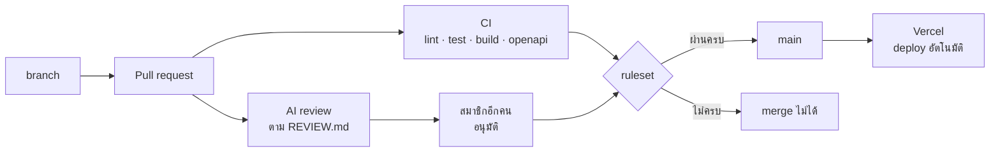

# WS-04 · Lecture — CI/CD Loop

เมื่อจบคาบ นักศึกษาควรสามารถ

- อธิบายความต่างระหว่างสัญญาณที่เตือนได้กับด่านที่ข้ามไม่ได้ และเหตุใดด่านจึงสำคัญขึ้นเมื่อ AI เขียน code ได้เร็ว
- ตั้ง ruleset ให้ `main` รับการแก้ไขผ่าน PR ที่ผ่าน CI และได้รับอนุมัติเท่านั้น
- เขียน `REVIEW.md` ที่ทำให้ทั้งคนและ AI review ตามเกณฑ์เดียวกัน
- ระบุความเสี่ยงด้านความปลอดภัยของ workflow ใน CI และย้อนการแก้ไขที่มีปัญหาผ่าน PR ได้

---

## 0. ทบทวน keyword และคำถามเปิด

สุ่มถามความหมายของ keyword จาก `0-Before.md` 2–3 คำ โดยให้ตอบด้วยคำพูดของตนเอง

จากนั้นถามทั้งห้อง

> ใน repository ของกลุ่มตอนนี้ สมาชิกคนหนึ่ง push เข้า `main` โดยตรงได้หรือไม่ และ merge PR ที่ CI เป็นสีแดงได้หรือไม่

คำตอบคือได้ทั้ง 2 ข้อ CI ที่สร้างใน WS-01 ถึง WS-03 จึงเป็นเพียงสัญญาณเตือน
หากมีผู้ไม่ดูหรือรีบ code ที่ test ไม่ผ่านก็ขึ้นเว็บจริงได้ทันที เพราะ Vercel deploy ทุกครั้งที่ `main` เปลี่ยน

ผลจากส่วน C ของ `0-Before.md` ใช้ประกอบได้
เมื่อสั่ง AI review โดยไม่มีเกณฑ์ ผลที่ได้มักยาว ปนเรื่องสำคัญกับเรื่องเล็ก และบางข้อขัดกับการตัดสินใจของกลุ่ม

---

## 1. จากสัญญาณเป็นด่าน



บทนี้เพิ่ม `REVIEW.md` ใน artifact chain และเปลี่ยนขั้นตรวจที่มีอยู่ทั้งหมดให้เป็นเงื่อนไขของการ merge

| ขั้นตรวจ | ผู้ตรวจ | ตรวจอะไรได้ | ตรวจอะไรไม่ได้ |
|---|---|---|---|
| CI ที่เป็น required status check | เครื่อง | lint, type, unit test และรูปแบบของ `openapi.yaml` ผ่านก่อน merge ทุกครั้ง | สิ่งที่ยังไม่มี test เช่น การทำงานผ่านหน้าจอ |
| AI review ตาม `REVIEW.md` | AI ที่สมาชิกซึ่งไม่ใช่ผู้เขียน code เป็นผู้สั่ง | code ต่างจาก spec หรือ plan, ข้อผิดพลาดของ logic และความเสี่ยงด้านความปลอดภัยที่พบบ่อย | ว่าข้อค้นพบนั้นถูกหรือไม่ AI review อาจผิดได้ |
| การอนุมัติของสมาชิกอีกคน | คน | การแก้ไขทำตามที่แผนตั้งใจ และยอมรับความเสี่ยงที่เหลือได้ | สิ่งที่ผู้อนุมัติไม่ได้อ่าน |

ข้อค้นพบของ AI review ไม่ได้อนุมัติหรือขวาง PR เอง ผู้ตัดสินคือสมาชิกที่อนุมัติ
*The AI-native SDLC playbook* อธิบายว่า AI ตรวจทุก PR ด้วยเกณฑ์ชุดเดียวกัน
ส่วนคนเลื่อนความสนใจขึ้นไปที่คำถามว่าการแก้ไขนี้ทำตามที่แผนตั้งใจหรือไม่ และความเสี่ยงยอมรับได้หรือไม่
และ agent ที่เขียน code ต้องไม่เป็นผู้อนุมัติ code นั้นเอง

> **ตัวอย่างจากการทำงานจริง: AI ขยายสิ่งที่ทีมมีอยู่แล้ว**
> รายงาน DORA ปี 2025 ของ Google ซึ่งสำรวจผู้ทำงานด้านเทคโนโลยี พบว่าเกือบ 90% ใช้ AI ในการทำงาน
> และการใช้ AI สัมพันธ์กับการส่งมอบงานได้มากขึ้น แต่ความไม่เสถียรของการส่งมอบก็ยังเพิ่มขึ้นต่อเนื่อง
> รายงานสรุปว่า AI ทำหน้าที่ขยายสิ่งที่องค์กรมีอยู่แล้ว ทีมที่มีระบบดีจะดีขึ้น ส่วนทีมที่มีปัญหาจะมีปัญหามากขึ้น
> ด่านตรวจใน CI และการ review คือส่วนหนึ่งของ "ระบบ" ที่ AI จะขยาย
>
> อ้างอิง:
> [InfoQ — DORA State of AI-assisted Software Development 2025](https://www.infoq.com/news/2025/09/dora-state-of-ai-in-dev-2025/) ·
> [Google — 2025 State of AI-assisted Software Development (PDF)](https://services.google.com/fh/files/misc/2025_state_of_ai_assisted_software_development.pdf)

---

## 2. Ruleset

### แต่ละกฎป้องกันอะไร

ruleset ของ GitHub ใช้ได้ฟรีกับ repository แบบ public ซึ่งตรงกับ repository ของกลุ่ม

| กฎ | ป้องกันอะไร |
|---|---|
| Restrict deletions | ลบ `main` ทิ้ง |
| Block force pushes | เขียนทับประวัติของ `main` จนหลักฐานเดิมหายไป |
| Require a pull request before merging | push เข้า `main` โดยตรงโดยไม่มีใครเห็น |
| Required approvals: 1 | merge โดยไม่มีสมาชิกอีกคนอ่าน GitHub ไม่นับการอนุมัติจากผู้เปิด PR เอง |
| Dismiss stale pull request approvals when new commits are pushed | แก้ code เพิ่มหลังได้รับอนุมัติแล้ว โดยไม่มีใครอ่านส่วนที่แก้ |
| Require status checks to pass: `build` | merge ขณะที่ CI ยังไม่ผ่าน |

`build` คือชื่อ job ใน `.github/workflows/ci.yml` ตั้งแต่ WS-01 ซึ่งรวมทุกขั้นตรวจไว้ใน job เดียว
เมื่อขั้นใดไม่ผ่าน job ทั้งหมดไม่ผ่าน

### ไม่มีผู้ใดอยู่ใน bypass list

ruleset อนุญาตให้บางคนข้ามกฎได้ ผ่านรายการที่เรียกว่า bypass list
หากเจ้าของ repository อยู่ในรายการนั้น ด่านจะมีผลกับทุกคนยกเว้นคนที่มีสิทธิ์มากที่สุด
และ AI agent ที่ทำงานด้วยสิทธิ์ของเจ้าของก็ข้ามได้เช่นกัน ในวิชานี้ bypass list ต้องว่าง

> **สถานการณ์ที่พบบ่อย**
> คืนก่อนส่งงาน CI ไม่ผ่านเพราะ test ข้อหนึ่ง เจ้าของ repository ซึ่งอยู่ใน bypass list จึง merge ไปก่อน
> โดยตั้งใจว่าจะแก้ test พรุ่งนี้ PR ต่อ ๆ มาทั้งหมดมี CI สีแดงตั้งแต่ต้น
> สมาชิกจึงแยกไม่ออกว่าการแก้ไขของตนทำให้ test ข้อใดไม่ผ่านเพิ่ม จนต้องหยุดงานทั้งกลุ่มเพื่อหาสาเหตุ

### PR เล็กจึง review ได้จริง

ด่านที่ต้องมีคนอนุมัติจะช้าลงทันทีหาก PR ใหญ่เกินกว่าจะอ่านได้
เมื่อ AI เขียน code ได้เร็ว ขั้นที่ช้าที่สุดจึงย้ายจากการเขียนไปเป็นการ review

> **ตัวอย่างจากการทำงานจริง: การ review กลายเป็นคอขวด**
> เดือนกรกฎาคม 2025 Faros AI รายงานผลจากข้อมูลนักพัฒนามากกว่า 10,000 คนใน 1,255 ทีม
> ทีมที่ใช้ AI มากมีจำนวน PR ที่ merge เพิ่มขึ้น 98% แต่เวลาที่ใช้ review PR เพิ่มขึ้น 91%
> ขนาดเฉลี่ยของ PR เพิ่มขึ้น 154% และจำนวน bug ต่อนักพัฒนาเพิ่มขึ้น 9%
>
> อ้างอิง:
> [Faros AI — The AI Productivity Paradox Report 2025](https://www.faros.ai/blog/ai-software-engineering)

ในวิชานี้ 1 PR ควรทำ 1 เรื่องตาม `plan.md` เช่น test และ code ของกฎ 1 ข้อ
หาก AI แก้ไฟล์เกินกว่าที่แผนระบุ ให้แยกเป็น PR ใหม่

---

## 3. `REVIEW.md`

### เหตุใด AI review ต้องมีเกณฑ์

AI ที่ไม่มีเกณฑ์จะรายงานทุกอย่างที่ตนคิดว่าควรปรับ ตั้งแต่ชื่อตัวแปรจนถึงข้อเสนอให้เปลี่ยน library
ผู้อนุมัติต้องคัดเองว่าข้อใดสำคัญ และเรื่องสำคัญมักจมอยู่ในรายการยาว
`REVIEW.md` กำหนดว่าตรวจเรื่องใด เรื่องใดสำคัญ เรื่องใดไม่ต้องตรวจ และรายงานในรูปแบบใด
ทั้งคนและ AI ใช้ไฟล์เดียวกัน ผลการ review จึงเทียบกันได้ทุก PR

| ไฟล์ | ตอบคำถาม | ผู้เขียน | ผู้ใช้ |
|---|---|---|---|
| `REVIEW.md` | review PR อย่างไร เรื่องใดสำคัญ เรื่องใดไม่ต้องตรวจ | สมาชิกกลุ่ม ใช้ AI ช่วยร่างได้ | AI ที่สมาชิกสั่ง review และผู้อนุมัติ PR |

### ตัวอย่าง `REVIEW.md`

**หลักการ**

- แบ่งการตรวจเป็นรอบ แต่ละรอบมีเรื่องที่ตรวจชัดเจน และระบุรอบไว้หน้าข้อค้นพบทุกข้อ
- รอบหนึ่งตรวจว่าตรงกับ spec และ plan ซึ่งเป็นสิ่งที่ CI ตรวจไม่ได้
- นิยามระดับความรุนแรง และจำกัดจำนวนข้อเล็กน้อย
- บอกสิ่งที่ไม่ต้องตรวจ โดยเฉพาะสิ่งที่ CI ตรวจอยู่แล้ว
- กำหนดรูปแบบผลการตรวจให้ชี้ตำแหน่ง ปัญหา และผลที่ตามมา
- อ้างถึงการตัดสินใจของกลุ่ม เช่น ADR และตารางการตัดสินใจใน spec

**ตัวอย่างที่ดี**

```markdown
# REVIEW.md

ใช้กับทุก PR ทั้งผู้ตรวจที่เป็นคนและ AI

## รอบการตรวจ
ตรวจ 3 รอบ และระบุรอบไว้หน้าข้อค้นพบทุกข้อ

### [spec] ตรงกับ spec และ plan
- พฤติกรรมของ code ตรงกับ Given / When / Then ใน spec.md ของ feature
- status code และ error code ตรงกับ spec และ openapi.yaml กรณีผิดกฎใช้ 409 ทั้งระบบ
- ไฟล์ที่แก้อยู่ในรายการของ plan.md หากไม่อยู่ plan.md ต้องถูกแก้ใน PR เดียวกัน

### [bug] ข้อผิดพลาดของ logic
- กฎ R1–R6 อยู่ใน src/domain เท่านั้น ตาม ADR-002
- function ใน src/domain ไม่เรียก new Date() หรือ Date.now()
- test ใหม่มีค่าขอบตาม spec และไม่มี test เดิมถูกแก้หรือลบโดยไม่มีเหตุผลใน PR

### [security] ความปลอดภัย
- ไม่มีค่าความลับใน code, log หรือข้อความ error
- route handler หาผู้ใช้ปัจจุบันผ่าน src/lib/current-user.ts เท่านั้น ไม่อ่าน user id จาก body
- error ที่ตอบกลับไม่มี stack trace หรือข้อความ error ภายใน

## ระดับความรุนแรง
- Important: พฤติกรรมต่างจาก spec ข้อมูลรั่ว หรือ test ไม่ได้ตรวจสิ่งที่ชื่อ test บอก
- Nit: ชื่อ รูปแบบ หรือความเห็นส่วนตัว รายงานไม่เกิน 5 ข้อ ที่เหลือบอกเพียงจำนวน

## ไม่ต้องตรวจ
- สิ่งที่ CI ตรวจอยู่แล้ว: lint, type, test ผ่านหรือไม่ และรูปแบบของ openapi.yaml
- package-lock.json

## รูปแบบผลการตรวจ
- [รอบ][ระดับ] ไฟล์:บรรทัด — ปัญหา — ผลที่ตามมา — ข้อเสนอ
- หากไม่พบ Important ให้เขียนว่า "ไม่พบ Important"
```

**ตัวอย่างที่ไม่ดี**

```markdown
# Review

ตรวจ code อย่างละเอียด หา bug และเสนอวิธีปรับปรุงให้ดีขึ้น
ทำตาม best practice
```

| ปัญหา | ผลที่ตามมา |
|---|---|
| ไม่บอกว่าตรวจเรื่องใด | AI ตรวจตามที่ตนคิดว่าสำคัญ แต่ละ PR ได้ผลไม่เหมือนกัน |
| ไม่อ้างถึง spec, plan หรือ ADR | AI ไม่ตรวจเรื่องที่ CI ตรวจไม่ได้ และอาจเสนอสิ่งที่ขัดกับการตัดสินใจของกลุ่ม |
| ไม่มีระดับความรุนแรงและไม่จำกัดข้อเล็กน้อย | เรื่องสำคัญจมอยู่ในรายการยาว |
| "best practice" | ไม่มีความหมายที่ตรวจได้ แต่ละคนเข้าใจต่างกัน |
| ไม่บอกสิ่งที่ไม่ต้องตรวจ | AI รายงานซ้ำในสิ่งที่ CI ตรวจอยู่แล้ว |

### ใครสั่ง AI review และใครตัดสิน

ในวิชานี้ไม่ใช้บริการ AI review แบบเสียเงิน
สมาชิกที่ **ไม่ใช่ผู้เขียน code** ของ PR นั้นใช้ AI agent ของตนอ่าน `REVIEW.md` และตรวจ diff
แล้วนำผลไปวางเป็น comment ใน PR จากนั้นผู้เขียน code ตอบทุกข้อ Important ว่าจะแก้หรือไม่แก้ พร้อมเหตุผล
ผู้อนุมัติอ่านทั้งผลการ review และคำตอบ ก่อนกด Approve

หากกลุ่มมีสิทธิ์ใช้บริการที่ review PR อัตโนมัติ ใช้แทนได้ โดยต้องให้บริการนั้นอ่าน `REVIEW.md`

---

## 4. ความปลอดภัยของ CI และการนำขึ้นเว็บจริง

### workflow ใน CI ก็เป็น code ที่โจมตีได้

workflow ใน `.github/workflows/` รันบนเครื่องของ GitHub ด้วยสิทธิ์ที่ repository ให้
หาก workflow รับข้อความจากผู้ใช้ภายนอก เช่น ชื่อ PR แล้วนำไปรันเป็นคำสั่ง ผู้โจมตีจะสั่งเครื่องนั้นได้

> **ตัวอย่างจากการทำงานจริง: ชื่อ PR กลายเป็นคำสั่ง**
> เดือนสิงหาคม 2025 package ของ Nx ที่ถูกปลอมแปลงถูกเผยแพร่บน npm อยู่ประมาณ 4 ชั่วโมง
> ต้นเหตุคือ workflow ที่ตรวจชื่อ PR ใช้ event `pull_request_target` ซึ่งรันด้วยสิทธิ์ของ repository หลัก
> และนำชื่อ PR ไปใส่ในคำสั่ง shell โดยตรง ผู้โจมตีจึงตั้งชื่อ PR ให้เป็นคำสั่ง
> แล้วใช้สิทธิ์อ่านเขียนของ token ใน workflow สั่งรัน workflow สำหรับเผยแพร่ package จนได้ token ของ npm ไป
> package ที่ปลอมแปลงสั่งให้ AI CLI ที่ติดตั้งในเครื่องของเหยื่อ เช่น Claude และ Gemini ช่วยค้นหาไฟล์ความลับ
> หลังเหตุการณ์ Nx เปลี่ยนไปใช้การเผยแพร่ที่ไม่ต้องเก็บ token ระยะยาว และให้คนอนุมัติ workflow ของผู้ร่วมพัฒนาภายนอกทุกครั้ง
>
> อ้างอิง:
> [Nx — s1ngularity postmortem](https://nx.dev/blog/s1ngularity-postmortem) ·
> [BleepingComputer](https://www.bleepingcomputer.com/news/security/ai-powered-malware-hit-2-180-github-accounts-in-s1ngularity-attack/)

| หลักการ | ใน `ci.yml` ของกลุ่ม |
|---|---|
| ให้สิทธิ์น้อยที่สุด | `permissions: contents: read` workflow อ่าน code ได้อย่างเดียว |
| ไม่รัน code ของผู้อื่นด้วยสิทธิ์สูง | ใช้ `pull_request` ไม่ใช้ `pull_request_target` |
| ไม่นำข้อความจากผู้ใช้ไปรันเป็นคำสั่ง | ไม่ใส่ `${{ github.event.pull_request.title }}` หรือข้อความทำนองนี้ใน `run:` |
| ไม่ให้งานค้าง | `timeout-minutes` และยกเลิกการรันเก่าของ PR เดียวกันเมื่อมี commit ใหม่ |
| ไม่ใส่ความลับใน workflow | ใช้ environment variable ของ Vercel หรือ GitHub Secrets และไม่ `echo` ค่าเหล่านั้น |

### CD ของกลุ่ม

Vercel สร้าง preview ของทุก PR และนำ `main` ขึ้นเว็บจริงทุกครั้งที่มีการ merge
เมื่อมี ruleset แล้ว สิ่งที่ขึ้นเว็บจริงจึงผ่าน CI และการอนุมัติมาก่อนเสมอ

หากสิ่งที่ merge ไปแล้วมีปัญหา ให้กดปุ่ม **Revert** ในหน้า PR นั้น
GitHub จะสร้าง PR ใหม่ที่ย้อนการแก้ไข ซึ่งต้องผ่านด่านเดียวกันก่อน merge
ไม่แก้ปัญหาด้วยการ push เข้า `main` โดยตรง และไม่ใช้ force push

### ตัววัดของ loop นี้

| คุณสมบัติของ loop | ตัววัดในบทนี้ |
|---|---|
| Latency | lead time ตั้งแต่เปิด PR จนขึ้นเว็บจริง และเวลาที่ CI ใช้ |
| Fidelity | PR ที่ทำให้กฎเสีย merge ไม่ได้ |
| Coverage | ทุกการแก้ไขที่เข้า `main` ผ่าน CI, AI review และการอนุมัติ ไม่มีทางอื่น |

---

## สรุป

1. CI ที่ไม่ได้เป็นเงื่อนไขของการ merge เป็นเพียงสัญญาณ ruleset เปลี่ยนสัญญาณนั้นเป็นด่าน
2. bypass list ต้องว่าง ด่านจึงมีผลกับทุกคนรวมถึง AI agent ที่ทำงานด้วยสิทธิ์ของเจ้าของ
3. `REVIEW.md` ทำให้ AI review ตามเกณฑ์ของกลุ่ม และให้คนตัดสินเฉพาะเรื่องที่ต้องใช้คน
4. PR ที่เล็กจึง review ได้จริง เมื่อ AI เขียนเร็ว การ review คือขั้นที่ช้าที่สุด
5. workflow ใน CI เป็น code ที่โจมตีได้ ให้สิทธิ์น้อยที่สุด และย้อนปัญหาด้วย Revert ผ่าน PR
