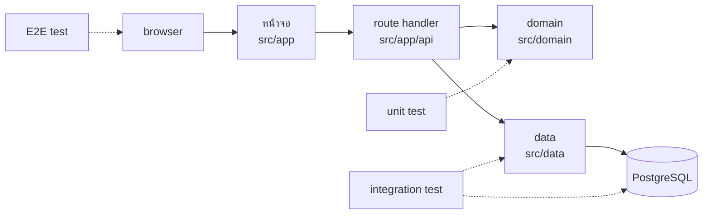
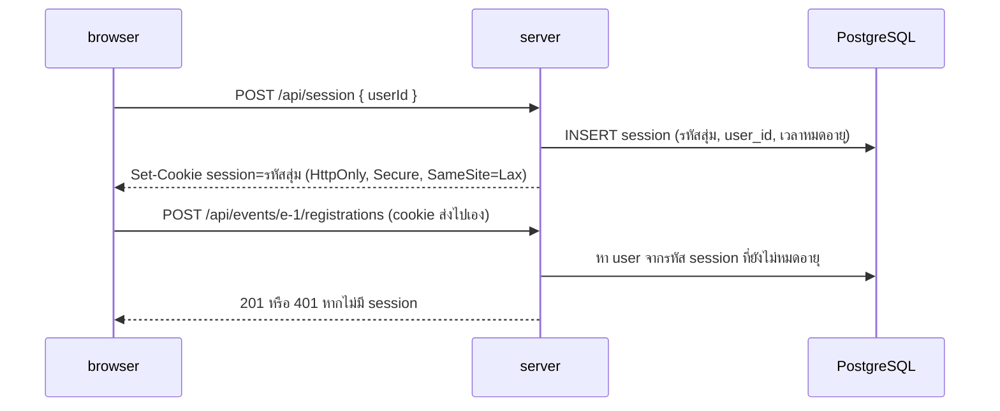
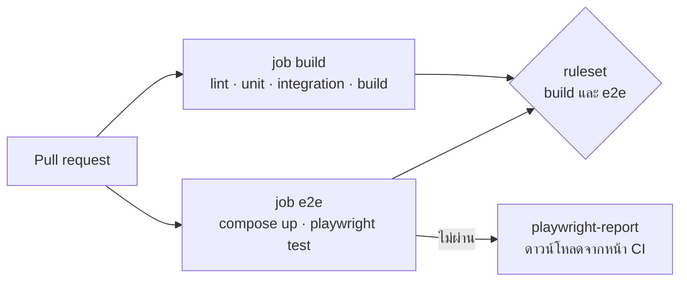

# WS-06 · Lecture — E2E Loop

เมื่อจบคาบ นักศึกษาควรสามารถ

- อธิบายว่า E2E test จับข้อผิดพลาดชนิดใดที่ unit test และ integration test จับไม่ได้ และเหตุใดจึงควรมีเพียงไม่กี่ test
- ทำให้ server รู้จักผู้ใช้จาก session และตรวจสิทธิ์ฝั่ง server ทุกคำขอ แทนการเชื่อข้อมูลที่ browser ส่งมา
- เขียน E2E test ของ journey ที่อ่านจาก spec ไม่ขึ้นกับโครงสร้างของ HTML และไม่ flaky
- เขียน `.agents/verifier.md` ให้ AI ตรวจผลงานด้วยบทสนทนาใหม่ และแยกได้ว่าต่างจาก AI review และ E2E ใน CI อย่างไร

---

## 0. ทบทวน keyword และคำถามเปิด

สุ่มถามความหมายของ keyword จาก `0-Before.md` 2–3 คำ โดยให้ตอบด้วยคำพูดของตนเอง

จากนั้นถามทั้งห้อง

> สมมติว่าชั้น data ลืมบันทึกสถานะ `CONFIRMED` ของผู้ที่ได้เลื่อนจากคิวสำรอง
> function `cancel` ใน `src/domain` ยังคืนผลถูกต้องทุกกรณี test ใดของกลุ่มจะไม่ผ่าน

คำตอบคือไม่มี unit test ตรวจ function ที่คืนผลถูกต้อง
integration test ตรวจ query ทีละตัว แต่ไม่ได้ตรวจว่า route handler เรียก query ครบ
ผู้ใช้จะพบเองเมื่อรอในคิวสำรองแล้วไม่ได้ที่นั่ง

ผลจากส่วน C ของ `0-Before.md` ใช้ประกอบได้
การทำ journey ด้วย `curl` ใช้เวลาหลายนาทีและพิมพ์ผิดได้ง่าย จึงไม่มีใครทำซ้ำทุก PR
และการยกเลิกแทนผู้อื่นด้วย header `x-user-id` ทำได้ เพราะ server เชื่อสิ่งที่ส่งมา

---

## 1. E2E test อยู่ตรงไหน



| | unit test | integration test | E2E test |
|---|---|---|---|
| ตรวจอะไร | กฎ 1 ข้อใน `src/domain` | query ใน `src/data` กับ PostgreSQL | journey ของผู้ใช้ผ่านทุกชั้น |
| จับอะไรได้ | เงื่อนไขของกฎผิด | query ผิด เรียงลำดับผิด | ชั้นต่าง ๆ เชื่อมกันผิด เช่น เรียก query ไม่ครบ ปุ่มเรียก endpoint ผิด ไม่ได้ส่ง cookie |
| เวลาต่อ test | มิลลิวินาที | ไม่กี่สิบมิลลิวินาที | หลายวินาที |
| เมื่อไม่ผ่าน | ชี้กฎที่ผิดทันที | ชี้ query ที่ผิด | รู้ว่า journey พัง แต่ต้องหาว่าพังที่ชั้นใด |
| จำนวนที่ควรมี | ทุกกฎและทุกค่าขอบ | ทุก query ที่มีเงื่อนไข | journey หลักไม่กี่เรื่อง |

E2E test ไม่ได้แทน unit test กฎ R4 ที่ยกเลิกได้จนถึง 24 ชั่วโมงก่อนเริ่มพอดี ยังตรวจด้วย unit test
เพราะการสร้างสถานการณ์นั้นผ่านหน้าจอทำได้ยากและช้า
E2E test ตรวจเฉพาะว่าชิ้นส่วนที่ test แยกกันแล้ว ทำงานร่วมกันได้ตาม journey

| คุณสมบัติของ loop | ตัววัดในบทนี้ |
|---|---|
| Latency | เวลาที่ E2E test ของ journey ใช้ในเครื่องและใน CI |
| Fidelity | E2E test ไม่ผ่านเมื่อชั้นใดชั้นหนึ่งเชื่อมผิด และผ่านซ้ำได้ทุกครั้งเมื่อ code ถูก |
| Coverage | journey หลักใน `PROJECT.md` ครบ และทุก PR ต้องผ่านก่อน merge |

---

## 2. Session และการตรวจสิทธิ์ฝั่ง server

### เหตุใด header `x-user-id` ต้องหายไป

ตั้งแต่ WS-03 `src/lib/current-user.ts` อ่าน user id จาก header ที่ใครก็ตั้งค่าได้
ผลในส่วน C ของ `0-Before.md` แสดงว่าผู้ใช้คนหนึ่งยกเลิกการลงทะเบียนของคนอื่นได้ด้วยคำสั่งเดียว
หัวข้อที่ 2 ของ `PROJECT.md` กำหนดว่า server ต้องตรวจสิทธิ์จาก session ทุกครั้ง และห้ามเชื่อ user id ที่ browser ส่งมา



ระบบนี้เข้าสู่ระบบด้วยการเลือกผู้ใช้จาก seed data โดยไม่มีรหัสผ่าน ตามขอบเขตใน `PROJECT.md`
สิ่งที่ต่างจาก header คือ หลังเข้าสู่ระบบแล้ว ทุกคำขอต้องมี cookie ที่ server ออกให้เอง
และ server เป็นผู้ตัดสินว่า cookie นั้นเป็นของใคร

| คุณสมบัติของ cookie | ป้องกันอะไร |
|---|---|
| รหัส session สุ่มยาว เช่น 32 byte | เดารหัสของผู้อื่นไม่ได้ |
| `HttpOnly` | JavaScript ในหน้าเว็บอ่าน cookie ไม่ได้ หากมี script แปลกปลอมก็ขโมยรหัสไม่ได้ |
| `Secure` | browser ส่ง cookie เฉพาะทาง HTTPS ยกเว้น `localhost` ที่ browser ยอมให้ใช้ได้ระหว่างพัฒนา |
| `SameSite=Lax` | เว็บอื่นส่งคำขอที่เปลี่ยนข้อมูลแทนผู้ใช้โดยแนบ cookie ไปด้วยไม่ได้ |
| เวลาหมดอายุ และลบ session ใน PostgreSQL เมื่อออกจากระบบ | รหัสที่หลุดไปใช้ได้ไม่ตลอดไป |

### ตรวจสิทธิ์ทุกคำขอฝั่ง server

**หลักการ**

- ทุก route handler และทุกหน้าที่แสดงข้อมูลส่วนตัวหาผู้ใช้จาก session ผ่าน `src/lib/current-user.ts` เท่านั้น
- ไม่รับ user id จาก body, query string หรือ header แม้จะดูสะดวก
- ไม่มี session ตอบ `401` มี session แต่ไม่มีสิทธิ์ เช่น ผู้เข้าร่วมสร้างกิจกรรม ตอบ `403`
- การซ่อนปุ่มบนหน้าจอไม่ใช่การตรวจสิทธิ์ คำขอส่งตรงไปที่ API ได้เสมอ

ตัวอย่างนี้ใช้ feature "แจ้งเตือนเมื่อได้ที่นั่งจากคิวสำรอง" ซึ่งอยู่นอกขอบเขตของ project
สมมติว่ามี endpoint ให้ผู้ใช้เปิดหรือปิดการแจ้งเตือนของตน

**ตัวอย่างที่ดี**

```ts
export async function PUT(req: Request) {
  const user = await currentUser();
  if (!user) return Response.json({ code: "UNAUTHENTICATED" }, { status: 401 });
  const { enabled } = await req.json();
  await setNotificationPreference(user.id, enabled === true);
  return new Response(null, { status: 204 });
}
```

**ตัวอย่างที่ไม่ดี**

```ts
export async function PUT(req: Request) {
  const { userId, enabled } = await req.json();
  await setNotificationPreference(userId, enabled);
  return new Response(null, { status: 204 });
}
```

| ปัญหา | ผลที่ตามมา |
|---|---|
| รับ `userId` จาก body | ผู้ใช้คนใดก็ปิดการแจ้งเตือนของคนอื่นได้ |
| ไม่ตรวจว่ามี session | ผู้ที่ยังไม่เข้าสู่ระบบก็เรียกได้ |
| ไม่ตรวจชนิดของ `enabled` | ค่าที่ไม่ใช่ boolean ถูกบันทึกลงฐานข้อมูล |

> **ตัวอย่างจากการทำงานจริง: แอปที่ AI สร้างเชื่อ browser**
> เดือนมีนาคมถึงพฤษภาคม 2025 Matt Palmer และผู้ร่วมวิจัยตรวจแอปที่สร้างด้วย Lovable ซึ่งเป็นบริการสร้างแอปด้วย AI
> จากแอป 1,645 แอปในหน้ารวมผลงานของ Lovable พบ 170 แอปที่ผู้ใดก็อ่านหรือเขียนข้อมูลได้โดยไม่ต้องเข้าสู่ระบบ
> ข้อมูลที่รั่วมีทั้งอีเมล ชื่อ เบอร์โทรศัพท์ ข้อมูลการชำระเงิน และ API key
> แอปเหล่านี้เรียกฐานข้อมูลจาก browser โดยตรง และขาดการตรวจสิทธิ์ฝั่งฐานข้อมูล การตรวจสิทธิ์ทั้งหมดจึงอยู่ที่หน้าจอ
> ช่องโหว่นี้ได้รหัส CVE-2025-48757 ซึ่ง Lovable โต้แย้งว่าเป็นความรับผิดชอบของผู้สร้างแต่ละแอป
> code ที่ AI สร้างทำงานได้ตามที่เห็นบนหน้าจอ แต่การตรวจสิทธิ์ฝั่ง server ต้องมีคนกำหนดและตรวจเอง
>
> อ้างอิง:
> [Matt Palmer — Statement on CVE-2025-48757](https://mattpalmer.io/posts/statement-on-CVE-2025-48757/) ·
> [NVD — CVE-2025-48757](https://nvd.nist.gov/vuln/detail/CVE-2025-48757)

`REVIEW.md` จาก WS-04 มีข้อที่ห้าม route handler อ่าน user id จาก body อยู่แล้ว
บทนี้ทำให้ข้อนั้นเป็นจริงทั้งระบบ และ E2E test ตรวจว่าคำขอที่ไม่มี session ได้ `401`
การตรวจว่าเข้าถึงข้อมูลของผู้อื่นไม่ได้ในทุกกรณีจะทำต่อในบทที่ 8

---

## 3. เขียน E2E test

### หลักการ

- **อ่านจาก spec ไม่ใช่จาก code** test อ้างถึงข้อความบนหน้าจอที่ spec กำหนด เช่น ปุ่ม "ลงทะเบียน"
  test จึงเขียนได้ก่อนมีหน้าจอ และไม่พังเมื่อเปลี่ยนโครงสร้าง HTML
- **ใช้ locator แบบที่ผู้ใช้เห็น** `getByRole("button", { name: "ลงทะเบียน" })` แทน `.btn-primary` หรือ `div > button:nth-child(2)`
- **เตรียมข้อมูลตรงที่ฐานข้อมูล ทำและตรวจผ่านหน้าจอ** การสร้างกิจกรรมที่มี 1 ที่นั่งไม่ใช่สิ่งที่ journey นี้ตรวจ จึงใส่ลง PostgreSQL ตรง ๆ ได้
- **แต่ละ test สร้างข้อมูลของตนเอง** ไม่พึ่ง seed data ที่อาจถูกแก้ หรือผลที่ test อื่นทิ้งไว้
- **รอด้วย `expect` ไม่ใช่เวลาที่กำหนดเอง** `expect(...).toBeVisible()` รอจนกว่าจะเห็นหรือหมดเวลา ส่วน `waitForTimeout(2000)` ช้าเกินในเครื่องเร็วและสั้นเกินในเครื่องช้า
- **ผู้ใช้หลายคนใช้ browser context แยกกัน** แต่ละ context มี cookie ของตนเอง เหมือนผู้ใช้คนละเครื่อง
- **ไม่ทำ endpoint สำหรับล้างข้อมูลในระบบ** test ใช้ `DATABASE_URL` ของฐานข้อมูลในเครื่องโดยตรง ระบบที่ขึ้นเว็บจริงจึงไม่มีทางล้างข้อมูล

### ตัวอย่าง

ตัวอย่างนี้ใช้ feature แจ้งเตือนเดิม สมมติว่า spec กำหนดว่าเมื่อผู้อยู่ในคิวสำรองได้ที่นั่ง
หน้ารายละเอียดกิจกรรมของผู้นั้นแสดงข้อความ "คุณได้ที่นั่งจากคิวสำรองแล้ว"

**ตัวอย่างที่ดี**

```ts
test("แจ้งเตือน: ผู้อยู่ในคิวสำรองเห็นข้อความเมื่อได้ที่นั่ง", async ({ browser }) => {
  await createEvent("e2e-notify", 1);

  const alice = await loginAs(browser, "Alice");
  await alice.goto("/events/e2e-notify");
  await alice.getByRole("button", { name: "ลงทะเบียน" }).click();

  const bob = await loginAs(browser, "Bob");
  await bob.goto("/events/e2e-notify");
  await bob.getByRole("button", { name: "ลงทะเบียน" }).click();
  await expect(bob.getByText("ลำดับในคิวสำรอง: 1")).toBeVisible();

  await alice.getByRole("button", { name: "ยกเลิก" }).click();

  await bob.reload();
  await expect(bob.getByText("คุณได้ที่นั่งจากคิวสำรองแล้ว")).toBeVisible();
});
```

**ตัวอย่างที่ไม่ดี**

```ts
test("notification", async ({ page }) => {
  await page.goto("/login");
  await page.click("ul > li:nth-child(2) > button");
  await page.goto("/events/e-1");
  await page.click(".btn-primary");
  await page.waitForTimeout(2000);
  await page.click(".btn-danger");
  await page.goto("/events/e-1");
  expect(await page.content()).toContain("ได้ที่นั่ง");
});
```

| ปัญหา | ผลที่ตามมา |
|---|---|
| ใช้ selector ตามโครงสร้าง HTML และชื่อ class | เปลี่ยนลำดับผู้ใช้หรือชื่อ class แล้ว test พัง ทั้งที่ระบบยังทำงานถูก |
| ใช้กิจกรรม `e-1` จาก seed data | หาก seed เปลี่ยนจำนวนที่นั่ง หรือ test อื่นลงทะเบียนไว้ก่อน ผลจะเปลี่ยน |
| ผู้ใช้คนเดียวลงทะเบียนแล้วยกเลิกเอง | ไม่มีใครอยู่ในคิวสำรอง จึงไม่ได้ตรวจการเลื่อนคิวเลย |
| `waitForTimeout(2000)` | ช้าโดยไม่จำเป็น และ flaky เมื่อเครื่องช้ากว่า 2 วินาที |
| `page.content()` มีคำว่า "ได้ที่นั่ง" | ผ่านได้แม้ข้อความนั้นอยู่ในส่วนอื่นของหน้า เช่น คำอธิบายกิจกรรม |
| ชื่อ test ไม่บอกพฤติกรรม | เมื่อไม่ผ่านใน CI ไม่รู้ว่าพฤติกรรมใดพัง |

### test ที่ flaky

test ที่บางครั้งไม่ผ่านทำลายความเชื่อถือของทั้งชุด เพราะเมื่อไม่ผ่านจริง สมาชิกจะคิดว่าเป็นอาการเดิม
ใน CI ตั้งให้ลองใหม่ 1 ครั้ง Playwright จะรายงาน test ที่ผ่านในครั้งที่ 2 ว่า flaky
test ที่ถูกรายงานว่า flaky ต้องแก้ ไม่ใช่ปล่อยไว้เพราะ CI เป็นสีเขียว

| สาเหตุที่พบบ่อย | วิธีแก้ |
|---|---|
| รอด้วยเวลาที่กำหนดเอง | ใช้ `expect` ที่รอจนเห็นผล |
| test พึ่งข้อมูลที่ test อื่นสร้าง | ให้แต่ละ test สร้างข้อมูลของตนเอง |
| ตรวจก่อนที่หน้าจอจะโหลดข้อมูลใหม่ | รอข้อความที่ยืนยันผล เช่น สถานะใหม่ ก่อนทำขั้นต่อไป |
| เวลาของกิจกรรมใกล้ขอบของกฎ R4 | สร้างกิจกรรมที่เริ่มในอีก 7 วัน ให้ห่างจากขอบชัดเจน |

---

## 4. Verifier

### feedback loop กับ verifier

*The AI-native SDLC playbook* แยก 2 สิ่งนี้ออกจากกัน
feedback loop คือ test และ build ที่ agent รันซ้ำระหว่างทำงานจนผ่าน
ส่วน verifier คือการตรวจครั้งสุดท้ายด้วยบทสนทนาใหม่ เมื่อ agent คิดว่างานเสร็จแล้ว
ผลการตรวจจึงไม่ถูกชักนำโดยสมมติฐานเดียวกับที่ใช้เขียน code
ตัวอย่าง verifier ใน playbook สั่งให้เปิดระบบ ลองพฤติกรรมที่แก้และ flow ข้างเคียง 2 flow
แล้วรายงานสิ่งที่รัน สิ่งที่เห็น และสิ่งที่ไม่ตรงกับแผน โดยห้ามแก้ code

| | AI review (WS-04) | verifier (บทนี้) | E2E test ใน CI |
|---|---|---|---|
| อ่านอะไร | diff, `REVIEW.md`, spec | spec, plan และระบบที่กำลังรัน | journey ที่เขียนไว้แล้ว |
| ทำอะไร | อ่าน code แล้วหาปัญหา | เปิดระบบ ลองใช้ แล้วรายงานสิ่งที่เห็น | รันซ้ำทุก PR |
| จับอะไรได้ | code ต่างจาก spec ข้อผิดพลาดของ logic | พฤติกรรมที่ยังไม่มี test และ flow ข้างเคียงที่พังโดยไม่ตั้งใจ | journey ที่เคยใช้ได้กลับพัง |
| ตัดสิน | ไม่ตัดสิน ผู้อนุมัติตัดสิน | ไม่ตัดสิน ผู้อนุมัติตัดสิน | ขวาง merge ด้วย ruleset |

เมื่อ verifier พบพฤติกรรมที่ควรตรวจซ้ำทุก PR ให้เพิ่มเป็น E2E test
verifier จึงเป็นทางที่ test ใหม่เกิดขึ้นจากสิ่งที่พบจริง

> **สถานการณ์ที่พบบ่อย**
> AI agent ทำหน้ารายละเอียดกิจกรรมเสร็จ แล้วรายงานว่า "ทดสอบแล้ว ผ่านทั้งหมด"
> ซึ่งหมายถึง `npm test` ที่ตรวจเฉพาะกฎใน `src/domain`
> ปุ่มยกเลิกบนหน้าจอเรียก endpoint ที่สะกด path ผิด สมาชิกที่อนุมัติ PR อ่าน diff แล้วไม่สังเกต
> verifier ที่เปิดระบบแล้วกดปุ่มจริงจะพบตั้งแต่ครั้งแรก

### `.agents/verifier.md`

**หลักการ**

- เปิดในบทสนทนาใหม่ โดยสมาชิกที่ไม่ได้สั่ง AI เขียน code ของ PR นั้น
- บอกว่าต้องอ่านอะไร และเปิดระบบด้วยคำสั่งใด
- ลองพฤติกรรมที่ PR ตั้งใจเปลี่ยน และ flow ข้างเคียงที่อาจพังตามไปด้วย
- ห้ามแก้ไฟล์ ห้าม commit และห้ามรันคำสั่งที่ลบข้อมูล ซึ่ง guard จาก WS-05 ขวางอยู่แล้ว
- รายงานทุกคำสั่งที่รันพร้อมผลที่เห็นจริง ข้อที่ไม่ตรงกับ spec ต้องอ้างหัวข้อใน spec
- ไม่ให้คะแนนหรือตัดสินว่า merge ได้ ผู้อนุมัติเป็นผู้ตัดสิน

template ของ `.agents/verifier.md` อยู่ในขั้นตอนที่ 5 ของ lab
agent บางตัวรองรับการเรียก verifier เป็น subagent ซึ่งเปิดบทสนทนาย่อยแยกให้เอง
เช่น Claude Code อ่าน subagent จากโฟลเดอร์ `.claude/agents/`
หาก agent ของกลุ่มไม่มีความสามารถนี้ การเปิดบทสนทนาใหม่แล้วสั่งให้อ่าน `.agents/verifier.md` ให้ผลเดียวกัน

---

## 5. E2E test ใน CI

E2E test ต้องใช้ระบบทั้งระบบ CI จึงเปิดระบบด้วย `docker compose up` แบบเดียวกับในเครื่อง
สิ่งแวดล้อมที่ทำไว้ใน WS-05 ทำให้ E2E test ในเครื่องและใน CI ได้ผลเดียวกัน



- แยก E2E เป็น job `e2e` 2 job จึงรันพร้อมกัน และเห็นได้ทันทีว่าส่วนใดไม่ผ่าน
- เจ้าของ repository เพิ่ม `e2e` เป็น required status check ใน ruleset `main-gate`
- เมื่อไม่ผ่าน CI เก็บ HTML report และ trace ของ Playwright ไว้ให้ดาวน์โหลด
  trace แสดงภาพหน้าจอ คำขอ และ log ของทุกขั้น จึงหาสาเหตุได้โดยไม่ต้องรันซ้ำในเครื่อง
- job `e2e` build image ของระบบเอง จึงย้าย `docker build` ออกจาก job `build`

---

## สรุป

1. E2E test จับการเชื่อมกันผิดระหว่างชั้น ซึ่ง unit test และ integration test ไม่เห็น แต่ช้าและหาสาเหตุยาก จึงมีเฉพาะ journey หลัก
2. server รู้จักผู้ใช้จาก session ที่ตนออกให้เท่านั้น และตรวจสิทธิ์ทุกคำขอ การซ่อนปุ่มไม่ใช่การตรวจสิทธิ์
3. E2E test อ่านจาก spec ใช้ locator แบบที่ผู้ใช้เห็น สร้างข้อมูลของตนเอง และรอด้วย `expect`
4. verifier ตรวจด้วยบทสนทนาใหม่โดยเปิดระบบจริง สิ่งที่พบซ้ำได้ควรกลายเป็น E2E test
5. E2E test เป็น required check ของทุก PR และเก็บ trace ไว้เมื่อไม่ผ่าน
