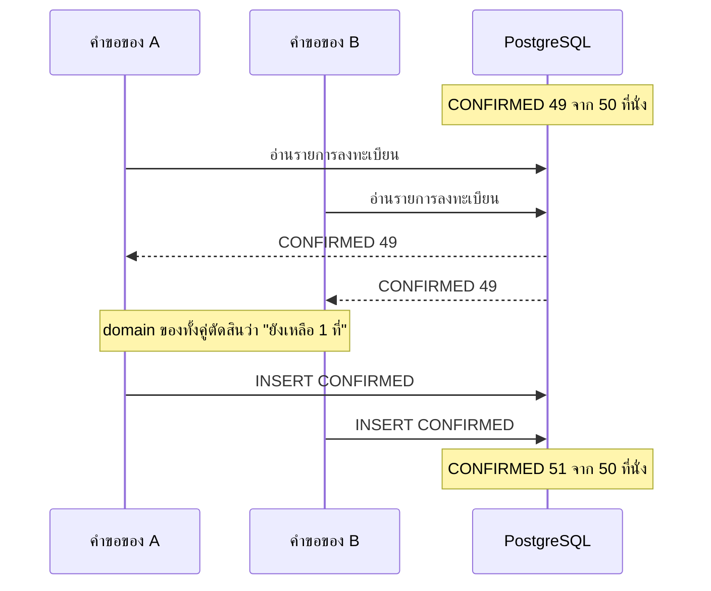
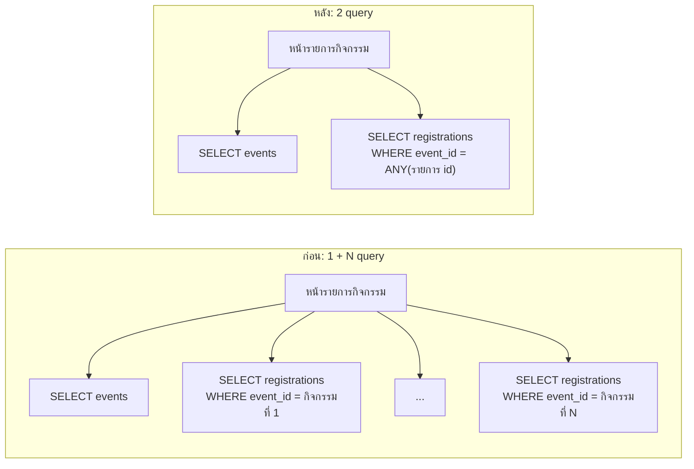

# WS-07 · Lecture — Performance Loop

เมื่อจบคาบ นักศึกษาควรสามารถ

- อธิบายว่าเหตุใด code ที่ผ่าน unit test และ E2E test ทุกข้อยังผิดกฎ R6 ได้เมื่อมีคำขอพร้อมกัน และแก้ด้วย transaction กับ row lock ในชั้น data
- เขียน load test ที่วัดผลได้ซ้ำ ใช้ p95 แทนค่าเฉลี่ย และใช้ threshold เป็นเงื่อนไขของ CI
- หาและแก้ N+1 query โดยยังเก็บกฎไว้ใน `src/domain`
- เขียน `ops/bands.yaml` ที่แยกสิ่งที่ต้องขวางทันทีออกจากสิ่งที่ต้องเฝ้าดู และระบุว่าคนกับ AI ทำอะไรในแต่ละระดับ

---

## 0. ทบทวน keyword และคำถามเปิด

สุ่มถามความหมายของ keyword จาก `0-Before.md` 2–3 คำ โดยให้ตอบด้วยคำพูดของตนเอง

จากนั้นถามทั้งห้องจากผลในส่วน C ของ `0-Before.md`

> ผู้ใช้ 300 คนลงทะเบียนกิจกรรมที่มี 50 ที่นั่งพร้อมกัน คาดว่าจะมีผู้ได้ `CONFIRMED` กี่คน
> หน้ารายการกิจกรรม 1 ครั้งส่ง query กี่ครั้ง

คำตอบที่มักได้คือ 50 คน เพราะ unit test ของ R1 ตรวจกรณีที่นั่งเต็มพอดีแล้ว
ขั้นตอนที่ 1 ของ lab จะแสดงผลจริง ซึ่งมักมากกว่า 50 หลายเท่า
ส่วนจำนวน query มักเท่ากับจำนวนกิจกรรมบวก 1 ซึ่งไม่เป็นปัญหาเมื่อมีกิจกรรม 3 รายการใน seed data
แต่ช้าลงทุกครั้งที่กิจกรรมเพิ่มขึ้น

---

## 1. Performance Loop

### วัดที่ไหน

| ที่ | ใช้ load test ได้หรือไม่ | เหตุผล |
|---|---|---|
| `docker compose up` ในเครื่อง | ได้ | เป็นระบบของกลุ่มเอง ข้อมูลทดสอบไม่กระทบใคร |
| CI | ได้ | ใช้ compose ชุดเดียวกับในเครื่อง ตามที่ทำไว้ใน WS-05 |
| Live URL บน Vercel และ Neon | **ไม่ได้** | Vercel อนุญาตให้ load test เฉพาะลูกค้าแผน Enterprise ที่ขออนุมัติก่อน และฐานข้อมูลแผนฟรีมีขีดจำกัด |

อ้างอิง: [Vercel — policy regarding load testing deployments](https://vercel.com/kb/guide/what-s-vercel-s-policy-regarding-load-testing-deployments)

ตัวเลขจากแต่ละที่เทียบกันตรง ๆ ไม่ได้ เครื่องของสมาชิก เครื่องของ CI และเว็บจริงเร็วไม่เท่ากัน
p95 ในเครื่อง 40 ms ไม่ได้แปลว่าเว็บจริงจะได้ 40 ms
สิ่งที่เทียบได้คือค่าจากที่เดียวกันในเวลาต่างกัน เช่น CI ก่อนและหลัง PR หนึ่ง

### ตัววัด

| ตัววัด | ความหมาย | เหตุผลที่ใช้ |
|---|---|---|
| p95 | คำขอ 95% เร็วกว่าค่านี้ | ค่าเฉลี่ยซ่อนคำขอที่ช้ามากไว้ หากคำขอ 1 ใน 20 ใช้ 3 วินาที ค่าเฉลี่ยอาจยังดูดี แต่ผู้ใช้จำนวนมากพบความช้านั้น |
| อัตราคำขอที่ผิดพลาด | สัดส่วนของคำขอที่ไม่ได้ status ที่คาดไว้ | ระบบที่ตอบเร็วเพราะตอบ `500` ไม่ได้เร็วจริง |
| ความถูกต้องหลังการทดสอบ | เช่น จำนวน `CONFIRMED` เทียบกับ `capacity` | load test ของ R6 สนใจผลที่ถูกต้องมากกว่าความเร็ว |

| คุณสมบัติของ loop | ตัววัดในบทนี้ |
|---|---|
| Latency | เวลาของ load test ทั้งชุดใน CI ซึ่งควรอยู่ในระดับนาที |
| Fidelity | load test ของ R6 ไม่ผ่านทุกครั้งเมื่อไม่มี lock และผ่านทุกครั้งเมื่อมี |
| Coverage | ทุก PR ตรวจ R6 และ p95 ของหน้ารายการกิจกรรม |

---

## 2. Race condition และกฎ R6

### เหตุใด test ที่มีอยู่จึงไม่เห็น



function `register` ใน `src/domain` ถูกต้องทุกกรณี เพราะตัดสินจากข้อมูลที่ได้รับ
ปัญหาอยู่ที่ข้อมูลนั้นล้าสมัยไปแล้วตั้งแต่ก่อนบันทึก unit test และ E2E test ส่งคำขอทีละรายการ จึงไม่มีทางเห็นช่วงเวลาที่ซ้อนกันนี้

### ทางเลือก

| ทางเลือก | ผล | ข้อจำกัด |
|---|---|---|
| ตัวแปร lock ใน memory ของ server | ใช้ได้ใน process เดียว | บน Vercel มีหลาย instance แต่ละตัวมี lock ของตนเอง จึงไม่ได้ป้องกันอะไร |
| ห่อด้วย transaction อย่างเดียว | ยังจองเกิน | ระดับ isolation ปกติของ PostgreSQL ไม่ได้กันไม่ให้ 2 transaction อ่านข้อมูลชุดเดียวกันพร้อมกัน |
| transaction และ `SELECT ... FROM events WHERE id = $1 FOR UPDATE` | คำขอของกิจกรรมเดียวกันทำงานทีละรายการ | คำขอที่ต้องรอ lock ช้าลง แต่กิจกรรมอื่นไม่ได้รับผล |
| isolation ระดับ `SERIALIZABLE` | PostgreSQL ยกเลิก transaction ที่ขัดกัน | code ต้องลองใหม่เมื่อถูกยกเลิก ซึ่งซับซ้อนกว่า |

วิชานี้ใช้ทางที่ 3 เพราะเข้าใจง่ายและตรวจได้ด้วย load test
lock อยู่ในชั้น data ตาม ADR-002 ชั้น data เปิด transaction จองแถวของกิจกรรม อ่านรายการลงทะเบียน
ส่งข้อมูลให้ function ใน `src/domain` ตัดสิน แล้วบันทึกก่อนปล่อย lock
**`src/domain` ไม่ต้องเปลี่ยน** เหมือนตอนย้ายไป PostgreSQL ใน WS-05

การยกเลิกต้องใช้ lock เดียวกัน เพราะการเลื่อนผู้อยู่ในคิวสำรองกับการลงทะเบียนใหม่ที่เกิดพร้อมกันก็ทำให้จองเกินได้
lock ของแถวกิจกรรมไม่ได้ป้องกัน R5 ซึ่งนับรวมหลายกิจกรรมของผู้ใช้คนเดียว
หากต้องป้องกัน R5 ด้วย ต้องจองแถวของผู้ใช้เพิ่ม และจองตามลำดับเดียวกันทุกครั้งเพื่อไม่ให้รอกันเอง กลุ่มบันทึกเรื่องนี้เป็นความเสี่ยงในแผน

### ตัวอย่าง

ตัวอย่างนี้ใช้ feature "แจ้งเตือนเมื่อได้ที่นั่งจากคิวสำรอง" ซึ่งอยู่นอกขอบเขตของ project
สมมติว่าตาราง `registrations` มีคอลัมน์ `notified_at` และผู้ได้ที่นั่งต้องได้รับการแจ้งเตือนเพียงครั้งเดียว
แม้ process ที่ส่งการแจ้งเตือนจะรันพร้อมกันหลายตัว

**หลักการ**

- การตรวจเงื่อนไขและการบันทึกต้องเกิดเป็นขั้นเดียวกันในฐานข้อมูล ไม่ใช่อ่านแล้วค่อยเขียน
- ทำได้ด้วย `UPDATE ... WHERE เงื่อนไข RETURNING` ซึ่งสำเร็จได้เพียงคำขอเดียว หรือด้วย row lock
- ทำสิ่งที่ย้อนไม่ได้ เช่น ส่งการแจ้งเตือน หลังจากฐานข้อมูลยืนยันแล้วเท่านั้น

**ตัวอย่างที่ดี**

```ts
const { rows } = await db().query(
  "UPDATE registrations SET notified_at = now() WHERE id = $1 AND notified_at IS NULL RETURNING id",
  [registrationId],
);
if (rows.length === 1) await sendNotification(registrationId);
```

**ตัวอย่างที่ไม่ดี**

```ts
const { rows } = await db().query("SELECT notified_at FROM registrations WHERE id = $1", [registrationId]);
if (rows[0].notified_at === null) {
  await sendNotification(registrationId);
  await db().query("UPDATE registrations SET notified_at = now() WHERE id = $1", [registrationId]);
}
```

| ปัญหา | ผลที่ตามมา |
|---|---|
| อ่านแล้วค่อยเขียนเป็น 2 คำสั่งแยกกัน | process 2 ตัวอ่านเห็น `null` พร้อมกัน แล้วส่งการแจ้งเตือนทั้งคู่ |
| ส่งการแจ้งเตือนก่อนบันทึก | หากบันทึกไม่สำเร็จ รอบถัดไปจะส่งซ้ำอีก |
| test ที่เรียกทีละครั้งผ่านเสมอ | ข้อผิดพลาดนี้เห็นได้เฉพาะเมื่อทดสอบพร้อมกัน |

> **ตัวอย่างจากการทำงานจริง: code ที่ AI ร่วมเขียนมีปัญหาเรื่องการทำงานพร้อมกันและ I/O มากกว่า**
> เดือนธันวาคม 2025 CodeRabbit วิเคราะห์ pull request แบบ open source 470 รายการ
> แบ่งเป็น PR ที่ AI ร่วมเขียน 320 รายการ และ PR ที่คนเขียนเอง 150 รายการ
> PR ที่ AI ร่วมเขียนมีปัญหาเฉลี่ย 10.83 ข้อต่อ PR เทียบกับ 6.45 ข้อ
> ปัญหาเรื่องความถูกต้องของการทำงานพร้อมกันและลำดับการทำงานพบประมาณ 2 เท่า
> และการอ่านเขียนข้อมูลเกินจำเป็น ซึ่งรวม query ที่ซ้ำซ้อน พบประมาณ 8 เท่า
> รายงานระบุว่ายืนยันผู้เขียนแต่ละ PR โดยตรงไม่ได้ PR ที่จัดว่าคนเขียนจึงอาจมี AI ช่วยอยู่บ้าง
> ปัญหาทั้ง 2 แบบนี้คือสิ่งที่ code ดูถูกต้องเมื่ออ่าน และผ่าน test ที่เรียกทีละครั้ง
>
> อ้างอิง:
> [CodeRabbit — State of AI vs Human Code Generation Report](https://www.coderabbit.ai/blog/state-of-ai-vs-human-code-generation-report)

---

## 3. วัดความเร็วและแก้ N+1 query

### load test ที่วัดผลได้ซ้ำ

**หลักการ**

- **กำหนดอัตราคำขอ ไม่ใช่จำนวนผู้ใช้ที่วนส่งให้เร็วที่สุด** k6 เรียกแบบนี้ว่า arrival rate
  เมื่อระบบช้าลง จำนวนคำขอต่อวินาทียังคงที่ ความช้าจึงปรากฏในผล แทนที่จะทำให้ส่งคำขอน้อยลงเอง
- **มีช่วง warm-up ที่ไม่นับ** คำขอแรก ๆ หลังเริ่มระบบช้ากว่าปกติมาก เพราะ server ยังไม่ได้เตรียมตัวและยังไม่ได้เชื่อมต่อฐานข้อมูล
- **ใช้ threshold เป็นเงื่อนไข** เช่น p95 ต่ำกว่า 500 ms k6 จบด้วย exit code ที่ไม่ใช่ 0 เมื่อไม่ผ่าน CI จึงใช้ได้ทันที
- **ตรวจ status ของทุกคำขอ** คำตอบที่เร็วเพราะเป็น error ต้องไม่นับว่าเร็ว
- **เตรียมข้อมูลให้ใกล้ขนาดจริง** หน้าที่มีกิจกรรม 3 รายการเร็วเสมอ ปัญหาจะเห็นเมื่อมีกิจกรรมหลายร้อยรายการ
- **ยิงเฉพาะระบบของตนเอง** ในเครื่องหรือใน CI

ตัวอย่างนี้วัดหน้าตั้งค่าการแจ้งเตือนของ feature แจ้งเตือนเดิม

**ตัวอย่างที่ดี**

```js
export const options = {
  scenarios: {
    warmup: { executor: "constant-arrival-rate", rate: 5, timeUnit: "1s", duration: "10s",
              preAllocatedVUs: 10, tags: { phase: "warmup" } },
    measure: { executor: "constant-arrival-rate", rate: 20, timeUnit: "1s", duration: "30s",
               preAllocatedVUs: 50, startTime: "10s", tags: { phase: "measure" } },
  },
  thresholds: {
    "http_req_duration{phase:measure}": ["p(95)<500"],
    "checks{phase:measure}": ["rate==1"],
  },
};

export default function () {
  const res = http.get(`${BASE}/settings/notifications`, { cookies: { session } });
  check(res, { "settings page 200": (r) => r.status === 200 });
}
```

**ตัวอย่างที่ไม่ดี**

```js
export const options = {
  vus: 100,
  duration: "30s",
  thresholds: { http_req_duration: ["avg<500"] },
};

export default function () {
  http.get("https://sdpx-g3.vercel.app/settings/notifications");
}
```

| ปัญหา | ผลที่ตามมา |
|---|---|
| ยิง Live URL บน Vercel | ผิดนโยบายของ Vercel และตัวเลขขึ้นกับเครือข่ายของผู้ยิง |
| `vus: 100` ที่วนส่งให้เร็วที่สุด | เมื่อระบบช้า จำนวนคำขอลดลงเอง ผลจึงดูดีกว่าความจริง |
| ไม่มี warm-up | คำขอแรก ๆ ที่ช้ามากปนอยู่ในผล ตัวเลขแต่ละครั้งต่างกันมาก |
| threshold เป็น `avg` | คำขอที่ช้ามากซ่อนอยู่ในค่าเฉลี่ย |
| ไม่ตรวจ status และไม่มี cookie | หน้าที่ตอบ `401` หรือพาไปหน้า login เร็วกว่าหน้าจริง ผลจึงผิด |

### N+1 query



แต่ละ query อาจใช้เวลาไม่ถึง 1 ms แต่เมื่อมี 200 กิจกรรมและ 20 คำขอต่อวินาที ระบบต้องตอบ 4,000 query ต่อวินาที
pool ของการเชื่อมต่อฐานข้อมูลมีจำนวนจำกัด คำขอจึงต่อคิวกันจน p95 สูงขึ้นหลายเท่า

แก้ได้ 2 ทาง

| ทาง | ข้อดี | ข้อเสีย |
|---|---|---|
| ดึงรายการลงทะเบียนของทุกกิจกรรมด้วย query เดียว แล้วส่งให้ `seatsLeft` ใน `src/domain` | กฎยังอยู่ที่เดียวตาม ADR-002 | ดึงข้อมูลมากกว่าที่ต้องใช้ |
| ให้ PostgreSQL นับด้วย `COUNT(*) ... GROUP BY` | ดึงข้อมูลน้อยที่สุด | วิธีนับที่นั่งไปอยู่ใน SQL ด้วย กฎจึงมี 2 ที่ที่ต้องแก้พร้อมกัน |

ให้เริ่มจากทางแรก แล้ววัดใหม่ หากผ่านเป้าหมายก็ไม่ต้องย้ายกฎไป SQL
การตัดสินใจเรื่องประสิทธิภาพควรมาจากตัวเลขที่วัดได้ ไม่ใช่จากการเดา

---

## 4. `ops/bands.yaml`

### ขวางทันที หรือเฝ้าดู

| | gate | band |
|---|---|---|
| ตัวอย่าง | จำนวนที่นั่งที่เกิน `capacity` ต้องเป็น 0 · p95 ต้องต่ำกว่า 500 ms | p95 ของหน้ารายการกิจกรรมสูงกว่าค่าปกติของ CI |
| ตัดสินอย่างไร | ผ่านหรือไม่ผ่านตามค่าที่กำหนด | เทียบกับค่าเฉลี่ยและส่วนเบี่ยงเบนมาตรฐาน (σ) ของผลที่ผ่านมา |
| เมื่อเกิด | CI ไม่ผ่าน merge ไม่ได้ | CI ยังผ่าน แต่บอกว่าต้องทำอะไรต่อ |
| เหตุผล | ละเมิดกฎหรือเป้าหมายแล้ว | ยังไม่ผิด แต่กำลังเปลี่ยนไปจากเดิม หากรอจนเกินเป้าหมายจะหาว่า PR ใดเป็นต้นเหตุได้ยาก |

กฎ R6 เป็น gate เสมอ จองเกินแม้ 1 ที่ก็ผิดกฎ ไม่มีช่วงที่ยอมรับได้

### ระดับและผู้ที่ทำ

*The AI-native SDLC playbook* ใช้ `bands.yaml` กำหนดระดับตามระยะห่างจากค่าปกติ
การตรวจว่าค่าออกนอกช่วงทำด้วย script ที่ทำงานแน่นอนทุกครั้ง ไม่ใช้ AI
AI ถูกเรียกเฉพาะหลังจากค่าออกนอกช่วงแล้ว และทำได้เพียงเท่าที่ระดับนั้นอนุญาต

| ระดับ | ใน playbook | ในวิชานี้ | คนอยู่ในวงอย่างไร |
|---|---|---|---|
| ต่ำกว่า 1σ | ไม่ทำอะไร | ไม่ทำอะไร | — |
| 1σ | บันทึกไว้ | ค่าปรากฏในสรุปของ CI | ไม่ต้องทำอะไร |
| 2σ | AI วิเคราะห์โดยอ่านอย่างเดียว | สมาชิกสั่ง AI วิเคราะห์ตามคำสั่งใน `AGENTS.md` โดยห้ามแก้ไฟล์ | สมาชิกอ่านผลแล้วตัดสินว่าจะแก้ จะรอดู หรือปรับ band |
| 3σ | AI เสนอการแก้ได้ แต่ผ่าน PR หรือ runbook ที่อนุมัติไว้แล้วเท่านั้น | สมาชิกสั่ง AI วิเคราะห์และเปิด PR แก้ไข | PR ต้องผ่าน CI, AI review และการอนุมัติตามปกติ |

ใน playbook script เรียก AI เองอัตโนมัติ ในวิชานี้สมาชิกเป็นผู้สั่ง ตามหลักการเริ่มจากทำเองแล้วจึงเขียนเป็น code
เมื่อกลุ่มทำตามขั้นตอนนี้ด้วยมือจนมั่นใจแล้ว จึงค่อยให้ CI เรียก AI แทน

### baseline มาจากที่เดียวกับที่ตรวจ

baseline ของ band ใน CI ต้องคำนวณจากผลของ CI ไม่ใช่จากเครื่องของสมาชิก
lab ใช้ค่า p95 จาก CI 5 ครั้ง ซึ่ง `ops/check-bands.mjs` พิมพ์ไว้ในสรุปของทุก workflow
5 ครั้งน้อยเกินกว่าจะเป็นสถิติที่ดี แต่พอให้เห็นว่าค่าแกว่งเท่าใด
เมื่อมีผลมากขึ้น ให้คำนวณใหม่จากผลล่าสุด และหาก band แจ้งเตือนบ่อยโดยไม่มีปัญหาจริง ให้ปรับ band แทนการเพิกเฉย

---

## สรุป

1. load test ทำเฉพาะกับระบบของตนเองในเครื่องหรือใน CI และเทียบตัวเลขเฉพาะจากที่เดียวกัน
2. function ใน domain ที่ถูกต้องยังให้ผลผิดได้เมื่อข้อมูลที่ได้รับล้าสมัย transaction อย่างเดียวไม่พอ ต้องจองแถวด้วย `FOR UPDATE` ในชั้น data
3. ใช้ p95 อัตราคำขอคงที่ และ warm-up แล้วให้ threshold เป็นเงื่อนไขของ CI
4. N+1 query ไม่เห็นเมื่อข้อมูลน้อย แก้ด้วยการดึงครั้งเดียวและเก็บกฎไว้ใน domain หากยังผ่านเป้าหมาย
5. gate ขวางสิ่งที่ผิดแล้ว band เตือนสิ่งที่กำลังเปลี่ยน script ตรวจ คนตัดสิน และ AI ทำได้เท่าที่ระดับนั้นอนุญาต
