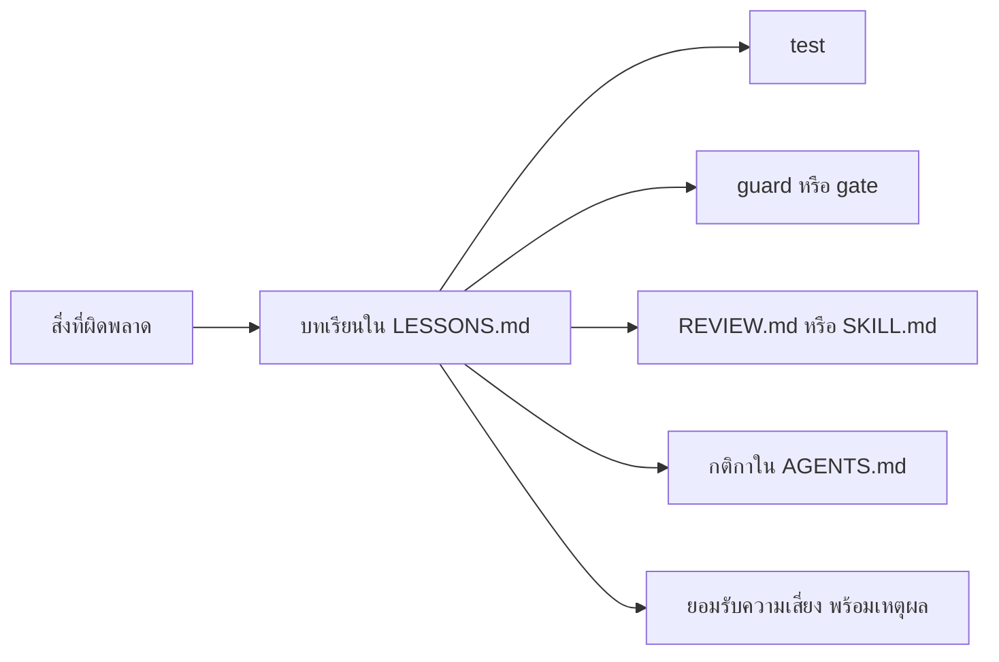

# WS-08 · Lecture — Quality Loop

เมื่อจบคาบ นักศึกษาควรสามารถ

- ระบุความเสี่ยงใน OWASP Top 10:2025 ที่เกี่ยวกับระบบของกลุ่ม และบอกได้ว่าบทใดในวิชาเพิ่มสิ่งที่ป้องกันแต่ละข้อ
- เขียน test ที่พิสูจน์ว่าผู้ใช้เข้าถึงข้อมูลของผู้อื่นไม่ได้ ทั้งในฐานะผู้เข้าร่วมและผู้จัด
- แยกได้ว่าเครื่องมือตรวจอัตโนมัติ AI security review และ test จับปัญหาคนละแบบอย่างไร
- เขียน `SKILL.md` สำหรับงานที่ทำซ้ำ และ `LESSONS.md` ที่ผูกทุกบทเรียนกับสิ่งที่ป้องกันไม่ให้เกิดซ้ำ

---

## 0. ทบทวน keyword และคำถามเปิด

สุ่มถามความหมายของ keyword จาก `0-Before.md` 2–3 คำ โดยให้ตอบด้วยคำพูดของตนเอง

จากนั้นถามทั้งห้อง

> หัวข้อที่ 8 ของ `PROJECT.md` บอกว่าผู้เข้าร่วมต้องดูหรือยกเลิกการลงทะเบียนของผู้อื่นไม่ได้
> กลุ่มพิสูจน์ข้อนี้ได้อย่างไรในตอนนี้ และหากพรุ่งนี้มีคนแก้ code จนข้อนี้ไม่เป็นจริง อะไรจะเตือน

ผลจากการโจมตีในส่วน C ของ `0-Before.md` ใช้ประกอบได้
กลุ่มส่วนใหญ่ตอบได้เพียงว่าลองแล้วไม่ได้ ซึ่งเป็นการตรวจครั้งเดียว ไม่ใช่สิ่งที่ตรวจซ้ำทุก PR
บทนี้เปลี่ยนการลองครั้งเดียวนั้นให้เป็น test, เครื่องมือใน CI และขั้นตอนที่ทำซ้ำได้ เหมือนที่ทุกบทก่อนหน้าทำกับเรื่องของตน

---

## 1. ความปลอดภัยเป็นส่วนหนึ่งของคุณภาพ

### OWASP Top 10:2025 กับระบบของกลุ่ม

OWASP Top 10:2025 ยังจัดให้ broken access control อยู่อันดับ 1 เหมือนฉบับก่อน
ตารางนี้แสดงเฉพาะข้อที่เกี่ยวกับระบบของกลุ่ม

| รหัส | ความเสี่ยง | ตัวอย่างในระบบนี้ | สิ่งที่ป้องกัน และบทที่เพิ่ม |
|---|---|---|---|
| A01 | Broken Access Control | ผู้จัดคนหนึ่งดูรายชื่อของกิจกรรมที่ผู้อื่นจัด | session และการตรวจสิทธิ์ฝั่ง server (WS-06) · access test (บทนี้) |
| A02 | Security Misconfiguration | error ตอบกลับพร้อม stack trace | `REVIEW.md` (WS-04) · security review (บทนี้) |
| A03 | Software Supply Chain Failures | package หรือ workflow ใน CI ถูกโจมตี | สิทธิ์ของ CI (WS-04) · `npm audit` และ Dependabot (บทนี้) |
| A04 | Cryptographic Failures | รหัส session เดาได้ | รหัสสุ่ม 32 byte และ cookie แบบ `Secure` (WS-06) |
| A05 | Injection | สร้าง SQL ด้วยการต่อข้อความจาก input | query แบบมี parameter (WS-05) · CodeQL (บทนี้) |
| A07 | Authentication Failures | cookie เดิมยังใช้ได้หลังออกจากระบบ | ลบ session ในฐานข้อมูล (WS-06) · access test (บทนี้) |
| A10 | Mishandling of Exceptional Conditions | ระบบตอบ `500` พร้อมข้อความภายในเมื่อ body ผิดรูปแบบ | ตรวจ input และ test ของกรณีผิดรูปแบบ (บทนี้) |

อ้างอิง: [OWASP Top 10:2025](https://owasp.org/Top10/2025/)

> **ตัวอย่างจากการทำงานจริง: code ที่ AI เขียนเกือบครึ่งไม่ผ่านการตรวจความปลอดภัย**
> เดือนกรกฎาคม 2025 Veracode ให้ language model มากกว่า 100 ตัวเขียน code ในภาษา Java, Python, C# และ JavaScript
> แล้วตรวจความปลอดภัยของผล พบว่า 45% ของตัวอย่าง code มีช่องโหว่ในกลุ่ม OWASP Top 10
> ในงานที่ต้องป้องกัน cross-site scripting AI ไม่ได้ป้องกันใน 86% ของตัวอย่าง และ code ภาษา Java ไม่ผ่าน 72%
> Veracode ยังพบว่าความปลอดภัยของ code ไม่ได้ดีขึ้นตามขนาดหรือความใหม่ของ model
> code ที่ทำงานได้จึงไม่ได้แปลว่าปลอดภัย และการเปลี่ยนไปใช้ model ที่ใหม่กว่าไม่ได้แก้ปัญหานี้
>
> อ้างอิง:
> [Veracode — 2025 GenAI Code Security Report](https://www.veracode.com/blog/genai-code-security-report/)

| คุณสมบัติของ loop | ตัววัดในบทนี้ |
|---|---|
| Latency | access test และเครื่องมือตรวจอัตโนมัติรันในทุก PR |
| Fidelity | access test ไม่ผ่านทันทีเมื่อลบการตรวจสิทธิ์ข้อใดข้อหนึ่ง |
| Coverage | ทุกข้อใน security checklist มีหลักฐานว่าตรวจด้วยอะไร |

---

## 2. Broken access control

### authentication ไม่ใช่ authorization

WS-06 ทำให้ server รู้ว่าคำขอมาจากใคร ซึ่งคือ authentication
แต่การรู้ว่าเป็นใครยังไม่พอ ทุกคำขอต้องตอบอีก 2 คำถาม

| คำถาม | ตัวอย่าง | หากไม่ตรวจ |
|---|---|---|
| บทบาทนี้ทำสิ่งนี้ได้หรือไม่ | ผู้เข้าร่วมสร้างกิจกรรมได้หรือไม่ | ผู้เข้าร่วมสร้างกิจกรรมได้เพียงเรียก API ตรง |
| ข้อมูลนี้เป็นของผู้ใช้คนนี้หรือไม่ | กิจกรรมนี้ผู้จัดคนนี้เป็นผู้สร้างหรือไม่ | ผู้จัดคนใดก็ดูรายชื่อของทุกกิจกรรมได้ |

คำถามที่ 2 คือที่มาของช่องโหว่แบบ IDOR ซึ่งตรวจยากที่สุด
เพราะ code ที่ตรวจเฉพาะบทบาทดูถูกต้องเมื่ออ่าน และทุก test ที่ใช้ผู้จัดเพียงคนเดียวก็ผ่าน
seed data ส่วนใหญ่มีผู้จัดคนเดียว test ของข้อนี้จึงต้องสร้างผู้จัดคนที่ 2 เอง

> **ตัวอย่างจากการทำงานจริง: แอปส่วนตัวถูกเข้าถึงได้ด้วย id ที่เปิดเผย**
> เดือนกรกฎาคม 2025 Wiz Research พบช่องโหว่ใน Base44 บริการสร้างแอปด้วย AI ของ Wix
> endpoint สำหรับสมัครและยืนยันบัญชีของแอปส่วนตัวไม่ต้องยืนยันตัวตนใด ๆ และต้องการเพียง `app_id`
> ซึ่งเห็นได้ใน URL ของแอป ผู้ใดก็สร้างบัญชีที่ยืนยันแล้วในแอปส่วนตัวขององค์กรอื่นได้ รวมถึงแอปที่ใช้ SSO
> Wix แก้ภายใน 24 ชั่วโมงและไม่พบหลักฐานว่าถูกใช้โจมตี
> id ที่เปิดเผยไม่ใช่ความลับ server ต้องตรวจสิทธิ์ทุกครั้งแม้คำขอจะมี id ที่ถูกต้อง
>
> อ้างอิง:
> [Infosecurity Magazine — Critical Authentication Flaw Identified in Base44](https://infosecurity-magazine.com/news/authentication-flaw-base44) ·
> [The Hacker News — Wiz Uncovers Critical Access Bypass Flaw in Base44](https://thehackernews.com/2025/07/wiz-uncovers-critical-access-bypass.html)

### ตัวอย่าง

ตัวอย่างนี้ใช้ feature "แจ้งเตือนเมื่อได้ที่นั่งจากคิวสำรอง" ซึ่งอยู่นอกขอบเขตของ project
สมมติว่ามี endpoint `GET /api/notifications/[id]` ให้ผู้ใช้อ่านการแจ้งเตือนของตน

**หลักการ**

- หาผู้ใช้จาก session แล้วตรวจทั้งบทบาทและความเป็นเจ้าของ ก่อนอ่านหรือแก้ข้อมูล
- กรองด้วยเจ้าของใน query เอง เช่น `WHERE id = $1 AND user_id = $2` ข้อมูลของผู้อื่นจึงไม่เคยถูกโหลดขึ้นมา
- ข้อมูลที่ไม่ใช่ของผู้ใช้ตอบเหมือนกับข้อมูลที่ไม่มีอยู่ หรือตอบ `403` ตามที่ spec กำหนด ให้เหมือนกันทั้งระบบ
- test ใช้ผู้ใช้อย่างน้อย 2 คน และตรวจว่าคนหนึ่งเข้าถึงของอีกคนไม่ได้

**ตัวอย่างที่ดี**

```ts
export async function GET(_req: Request, ctx: { params: Promise<{ id: string }> }) {
  const user = await currentUser();
  if (!user) return Response.json({ code: "UNAUTHENTICATED" }, { status: 401 });
  const { id } = await ctx.params;
  const notification = await findNotificationOfUser(id, user.id); // WHERE id = $1 AND user_id = $2
  if (!notification) return Response.json({ code: "NOT_FOUND" }, { status: 404 });
  return Response.json(notification);
}
```

```ts
test("แจ้งเตือน: ผู้ใช้อ่านการแจ้งเตือนของผู้อื่นไม่ได้", async ({ playwright }) => {
  const bobNotification = await createNotification("u-b");
  const alice = await playwright.request.newContext();
  await loginApi(alice, "u-a");
  expect((await alice.get(`/api/notifications/${bobNotification}`)).status()).toBe(404);
});
```

**ตัวอย่างที่ไม่ดี**

```ts
export async function GET(_req: Request, ctx: { params: Promise<{ id: string }> }) {
  const user = await currentUser();
  if (!user) return Response.json({ code: "UNAUTHENTICATED" }, { status: 401 });
  const { id } = await ctx.params;
  return Response.json(await findNotification(id)); // WHERE id = $1
}
```

| ปัญหา | ผลที่ตามมา |
|---|---|
| ตรวจเพียงว่ามี session | ผู้ใช้ทุกคนที่เข้าสู่ระบบแล้วอ่านการแจ้งเตือนของทุกคนได้ เพียงเปลี่ยน id |
| query ไม่กรองด้วยเจ้าของ | แม้จะเพิ่มการตรวจภายหลัง ข้อมูลของผู้อื่นก็ถูกโหลดขึ้นมาแล้ว และพลาดได้ง่ายเมื่อแก้ code |
| test ที่มีผู้ใช้คนเดียว | ผ่านเสมอ เพราะไม่มีข้อมูลของผู้อื่นให้ลองเข้าถึง |

---

## 3. 3 วิธีตรวจความปลอดภัย

| | เครื่องมืออัตโนมัติ | AI security review | access test |
|---|---|---|---|
| ตัวอย่างในบทนี้ | CodeQL, `npm audit`, Dependabot, `no-secrets` จาก WS-05 | AI ที่ทำตาม `SKILL.md` ของ security review | `e2e/access.spec.ts` |
| ทำงานเมื่อใด | ทุก PR และเมื่อมีช่องโหว่ใหม่ของ package | เมื่อสมาชิกสั่ง เช่น ก่อนส่งงาน หรือเมื่อเพิ่ม endpoint | ทุก PR |
| จับได้ดี | รูปแบบที่รู้จัก เช่น SQL ที่ต่อข้อความ package ที่มีช่องโหว่ ค่าความลับใน code | ปัญหาที่ต้องเข้าใจความหมาย เช่น endpoint ที่ลืมตรวจความเป็นเจ้าของ | กรณีที่เขียนไว้ ว่ายังถูกต้องทุกครั้ง |
| จับไม่ได้ | กฎของระบบ เช่น ผู้จัดต้องเป็นเจ้าของกิจกรรม | สิ่งที่ไม่ได้อ่าน และอาจรายงานปัญหาที่ไม่มีจริง | กรณีที่ไม่มีใครคิดจะเขียน |
| ผลที่ได้ | ขวาง PR หรือแจ้งเตือนในแท็บ Security | รายการข้อค้นพบที่คนต้องตัดสิน | ขวาง PR ด้วย ruleset |

ทั้ง 3 วิธีเสริมกัน ข้อค้นพบของ AI security review ที่ถูกต้องควรกลายเป็น access test
เพื่อให้ปัญหาเดิมถูกจับได้ทุก PR โดยไม่ต้องพึ่ง AI อีก
ข้อค้นพบของเครื่องมือที่ไม่ใช่ปัญหาจริง ให้ปิดพร้อมเหตุผลในหน้าของเครื่องมือนั้น ไม่ปล่อยค้างไว้จนทุกคนเลิกอ่าน

CodeQL ใช้ได้ฟรีกับ repository แบบ public ผ่าน default setup ซึ่ง GitHub ตั้งค่า workflow ให้เอง
ผลแสดงในแท็บ Security ของ repository

---

## 4. `SKILL.md`

### skill ต่างจาก `AGENTS.md` และ guard อย่างไร

| | `AGENTS.md` | skill | guard |
|---|---|---|---|
| ใช้เมื่อใด | AI อ่านทุกครั้งที่เริ่มงาน | AI โหลดเมื่องานตรงกับคำอธิบายของ skill หรือเมื่อสมาชิกสั่ง | ทำงานอัตโนมัติก่อนคำสั่งหรือก่อน merge |
| เนื้อหา | กติกาสั้น ๆ ที่ใช้กับทุกงาน | ขั้นตอนละเอียดของงานเรื่องเดียว | script ที่ขวาง |
| ความแน่นอน | คำแนะนำ | คำแนะนำ | แน่นอนทุกครั้ง |
| ตัวอย่าง | ห้ามรับ user id จาก body | ขั้นตอน security review ทั้งระบบ | `protect-db.mjs` |

*The AI-native SDLC playbook* อธิบายว่า skill เป็นการควบคุมแบบคำแนะนำ
ส่วน hook เป็นชั้นที่แน่นอนอยู่ด้านหลัง skill ทำให้การฝ่าฝืนเกิดได้ยาก ส่วน hook ทำให้แทบเป็นไปไม่ได้
skill จึงเหมาะกับงานที่ต้องใช้วิจารณญาณแต่ต้องทำด้วยขั้นตอนเดิมทุกครั้ง เช่น security review

### รูปแบบ

skill เป็นโฟลเดอร์ที่มีไฟล์ `SKILL.md` ตามรูปแบบ Agent Skills ซึ่ง agent หลายยี่ห้อรองรับ
ส่วนบนเป็น YAML ที่มี `name` และ `description` agent อ่านเฉพาะส่วนนี้ตอนเริ่มงาน
และโหลดเนื้อหาทั้งหมดเมื่อตัดสินว่างานตรงกับ `description`
วิชานี้เก็บ skill ไว้ที่ `.agents/skills/[ชื่อ]/SKILL.md` ซึ่งเป็นตำแหน่งที่ใช้ร่วมกันระหว่าง agent หลายยี่ห้อ
agent บางตัวอ่าน skill จากโฟลเดอร์ของตนเอง เช่น Claude Code อ่านจาก `.claude/skills/`

อ้างอิง: [Agent Skills — Specification](https://agentskills.io/specification)

**หลักการ**

- `name` ใช้ตัวพิมพ์เล็ก ตัวเลข และขีดกลาง และตรงกับชื่อโฟลเดอร์
- `description` บอกทั้งว่า skill ทำอะไร และใช้เมื่อใด agent ใช้ข้อความนี้ตัดสินว่าจะโหลด skill หรือไม่
- เนื้อหาเป็นขั้นตอนที่ตรวจได้ บอกว่าต้องอ่านอะไร ทำอะไร และรายงานในรูปแบบใด
- อ้างถึงไฟล์ของกลุ่ม เช่น checklist และ `REVIEW.md` แทนการเขียนซ้ำ
- บอกสิ่งที่ห้ามทำ เช่น ห้ามแก้ไฟล์ระหว่าง review

ตัวอย่างนี้เป็น skill สำหรับเพิ่ม endpoint ใหม่ ซึ่งใช้ได้กับ feature แจ้งเตือนเดิม

**ตัวอย่างที่ดี**

```markdown
---
name: add-endpoint
description: Steps for adding or changing an API route handler in this project, including access checks and tests. Use when creating or editing files under src/app/api/.
---

# Add an endpoint

1. Read the spec.md of the feature and find the status codes for 401, 403 and 404.
2. Add the endpoint to docs/openapi.yaml first, then run npx --yes @redocly/cli@2 lint docs/openapi.yaml.
3. Write tests before the code:
   - a request without a session gets 401
   - a user with the wrong role gets 403
   - a user who does not own the data cannot read or change it, using two different users
4. In the route handler, get the user only from src/lib/current-user.ts.
   Filter by owner inside the SQL query.
5. Run npm test, npm run test:db and npm run e2e, and show the output.
```

**ตัวอย่างที่ไม่ดี**

```markdown
---
name: Security Helper
description: Helps with security.
---

Make sure the endpoint is secure and follows best practices.
```

| ปัญหา | ผลที่ตามมา |
|---|---|
| `name` มีตัวพิมพ์ใหญ่และช่องว่าง | ผิดรูปแบบ agent บางตัวไม่โหลด skill นี้ |
| `description` ไม่บอกว่าใช้เมื่อใด | agent ไม่รู้ว่าควรโหลด skill เมื่อแก้ route handler |
| "secure" และ "best practices" | ไม่มีขั้นตอนที่ตรวจได้ แต่ละครั้งได้ผลต่างกัน |
| ไม่มี test ที่ใช้ผู้ใช้ 2 คน | ปัญหาแบบ IDOR ผ่านไปได้ |

---

## 5. `LESSONS.md` — ปิดวงจรของทั้งวิชา

### จากความผิดพลาดเป็นสิ่งที่ป้องกัน

ทุกบทในวิชานี้เริ่มจากปัญหาที่เกิดขึ้นจริง แล้วเพิ่มสิ่งที่ตรวจได้ซ้ำ
*The AI-native SDLC playbook* แนะนำว่าเมื่อ AI ผิดเรื่องเดิมซ้ำ ให้บันทึกการแก้ไว้ในไฟล์ที่ AI อ่าน
และทุกเหตุการณ์ที่เกิดกับระบบจริงควรกลายเป็นการตรวจที่รันซ้ำได้
`LESSONS.md` คือที่รวมบทเรียนของกลุ่ม แต่ละบทเรียนต้องชี้ไปที่สิ่งที่ป้องกันไม่ให้เกิดซ้ำ
บทเรียนที่ยังไม่มีสิ่งใดป้องกัน คือสิ่งที่กลุ่มยังต้องพึ่งความจำ



ลำดับที่ควรเลือกคือ test หรือ guard ก่อน เพราะทำงานแน่นอนทุกครั้ง
แล้วจึง `REVIEW.md`, `SKILL.md` หรือ `AGENTS.md` ซึ่งเป็นคำแนะนำ

### ตัวอย่าง

**ตัวอย่างที่ดี**

```markdown
## L-04: AI แก้ไฟล์ test ให้ผ่านแทนการแก้ code
- เกิดเมื่อ: WS-03 ขั้นตอนที่ 4 PR ของ R4 · [ลิงก์ PR]
- พบได้อย่างไร: ผู้อนุมัติเห็นใน diff ว่า expected value ใน test ถูกเปลี่ยน
- สาเหตุ: คำสั่งที่ให้ AI ไม่ได้ห้ามแก้ test และไม่มีอะไรตรวจ
- สิ่งที่ป้องกันตอนนี้: guard `.agents/guards/protect-tests.mjs` (WS-05) · กติกาใน AGENTS.md
- ตรวจว่าทำงานจริงได้อย่างไร: `npx vitest run .agents`
```

**ตัวอย่างที่ไม่ดี**

```markdown
## AI ทำ test พัง
ต้องระวังมากขึ้นเวลาใช้ AI
```

| ปัญหา | ผลที่ตามมา |
|---|---|
| ไม่มีที่มาและลิงก์ | ผู้อ่านภายหลังตรวจไม่ได้ว่าเกิดอะไรขึ้นจริง |
| "ต้องระวังมากขึ้น" | ไม่มีสิ่งใดเปลี่ยน เรื่องเดิมจะเกิดอีกเมื่อทุกคนลืม |
| ไม่มีสิ่งที่ป้องกันหรือวิธีตรวจ | ไม่รู้ว่าบทเรียนนี้ยังถูกป้องกันอยู่หรือไม่ |

### artifact chain ของทั้งวิชา

| บท | ไฟล์ | สิ่งที่ตรวจซ้ำได้ |
|---|---|---|
| 01 | `AGENTS.md` | CI ตรวจ build และ deploy อัตโนมัติ |
| 02 | `intent.md`, `spec.md`, ADR-001 | lint ของ `openapi.yaml` |
| 03 | `plan.md`, ADR-002 | unit test ของกฎ R1–R5 |
| 04 | `REVIEW.md` | ruleset, CI ทุก PR และ AI review |
| 05 | `.agents/guards/` | guard ก่อนคำสั่งของ agent และ integration test |
| 06 | `.agents/verifier.md` | E2E test ของ journey |
| 07 | `ops/bands.yaml` | load test ของ R6 และ p95 |
| 08 | `SKILL.md`, `LESSONS.md` | access test, CodeQL และ `npm audit` |

---

## สรุป

1. broken access control ยังเป็นความเสี่ยงอันดับ 1 และ code ที่ AI เขียนเกือบครึ่งมีช่องโหว่ จึงต้องพิสูจน์ด้วยการตรวจที่รันซ้ำได้
2. การรู้ว่าผู้ใช้เป็นใครยังไม่พอ ต้องตรวจทั้งบทบาทและความเป็นเจ้าของ และ test ต้องใช้ผู้ใช้อย่างน้อย 2 คน
3. เครื่องมืออัตโนมัติ AI security review และ access test จับปัญหาคนละแบบ ข้อค้นพบที่ถูกต้องควรกลายเป็น test
4. skill เก็บขั้นตอนของงานที่ทำซ้ำ ให้ AI ทำแบบเดิมทุกครั้ง แต่ยังเป็นคำแนะนำ สิ่งที่ต้องเป็นจริงเสมอต้องเป็น test หรือ guard
5. ทุกบทเรียนใน `LESSONS.md` ต้องชี้ไปที่สิ่งที่ป้องกันไม่ให้เกิดซ้ำ
