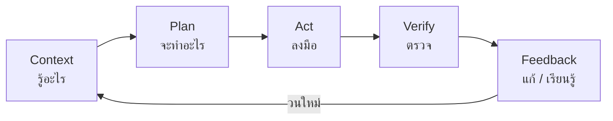
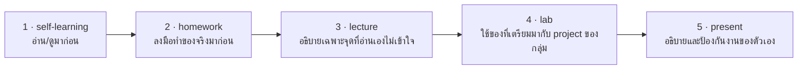
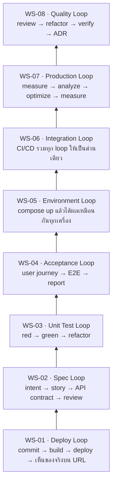

# SDPX-AI

**Software Development Process in Practice — AI-Assisted**

วิชานี้สอน *กระบวนการ* พัฒนาซอฟต์แวร์ในยุคที่ AI agent เขียน code ได้เองแล้ว
สิ่งที่ทำให้วิศวกรซอฟต์แวร์มีค่าจึงไม่ใช่ความเร็วในการพิมพ์ code
แต่คือความสามารถในการ **ออกแบบวงจรที่ทำให้รู้เร็วที่สุดว่าอะไรถูกอะไรผิด**



Loop หนึ่งวัดกันที่ 3 อย่าง — ทุกสัปดาห์เราจะพยายามทำให้ทั้งสามดีขึ้น

| คุณสมบัติ | คำถาม | ตัวอย่างที่แย่ | ตัวอย่างที่ดี |
| :--- | :--- | :--- | :--- |
| **Latency** | กว่าจะรู้ผลใช้เวลาเท่าไร | รอ user แจ้ง bug 3 วันให้หลัง | unit test เขียว/แดงใน 2 วินาที |
| **Fidelity** | signal บอกความจริงแค่ไหน | test ที่ผ่านตลอดไม่ว่า code จะพังแค่ไหน | test ที่แดงทันทีเมื่อลบ business rule |
| **Coverage** | จับความผิดพลาดได้กี่แบบ | ตรวจแค่ happy path | ตรวจ error case + integration + performance |

---

## เริ่มตรงไหนดี

<div class="grid cards" markdown>

-   :material-school: **เป็นนักศึกษาในวิชานี้**

    ---

    เปิดสัปดาห์ที่กำลังเรียน แล้วไล่จากซ้ายไปขวาในตารางด้านล่าง
    **ห้ามข้าม `--before`** เพราะคาบเรียนเริ่มจากจุดที่ `--before` จบ

    [ไปที่ตาราง Workshop](#workshop-ทงหมด){ .md-button }

-   :material-teach: **เป็นผู้สอน**

    ---

    `lecture.md` มีคำแนะนำการแบ่งเวลา, ตารางศัพท์ และ diagram พร้อมใช้
    `present.md` มี rubric และคำถาม oral defense

    [ดู Workshop ทั้งหมด](#workshop-ทงหมด){ .md-button }

-   :material-book-open-variant: **แวะมาอ่านเอาความรู้**

    ---

    เอกสารอ่านประกอบ 7 บท อ่านจบได้ในตัวเอง ไม่ต้องเรียนวิชานี้ก่อน
    มีเอกสารอ้างอิงกำกับทุกบท

    [ไปที่อ่านประกอบ](#เอกสารอานประกอบ){ .md-button }

</div>

---

## ลำดับของแต่ละสัปดาห์ — ห้ามสลับ

`WS-0X--before` เป็น **เงื่อนไขก่อนเข้าคาบ** ไม่ใช่ของเสริม
งานใน `homework.md` คือวัตถุดิบที่ `lab.md` หยิบมาใช้ต่อทันที



ทุกไฟล์มีตารางกำกับว่า **สิ่งที่เตรียมมาจะถูกใช้ตรงไหน** และ **ถ้าไม่ได้เตรียมมาจะติดตรงไหน**

---

## Workshop ทั้งหมด

ตารางเดียวเห็นครบ 40 ไฟล์ — อ่านจากซ้ายไปขวาคือลำดับที่ต้องทำ

| WS | หัวข้อ | Loop ที่ได้ | 1 · เรียนเอง | 2 · การบ้าน | 3 · บรรยาย | 4 · ปฏิบัติ | 5 · นำเสนอ |
| :-- | :--- | :--- | :--: | :--: | :--: | :--: | :--: |
| **01** | First Deploy + Loop Engineering | Deploy Loop | [เรียนเอง](WS-01--before/self-learning.md) | [การบ้าน](WS-01--before/homework.md) | [บรรยาย](WS-01-RUN-first-deploy/lecture.md) | [ปฏิบัติ](WS-01-RUN-first-deploy/lab.md) | [นำเสนอ](WS-01-RUN-first-deploy/present.md) |
| **02** | Requirements & Design | Spec Loop | [เรียนเอง](WS-02--before/self-learning.md) | [การบ้าน](WS-02--before/homework.md) | [บรรยาย](WS-02-RUN-req-design/lecture.md) | [ปฏิบัติ](WS-02-RUN-req-design/lab.md) | [นำเสนอ](WS-02-RUN-req-design/present.md) |
| **03** | Unit Testing | Unit Test Loop | [เรียนเอง](WS-03--before/self-learning.md) | [การบ้าน](WS-03--before/homework.md) | [บรรยาย](WS-03-RUN-unit-test/lecture.md) | [ปฏิบัติ](WS-03-RUN-unit-test/lab.md) | [นำเสนอ](WS-03-RUN-unit-test/present.md) |
| **04** | End-to-End Testing | Acceptance Loop | [เรียนเอง](WS-04--before/self-learning.md) | [การบ้าน](WS-04--before/homework.md) | [บรรยาย](WS-04-RUN-e2e/lecture.md) | [ปฏิบัติ](WS-04-RUN-e2e/lab.md) | [นำเสนอ](WS-04-RUN-e2e/present.md) |
| **05** | Docker | Environment Loop | [เรียนเอง](WS-05--before/self-learning.md) | [การบ้าน](WS-05--before/homework.md) | [บรรยาย](WS-05-RUN-docker/lecture.md) | [ปฏิบัติ](WS-05-RUN-docker/lab.md) | [นำเสนอ](WS-05-RUN-docker/present.md) |
| **06** | CI/CD | Integration Loop | [เรียนเอง](WS-06--before/self-learning.md) | [การบ้าน](WS-06--before/homework.md) | [บรรยาย](WS-06-RUN-cicd/lecture.md) | [ปฏิบัติ](WS-06-RUN-cicd/lab.md) | [นำเสนอ](WS-06-RUN-cicd/present.md) |
| **07** | Performance & Observability | Production Loop | [เรียนเอง](WS-07--before/self-learning.md) | [การบ้าน](WS-07--before/homework.md) | [บรรยาย](WS-07-RUN-perf/lecture.md) | [ปฏิบัติ](WS-07-RUN-perf/lab.md) | [นำเสนอ](WS-07-RUN-perf/present.md) |
| **08** | Code Quality & Security | Quality Loop | [เรียนเอง](WS-08--before/self-learning.md) | [การบ้าน](WS-08--before/homework.md) | [บรรยาย](WS-08-RUN-code-quality/lecture.md) | [ปฏิบัติ](WS-08-RUN-code-quality/lab.md) | [นำเสนอ](WS-08-RUN-code-quality/present.md) |

### Loop ที่จะสร้างทีละชั้น



!!! note "Test Harness ใช้เฉพาะสองสัปดาห์"
    **Test Harness** คือคำเฉพาะของฝั่ง testing — หมายถึงโครงสร้างรอบ ๆ test
    (test doubles, fixtures, factories, seed data, page objects) ที่ทำให้ test รันซ้ำได้ผลเดิม
    วิชานี้ใช้คำนี้เฉพาะใน **WS-03** และ **WS-04** เท่านั้น สัปดาห์อื่นเรียกว่า *loop*

---

## เอกสารอ่านประกอบ

7 บทที่อ่านจบได้ในตัวเอง ไม่อ้างอิงข้ามบทและไม่ต้องเรียน workshop มาก่อน

<div class="grid cards" markdown>

-   **[01 · IT Project Management ในยุค AI](readings/01-it-project-management-ai.md)**

    ---

    ทำไมโครงการ IT ล้มบ่อย · กรอบของ Princeton PATCO · **RACI และการวางตัวของ PM
    ต่อแต่ละ role** · **Work Breakdown Structure** · การประมาณงาน · DORA

-   **[02 · Risk Management](readings/02-risk-management.md)**

    ---

    แยก risk / issue / assumption · ISO 31000 · ตาราง Likelihood × Impact · EMV ·
    ความเสี่ยงชนิดใหม่ที่มากับ AI agent · pre-mortem · แม่แบบ risk register

-   **[03 · Software Testing](readings/03-software-testing.md)**

    ---

    **หน้าที่ของ tester ทีละ phase** · เทคนิคออกแบบ test case · coverage และ mutation testing ·
    test double 5 ชนิด · **defect life cycle** · **tester ทำงานกับ AI อย่างไร**

-   **[04 · System Architecture Design](readings/04-system-architecture-design.md)**

    ---

    Quality attribute · C4 model · **รูปแบบสถาปัตยกรรม 10 แบบ** ตั้งแต่ 3-tier, MVC
    จนถึง microservices, event-driven และสถาปัตยกรรมของแอปที่มี LLM · resilience · ADR

-   **[05 · The Mythical Man-Month](readings/05-mythical-man-month.md)**

    ---

    Brooks's Law · ต้นทุนการสื่อสารแบบกำลังสอง · conceptual integrity ·
    **No Silver Bullet พร้อมกรณีศึกษาจริงและหลักฐานเชิงตัวเลขเรื่องผลของ AI**

-   **[06 · How to be a Senior Software Engineer](readings/06-senior-software-engineer.md)**

    ---

    senior วัดกันที่อะไรจริง ๆ · design doc · code review ที่ยกระดับคน ·
    การตัดสินใจแบบประตูทางเดียว/สองทาง · เป็น senior ในยุคที่ AI เขียน code

-   **[07 · วิศวกรซอฟต์แวร์ยุคใหม่](readings/07-modern-software-engineer.md)**

    ---

    4 คุณสมบัติที่องค์กรมองหา — Challenge-ready · Business-centric ·
    Cost-effective · Highly resilient และความขัดแย้งระหว่างทั้งสี่ด้าน

</div>

---

## ปฏิทิน 17 สัปดาห์

| Week | Topic | Loop ที่ได้ | Before Class | At Class |
| :--- | :--- | :--- | :--- | :--- |
| 01 | Introduction | — | | |
| 02 | IT Project Management 101 | — | [อ่านประกอบ 01](readings/01-it-project-management-ai.md) · [02](readings/02-risk-management.md) | |
| 03 | First Deploy + Loop Engineering | Deploy Loop | [WS-01--before](WS-01--before/self-learning.md) | [WS-01-RUN](WS-01-RUN-first-deploy/lecture.md) |
| 04 | Analysis and Design | Spec Loop | [WS-02--before](WS-02--before/self-learning.md) | [WS-02-RUN](WS-02-RUN-req-design/lecture.md) |
| 05 | Software Testing | — | [อ่านประกอบ 03](readings/03-software-testing.md) | |
| 06 | *Midterm Exam* | — | | |
| 07 | Unit Testing | Unit Test Loop | [WS-03--before](WS-03--before/self-learning.md) | [WS-03-RUN](WS-03-RUN-unit-test/lecture.md) |
| 08 | End-to-End Testing | Acceptance Loop | [WS-04--before](WS-04--before/self-learning.md) | [WS-04-RUN](WS-04-RUN-e2e/lecture.md) |
| 09 | Software Architecture | — | [อ่านประกอบ 04](readings/04-system-architecture-design.md) | |
| 10 | Docker | Environment Loop | [WS-05--before](WS-05--before/self-learning.md) | [WS-05-RUN](WS-05-RUN-docker/lecture.md) |
| 11 | CI/CD | — | | |
| 12 | CI/CD | Integration Loop | [WS-06--before](WS-06--before/self-learning.md) | [WS-06-RUN](WS-06-RUN-cicd/lecture.md) |
| 13 | Performance Testing | Production Loop | [WS-07--before](WS-07--before/self-learning.md) | [WS-07-RUN](WS-07-RUN-perf/lecture.md) |
| 14 | Code Quality | Quality Loop | [WS-08--before](WS-08--before/self-learning.md) | [WS-08-RUN](WS-08-RUN-code-quality/lecture.md) |
| 15 | Presentation | — | | |
| 16 | Summary | — | [อ่านประกอบ 05](readings/05-mythical-man-month.md) · [06](readings/06-senior-software-engineer.md) · [07](readings/07-modern-software-engineer.md) | |
| 17 | *Final Exam* | — | | |

---

## โครงงานและ Artifacts

- [Pairwise Evaluation PRD](project-ideas/pairwise_evaluation_prd.md) — เอกสารข้อกำหนดผลิตภัณฑ์ฉบับเต็ม

Artifacts ที่กลุ่มจะสะสมตลอดวิชา

```
repo ของกลุ่ม
├── AGENTS.md                          ← WS-01: context ที่ AI agent อ่านทุกครั้ง
├── memory-bank/
│   ├── intent.md                      ← WS-02: "ทำไมเราถึงสร้างสิ่งนี้"
│   ├── units/[unit]/unit-brief.md     ← WS-02: ขอบเขตของแต่ละ module
│   └── standards/tech-stack.md        ← WS-01: การตัดสินใจเรื่องเครื่องมือ
├── docs/
│   ├── openapi.yaml                   ← WS-02: API contract
│   ├── adr/ADR-00X-*.md               ← WS-08: architecture decisions
│   └── performance-report.md          ← WS-07: baseline + วิเคราะห์
├── tests/                             ← WS-03, WS-04: test harness
├── Dockerfile, compose.yaml           ← WS-05
└── .github/workflows/ci.yml           ← WS-06
```

---

## กติกาสำคัญของวิชา

!!! warning "4 ข้อที่ใช้ตลอดทั้งเทอม"
    1. **AI เสนอ — คนตัดสิน** ทุก artifact ที่ AI สร้าง ต้องมีคนในกลุ่มที่อธิบายได้
    2. **ถ้าอธิบายไม่ได้ ห้าม commit** oral defense ระหว่าง present วัดข้อนี้โดยตรง
    3. **ห้ามส่ง secret เข้า AI tool หรือเข้า repo** ไม่ว่ากรณีใด
    4. **Verify ก่อนเชื่อ** ทั้ง output ของ AI และผลลัพธ์ของตัวเอง

## การให้คะแนน

| ส่วน | คะแนน |
| :--- | ---: |
| Lab | 40 |
| Presentation | 10 |
| Midterm Exam | 20 |
| Final Exam | 30 |
| **รวม** | **100** |
