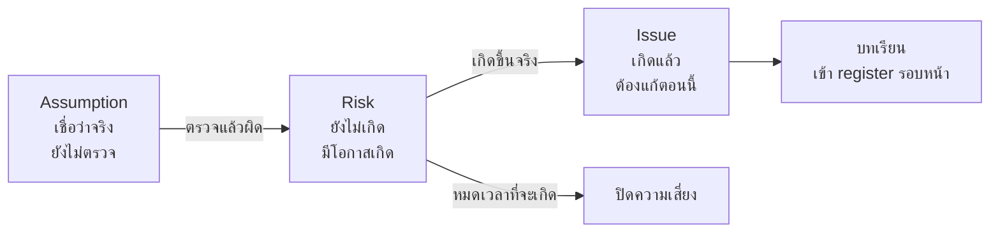
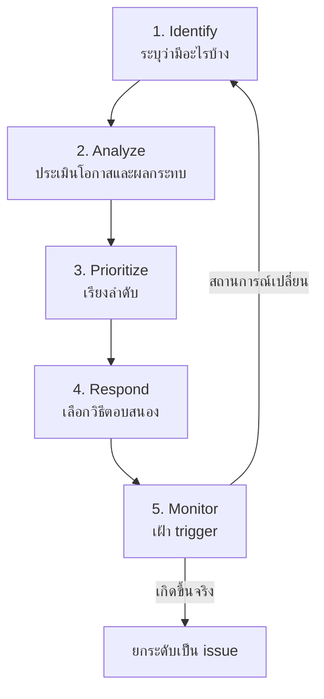
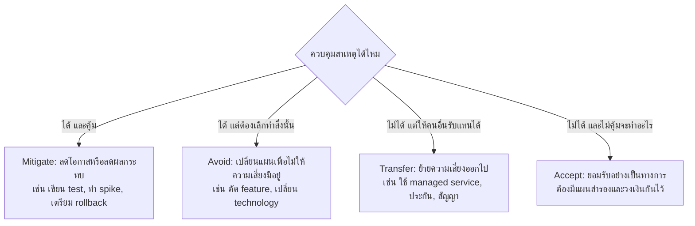
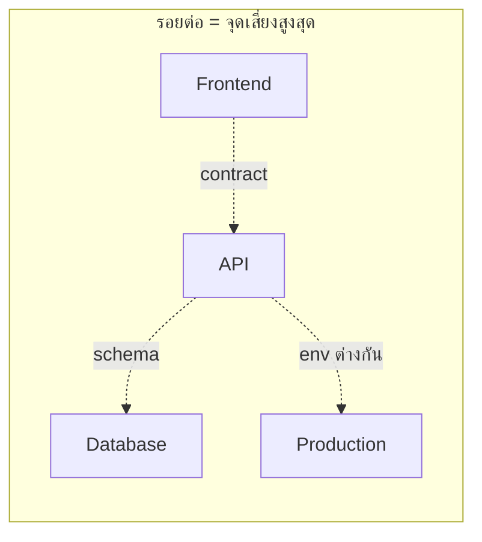
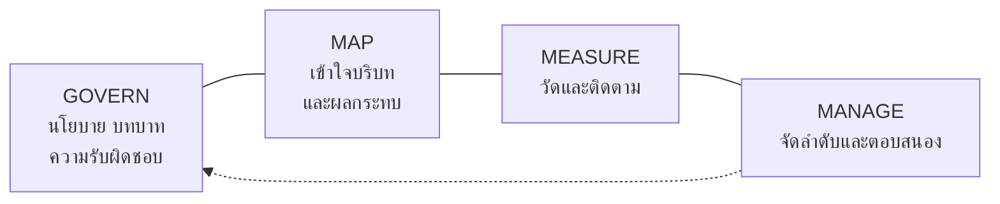
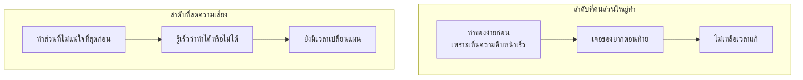

# Risk Management สำหรับงานซอฟต์แวร์

> เอกสารนี้เขียนโดยมี AI (Claude) ช่วย อาจมีส่วนที่ผิด ตกหล่น หรือเก่าไปแล้ว
> ลองเช็กกับแหล่งอ้างอิงท้ายบทและแหล่งอื่นก่อนเชื่อ การสงสัยสิ่งที่อ่านก็เป็นส่วนหนึ่งของวิชานี้
> ตัวเลขในกรณีตัวอย่างและตารางตัวอย่างเป็นตัวเลขสมมติ ไม่ได้มาจากงานวิจัย

> **เชื่อมกับ loop ของวิชา:** ความเสี่ยงคือความไม่รู้ที่มีราคา
> การจัดการความเสี่ยงจึงเป็นการตัดสินใจว่า จะยอมจ่ายเท่าไรเพื่อรู้คำตอบให้เร็วขึ้นกี่วัน

---

## อ่านแล้วจะได้อะไร

| สิ่งที่จะทำได้ | ใช้ในงานจริงอย่างไร |
|---|---|
| แยก risk, issue และ assumption ออกจากกันได้ | ทีมที่ปนสามคำนี้จะรายงานสถานะผิด และแก้ปัญหาผิดจังหวะ |
| ทำ risk register ที่ใช้งานได้จริง ไม่ใช่เอกสารประดับ | ผู้บริหารมักเปิดเอกสารนี้ก่อนเมื่อโครงการเริ่มมีปัญหา |
| เลือกวิธีตอบสนองความเสี่ยงให้เหมาะกับต้นทุน | ถ้า mitigate ทุกข้อเท่ากัน ทีมจะเสียเวลากับเรื่องที่ไม่สำคัญ |
| จัดลำดับงานโดยเอาความเสี่ยงขึ้นก่อน | เป็นวิธีคิดที่แยก senior ออกจาก junior ได้ชัดเรื่องหนึ่ง |
| ระบุความเสี่ยงแบบใหม่ที่มากับ AI agent | องค์กรเริ่มมีนโยบายเรื่องนี้แล้ว และมักถูกถามในการสัมภาษณ์งาน |

---

## ศัพท์ที่ควรรู้ก่อน

| ศัพท์ | ความหมายในวิชานี้ |
|---|---|
| Risk | เหตุการณ์ที่ยังไม่เกิด แต่ถ้าเกิดจะกระทบเป้าหมาย มีความน่าจะเป็นเสมอ |
| Issue | ความเสี่ยงที่เกิดขึ้นแล้ว ต้องแก้ตอนนี้ ไม่ใช่แค่เฝ้าระวัง |
| Assumption | สิ่งที่เราเชื่อว่าจริงโดยยังไม่ได้ตรวจ ถ้าผิดก็จะกลายเป็น risk ทันที |
| Constraint | ข้อจำกัดที่รู้แน่นอนแล้ว เช่น ต้องส่งงานก่อนสอบไฟนอล |
| Likelihood | โอกาสที่ความเสี่ยงจะเกิด |
| Impact | ความรุนแรงถ้าเกิดขึ้น |
| Exposure / EMV | ค่าคาดหวังของความเสียหาย = likelihood × impact |
| Risk appetite | ระดับความเสี่ยงที่องค์กรยอมรับได้โดยไม่ต้องทำอะไร |
| Trigger | สัญญาณที่บอกว่าความเสี่ยงกำลังจะกลายเป็น issue |
| Risk owner | คนเดียวที่รับผิดชอบเฝ้าและตัดสินใจเรื่องความเสี่ยงข้อนั้น |
| Residual risk | ความเสี่ยงที่ยังเหลืออยู่หลังทำมาตรการแล้ว |
| Spike | งานทดลองสั้น ๆ เพื่อลดความไม่รู้ ไม่ได้ทำเพื่อส่งมอบ feature |
| Bus factor | ถ้าหายไปพร้อมกันกี่คนแล้วโครงการเดินต่อไม่ได้ ตัวเลขนั้นคือ bus factor |
| Blameless postmortem | การถอดบทเรียนหลังเกิดเหตุ โดยหาสาเหตุที่ตัวระบบ ไม่หาตัวคนผิด |

---

## 1. ความเสี่ยงคืออะไร และไม่ใช่อะไร

ประโยคที่เจอบ่อยในรายงานของนักศึกษา

> แบบที่ไม่ช่วย: "ความเสี่ยงคือทีมอาจทำงานไม่ทัน"

ประโยคนี้ใช้ไม่ได้ เพราะไม่บอกว่าอะไรทำให้ไม่ทัน เลยไม่รู้ว่าจะลงมือทำอะไร
ประโยคความเสี่ยงที่ใช้ได้จริงมี 3 ส่วน

> **เพราะ** [ข้อเท็จจริงที่เป็นสาเหตุ] → **อาจเกิด** [เหตุการณ์ที่ไม่แน่นอน] → **ซึ่งจะทำให้** [ผลกระทบที่วัดได้]

ตัวอย่างที่แก้แล้ว

> แบบที่ช่วย: "**เพราะ** ทั้งกลุ่มไม่มีใครเคยใช้ WebSocket มาก่อน
> **อาจเกิด** การที่ feature แจ้งเตือนแบบ real-time ใช้เวลานานกว่าที่ประมาณไว้ 2 เท่า
> **ซึ่งจะทำให้** ไม่มีเวลาทำ E2E test ก่อน present"

### ความต่างที่ต้องแยกให้ออก



ความผิดพลาดที่เจอบ่อยที่สุดคือเอา issue ไปใส่ในตารางความเสี่ยง
รายงานจะดูเหมือนมีการจัดการ แต่จริง ๆ เป็นรายการปัญหาที่ยังไม่มีใครแก้

---

## 2. วงจรการจัดการความเสี่ยง

มาตรฐาน ISO 31000 วางกระบวนการเป็นวงจรที่ต้องหมุนซ้ำ ไม่ได้ทำครั้งเดียวตอนต้นโครงการ



สำหรับโครงการขนาดวิชาเรียน ให้ทบทวน register สัปดาห์ละครั้ง ครั้งละ 15 นาที
ในที่ประชุมถามแค่ 3 ข้อ

1. ข้อไหนหายไปแล้ว ปิดทิ้งได้
2. ข้อไหนใกล้จะเกิด ไปดู trigger
3. มีอะไรใหม่จากสิ่งที่เพิ่งรู้สัปดาห์นี้

> **กรณีตัวอย่าง**
> Risk register ที่ไม่เคยมีบรรทัดไหนถูกปิดเลย คือ register ที่ไม่มีใครอ่าน
> การปิดความเสี่ยงได้เป็นสัญญาณที่ดี เพราะแปลว่าความไม่รู้ลดลงจริง

---

## 3. ประเมินความเสี่ยง

### วิธีเชิงคุณภาพ: ตาราง Likelihood × Impact

ใช้สเกล 1–5 ทั้งสองแกน แล้วคูณกันได้คะแนน 1–25

| | **Impact 1**<br/>เล็กน้อย | **2**<br/>น้อย | **3**<br/>ปานกลาง | **4**<br/>สูง | **5**<br/>รุนแรง |
|---|---|---|---|---|---|
| **Likelihood 5** เกิดแน่ | 5 | 10 (กลาง) | 15 (สูง) | 20 (สูง) | 25 (สูง) |
| **4** น่าจะเกิด | 4 | 8 (กลาง) | 12 (กลาง) | 16 (สูง) | 20 (สูง) |
| **3** เกิดได้ | 3 | 6 | 9 (กลาง) | 12 (กลาง) | 15 (สูง) |
| **2** ไม่น่าเกิด | 2 | 4 | 6 | 8 (กลาง) | 10 (กลาง) |
| **1** แทบเป็นไปไม่ได้ | 1 | 2 | 3 | 4 | 5 |

- **สูง (15–25)** ต้องมีแผนตอบสนองที่ลงมือแล้ว และมีเจ้าของชัดเจน
- **กลาง (8–14)** ต้องมีแผนเตรียมไว้ และมี trigger ที่เฝ้าอยู่
- **ต่ำ (1–7)** รับไว้ ทบทวนเดือนละครั้ง

กับดักที่ต้องระวัง คือคะแนนที่คูณกันทำให้ความเสี่ยงที่โอกาสต่ำมากแต่ผลกระทบมหาศาล
ได้คะแนนเท่ากับความเสี่ยงที่โอกาสสูงแต่ผลกระทบเล็ก ทั้งที่สองแบบนี้ต้องจัดการต่างกันมาก
ข้อมูลรั่วไหลมีโอกาสเกิดต่ำ แต่ถ้าเกิดแล้วโครงการอาจจบทันที
ความเสี่ยงแบบนี้ให้ดูที่ผลกระทบเป็นหลัก ไม่ใช่คะแนนรวม

### วิธีเชิงปริมาณ: Expected Monetary Value

$$EMV = P(\text{เกิด}) \times \text{ผลกระทบ}$$

ตัวอย่างการใช้ตัดสินใจ (ตัวเลขสมมติ)

| ทางเลือก | ต้นทุนที่ต้องจ่ายแน่ | ความเสี่ยงที่เหลือ | EMV รวม |
|---|---|---|---|
| ไม่ทำอะไร | 0 | 40% × เสียเวลา 10 วัน | 4.0 วัน |
| ทำ spike ทดลอง 1 วัน | 1 วัน | 10% × เสียเวลา 10 วัน | 2.0 วัน |
| เปลี่ยนไปใช้ของที่ทีมคุ้นเคย | 2 วัน | 5% × เสียเวลา 4 วัน | 2.2 วัน |

ตัวเลขไม่ต้องแม่นก็ได้ ประโยชน์ของการเขียนออกมาคือ การเถียงจะเปลี่ยนจาก
"ฉันรู้สึกว่าเสี่ยง" เป็น "เราเห็นไม่ตรงกันที่ตัวเลขไหน" ซึ่งคุยต่อได้

---

## 4. เลือกวิธีตอบสนอง



ข้อสำคัญคือ Accept ที่ถูกต้องต้องเขียนลงเอกสาร ไม่ใช่เงียบไว้
"เรารู้ว่าเสี่ยง และตัดสินใจร่วมกันว่ารับได้ ถ้าเกิดจะทำ X" ต่างจาก
"ไม่มีใครพูดถึงมันเลย" มากในวันที่เรื่องนั้นเกิดขึ้นจริง

ความไม่แน่นอนไม่ได้แย่เสมอไป ISO 31000 นิยาม risk ว่าเป็นผลของความไม่แน่นอนต่อเป้าหมาย
ซึ่งรวมด้านบวกด้วย วิธีตอบสนองฝั่งบวกที่เทียบกันได้คือ Exploit, Enhance, Share, Accept

---

## 5. ความเสี่ยงที่พบจริงในโครงการซอฟต์แวร์

### 5.1 Technical risk: ของที่ไม่เคยทำ

สัญญาณเตือน คือไม่มีใครในทีมเคยทำสิ่งนี้ และไม่มีตัวอย่างใกล้เคียงพอ

วิธีจัดการ คือทำ spike เป็นงานทดลองที่กำหนดเวลาตายตัว เช่น 4 ชั่วโมง
ต้องมีเกณฑ์ชัดว่าอะไรคือคำตอบที่ต้องได้ และตกลงกันล่วงหน้าว่า
"ถ้าหมดเวลาแล้วยังไม่ได้คำตอบ เราจะเลือกทางสำรอง"

จุดที่คนพลาดบ่อยคือเอา code ของ spike ไปใช้ต่อ
spike เขียนเพื่อเรียนรู้ ไม่ใช่เพื่อใช้งาน ควรทิ้งแล้วเขียนใหม่พร้อม test

### 5.2 Integration risk: จุดที่ระบบมาเจอกัน

ความเสี่ยงในซอฟต์แวร์มักกระจุกอยู่ที่รอยต่อ ได้แก่ ระหว่าง frontend กับ API,
ระหว่าง app กับ database, และระหว่างเครื่องเรากับเครื่อง production



มาตรการที่ได้ผลคือเปลี่ยนความเสี่ยงตรงรอยต่อให้เป็นเครื่องมือ
ล็อก API contract ให้ชัดก่อนเริ่มเขียน code, ใช้ container ให้ environment เหมือนกันทุกเครื่อง,
และให้ CI ตรวจทุกรอยต่ออัตโนมัติทุก commit

### 5.3 People risk: bus factor

ถ้าโครงการมีคนเดียวที่ตั้ง environment เป็น และคนนั้นป่วยในสัปดาห์สอบ
โครงการก็หยุดทันที นี่คือ bus factor = 1

วิธีจัดการที่ทำได้ทันที
- ทุกอย่างที่ทำด้วยมือต้องมีเอกสาร หรือดีกว่านั้นคือทำเป็น script
- `README` ต้องพาคนใหม่จาก clone ไปถึงรันได้ด้วยคำสั่งไม่เกิน 3 บรรทัด
- หมุนเวียนคนทำงานแต่ละส่วนอย่างน้อย 1 ครั้งต่อเทอม

> **กรณีตัวอย่าง**
> `docker compose up` ที่รันได้จริงในเครื่องของคนใหม่ ลด people risk ได้ดีกว่าเอกสาร onboarding 20 หน้า
> เพราะเอกสารจะเก่า แต่ compose file ที่ CI รันทุกวันจะไม่เก่า

### 5.4 Schedule risk: งานที่ประเมินต่ำเป็นประจำ

งานที่มักถูกลืมตอนประมาณเวลา

- [ ] เวลา review และแก้ตาม review
- [ ] เวลา deploy ครั้งแรก ซึ่งแทบไม่เคยผ่านในครั้งแรก
- [ ] เวลาแก้ bug ที่เจอตอน integrate
- [ ] เวลาเขียนเอกสารและเตรียม present
- [ ] เวลารอคนอื่น เช่น รออนุมัติ รอคำตอบ รอสิทธิ์เข้าถึง

เวลารอคนอื่นเป็นตัวที่ประเมินพลาดหนักที่สุด เพราะไม่ปรากฏใน task ของใครเลย
วิธีจัดการคือเริ่มงานที่ต้องรอคนอื่นให้เร็วที่สุด แม้ยังไม่ถึงคิวตามแผน

### 5.5 Security risk

ความเสี่ยงด้านความปลอดภัยต่างจากข้ออื่นตรงที่ผลกระทบไม่ได้จบที่โครงการของเรา
ข้อมูลผู้ใช้ที่รั่วไปแล้วเรียกคืนไม่ได้ และในไทยมี PDPA กำกับด้วย

ใช้ OWASP Top 10 เป็น checklist ตั้งต้น สิ่งที่ต้องจำในเรื่อง risk คือ
ช่องโหว่ด้าน security มักได้คะแนน likelihood ต่ำ แต่ impact สูงสุด จึงต้องดูที่ impact

---

## 6. ความเสี่ยงแบบใหม่ที่มากับ AI

การใส่ AI agent เข้ามาใน loop เพิ่มความเสี่ยงที่ตำรา PM แบบเดิมไม่ได้พูดถึง

| ความเสี่ยง | เกิดขึ้นอย่างไร | มาตรการที่ใช้ได้จริง |
|---|---|---|
| Hallucination | AI สร้าง API ฟังก์ชัน หรือแหล่งอ้างอิงที่ไม่มีอยู่จริง อย่างมั่นใจ | ทุกอย่างต้องรันได้จริง และทุกลิงก์ต้องเปิดได้จริงก่อน commit |
| Automation bias | คนเชื่อคำตอบที่จัดหน้าสวยมากกว่าที่ควร | กติกา "อธิบายไม่ได้ ห้าม commit" |
| Excessive agency | ให้ agent รันคำสั่งเองได้มากเกินความจำเป็น | จำกัดสิทธิ์ และต้องมีคนอนุมัติก่อนแตะ production |
| Prompt injection | ข้อความในไฟล์หรือเว็บที่ agent อ่านแฝงคำสั่งไว้ | ถือว่าทุกอย่างที่ agent อ่านเป็นข้อมูล ไม่ใช่คำสั่ง |
| ข้อมูลรั่วผ่าน prompt | วาง secret ข้อมูลลูกค้า หรือ code ภายในลงในเครื่องมือภายนอก | กติกาข้อ 3 ของวิชา ห้ามส่ง secret เข้า AI tool |
| License / IP | code ที่ AI สร้างอาจคล้ายของที่มีลิขสิทธิ์ | ตรวจ license ของ dependency และไม่ลอกก้อนใหญ่โดยไม่เข้าใจ |
| Skill atrophy | ทีมอธิบาย code ของตัวเองไม่ได้ | oral defense ทุกสัปดาห์ |
| Vendor / model drift | โมเดลเปลี่ยนเวอร์ชัน ผลลัพธ์เปลี่ยนตาม | อย่าให้ระบบพึ่ง output ที่ไม่ deterministic โดยไม่มี test คุม |

กรอบอ้างอิงที่องค์กรใช้จริงคือ NIST AI Risk Management Framework (AI RMF 1.0)
ซึ่งแบ่งหน้าที่เป็น 4 กลุ่ม



> **กรณีตัวอย่าง**
> คำถามที่เจอในการสัมภาษณ์งานมากขึ้นเรื่อย ๆ คือ
> "คุณให้ AI agent ทำอะไรได้บ้าง และอะไรที่คุณไม่ให้ทำ เพราะอะไร"
> คำตอบที่ดีไม่ใช่ "ใช้ทุกอย่าง" หรือ "ไม่ใช้เลย" แต่คืออธิบายเส้นแบ่งพร้อมเหตุผลได้

---

## 7. เทคนิคที่ใช้ได้ทันที

### Pre-mortem: ถอดบทเรียนก่อนเกิดเหตุ

เทคนิคของ Gary Klein ใช้เวลา 15 นาที แต่ได้ผลมาก

1. สมมติว่าตอนนี้เป็นวัน present และโครงการล้มเหลวไปแล้ว
2. ให้ทุกคนเขียนคนละ 5 นาทีว่ามันล้มเพราะอะไร เขียนเป็นอดีตกาล
3. อ่านออกมาทีละคน แล้วรวมเป็นรายการ
4. เลือก 3 ข้อที่คนเขียนตรงกันมากที่สุด ใส่ risk register พร้อมมาตรการ

ที่ได้ผลกว่าการถามว่า "มีความเสี่ยงอะไรบ้าง" เพราะการสมมติว่าล้มไปแล้ว
ทำให้คนกล้าพูดสิ่งที่ปกติไม่กล้า เพราะกลัวดูเป็นคนขวางทีม

### จัดลำดับงานโดยเอาความเสี่ยงขึ้นก่อน



เหตุผลเดียวกันนี้ทำให้ควร deploy ของจริงตั้งแต่ยังไม่มี feature
เพราะ deploy เป็นส่วนที่ไม่แน่นอนที่สุดและถูกเลื่อนบ่อยที่สุด จึงต้องเอามาไว้ต้นทาง

### Blameless postmortem

เมื่อความเสี่ยงกลายเป็น issue จริง สิ่งที่ทำหลังจากนั้นสำคัญกว่าตัวเหตุการณ์

แม่แบบสั้น ๆ ที่ใช้ได้

```markdown
## เกิดอะไรขึ้น
[ลำดับเหตุการณ์พร้อมเวลา — ข้อเท็จจริงล้วน ไม่มีการตีความ]

## ผลกระทบ
[ใครได้รับผลกระทบ นานเท่าไร วัดเป็นตัวเลขได้ไหม]

## ทำไมระบบถึงยอมให้เกิดขึ้นได้
[ถามว่า "ทำไม" ต่อเนื่องจนถึงสาเหตุเชิงระบบ ไม่หยุดที่ "คนทำพลาด"]

## สัญญาณที่มีอยู่แล้วแต่ไม่มีใครเห็น
[log, test, alert ที่ควรจับได้แต่ไม่ได้จับ]

## จะทำอะไรให้มันจับได้เองครั้งหน้า
[งานที่มีเจ้าของและกำหนดวัน — ไม่ใช่ "จะระมัดระวังมากขึ้น"]
```

บรรทัดสุดท้ายคือหัวใจ "จะระมัดระวังมากขึ้น" ไม่ใช่มาตรการ
มาตรการจริงคือสิ่งที่ทำให้ครั้งหน้าระบบจับได้เอง โดยไม่ต้องพึ่งความจำของคน
ซึ่งก็คือการเพิ่ม coverage ให้ loop นั่นเอง

---

## 8. แม่แบบ Risk Register

สร้างไฟล์ `docs/risk-register.md` ในโครงการของกลุ่ม

```markdown
# Risk Register — [ชื่อโครงการ]
อัปเดตล่าสุด: [วันที่]

| ID | ความเสี่ยง (เพราะ...อาจเกิด...ทำให้...) | L | I | คะแนน | วิธีตอบสนอง | มาตรการที่ลงมือแล้ว | Trigger | เจ้าของ | สถานะ |
|---|---|---|---|---|---|---|---|---|---|
| R1 | เพราะไม่มีใครเคยตั้ง CI มาก่อน อาจเกิดการที่ pipeline ใช้เวลาเกิน 2 วัน ทำให้งานส่วน CI/CD ไม่เสร็จ | 4 | 3 | 12 | Mitigate | ทำ spike 3 ชม. ในสัปดาห์ก่อนหน้า | ผ่านไป 1 วันแล้ว workflow ยังแดง | [ชื่อ] | เปิด |
| R2 | | | | | | | | | |

## ความเสี่ยงที่ปิดแล้ว
| ID | ความเสี่ยง | ปิดเมื่อ | เหตุผลที่ปิด |
|---|---|---|---|

## Assumption ที่ยังไม่ได้ตรวจ
| สมมติฐาน | จะตรวจอย่างไร | ตรวจเมื่อไร |
|---|---|---|
```

เกณฑ์ว่า register ใช้ได้จริงหรือไม่ คือเปิดดูแล้วต้องตอบได้ทันทีว่า
สัปดาห์นี้ต้องเฝ้าอะไรเป็นพิเศษ ถ้าตอบไม่ได้ แปลว่ายังเป็นเอกสารประดับ

---

## เอกสารอ้างอิง

**มาตรฐานและกรอบ**
- ISO 31000 — Risk management guidelines (https://www.iso.org/iso-31000-risk-management.html)
- ISO/IEC 27005 — Information security risk management
  (https://www.iso.org/standard/80585.html)
- NIST — *AI Risk Management Framework (AI RMF 1.0)*
  (https://www.nist.gov/itl/ai-risk-management-framework)
- NIST — Risk Management Framework for Information Systems
  (https://csrc.nist.gov/projects/risk-management)
- PMI — PMBOK Guide 7th Edition, performance domain ว่าด้วย *Uncertainty*
  (https://www.pmi.org/standards/pmbok)

**ความเสี่ยงด้านความปลอดภัยและ AI**
- OWASP Top 10 (https://owasp.org/www-project-top-ten/)
- OWASP Top 10 for LLM Applications
  (https://owasp.org/www-project-top-10-for-large-language-model-applications/)
- OWASP Risk Rating Methodology
  (https://owasp.org/www-community/OWASP_Risk_Rating_Methodology)
- สำนักงานคณะกรรมการคุ้มครองข้อมูลส่วนบุคคล — PDPA (https://www.pdpc.or.th/)

**เทคนิคและงานวิจัย**
- Gary Klein — *Performing a Project Premortem*, Harvard Business Review
  (https://hbr.org/2007/09/performing-a-project-premortem)
- Google SRE Book — *Postmortem Culture: Learning from Failure*
  (https://sre.google/sre-book/postmortem-culture/)
- Google SRE Book — *Embracing Risk* (https://sre.google/sre-book/embracing-risk/)
- Bent Flyvbjerg & Alexander Budzier — *Why Your IT Project May Be Riskier Than You Think*,
  Harvard Business Review (https://hbr.org/2011/09/why-your-it-project-may-be-riskier-than-you-think)
  ซึ่งเป็นที่มาของแนวคิด *black swan IT project*
