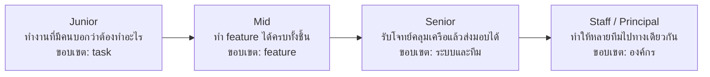
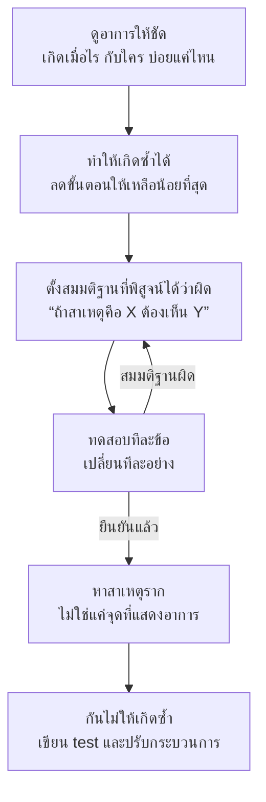
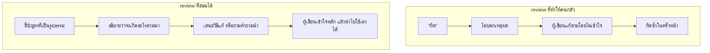
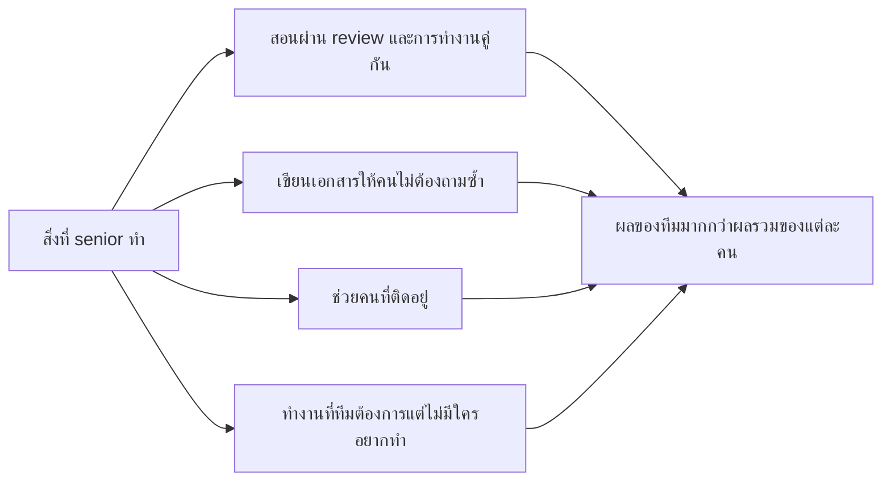
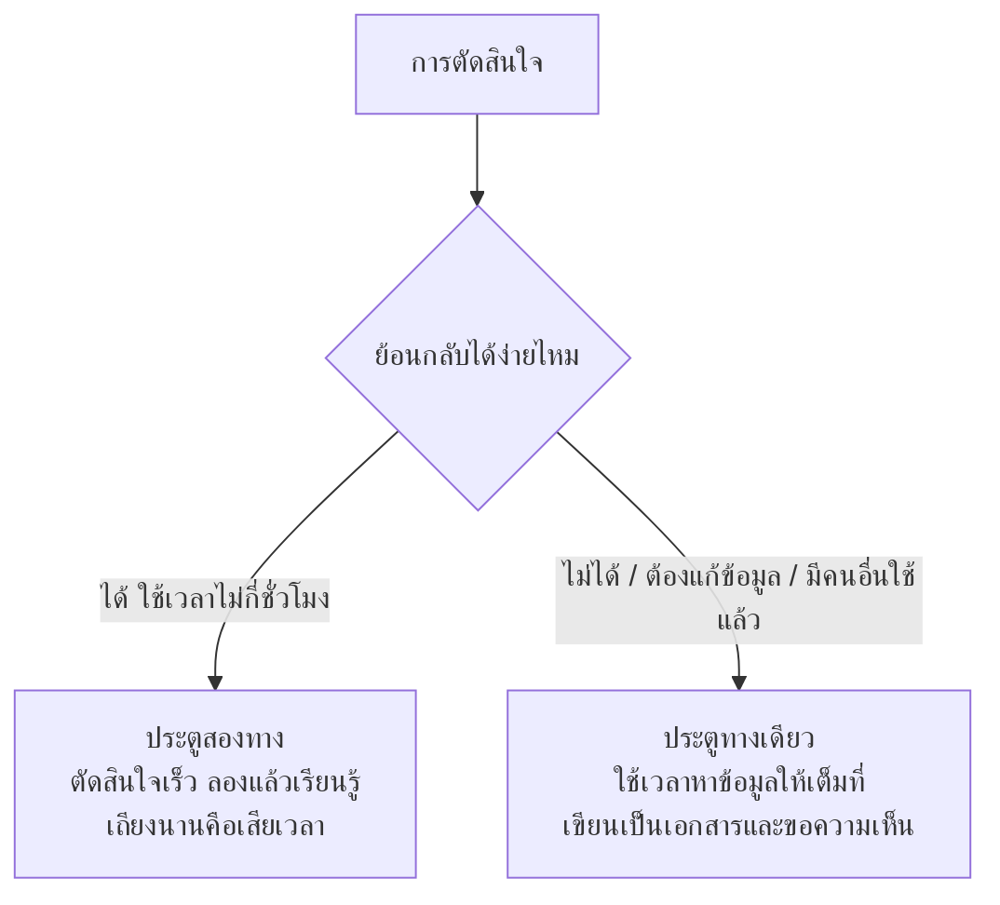
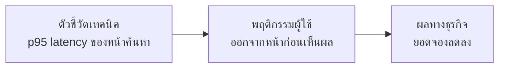
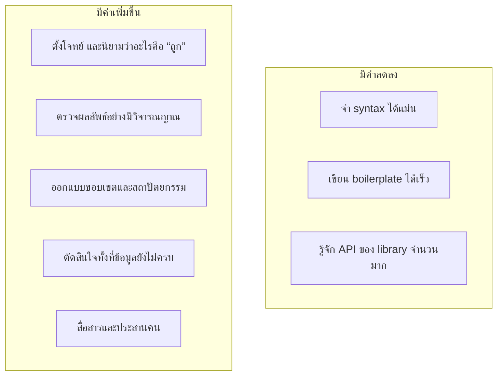
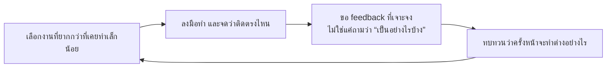

# เป็น Senior Software Engineer ต้องทำอะไรบ้าง

> เอกสารนี้เขียนโดยมี AI (Claude) ช่วย อาจมีส่วนที่ผิด ตกหล่น หรือเก่าไปแล้ว
> ลองเช็กกับแหล่งอ้างอิงท้ายบทก่อนเชื่อ การสงสัยสิ่งที่อ่านก็เป็นส่วนหนึ่งของวิชานี้
> ตัวเลขในกรณีตัวอย่างเป็นตัวเลขสมมติ ไม่ได้มาจากงานวิจัย

> **เชื่อมกับ loop ของวิชา:** ระดับของวิศวกรดูได้จากขนาดของ loop ที่รับผิดชอบเองได้
> Junior ปิด loop ของงานชิ้นเดียว Senior ปิด loop ของทั้งระบบ ตั้งแต่โจทย์จนถึงของที่ผู้ใช้ใช้จริง

---

## อ่านแล้วจะได้อะไร

| เรื่อง | ทำไมถึงสำคัญ |
|---|---|
| รู้ว่า senior วัดจากอะไร ถ้าไม่ใช่จำนวนปี | วางแผนพัฒนาตัวเองได้ตั้งแต่ปีแรก |
| แปลงโจทย์ที่ยังคลุมเครือให้เป็นงานที่ลงมือทำได้ | เป็นสิ่งที่แยก senior ออกจาก mid ชัดที่สุด |
| เขียนเอกสารออกแบบและอธิบาย trade-off ให้คนอื่นตัดสินใจได้ | วิศวกรระดับสูงมีอิทธิพลผ่านงานเขียนมากกว่า code |
| ทำ code review ให้คนเขียนเก่งขึ้น | review เป็นวิธีสอนที่ถูกที่สุดในทีม |
| ดูแลระบบตอนที่มันพัง ไม่ใช่แค่ตอนที่มันทำงาน | คนเชื่อใจเรา เพราะเห็นว่าเราทำอะไรในวันที่แย่ |
| ใช้ AI โดยที่ตัวเองไม่อ่อนลง | ใครทำได้ จะโตต่อได้ในระยะยาว |

---

## ศัพท์ที่ควรรู้ก่อน

| ศัพท์ | ความหมาย |
|---|---|
| Scope | ขนาดงานที่รับผิดชอบได้โดยไม่ต้องมีคนคอยดู |
| Impact | ผลที่เกิดกับผู้ใช้หรือธุรกิจ ไม่ใช่จำนวนงานที่ทำ |
| IC track | เส้นทางที่เติบโตได้โดยไม่ต้องเป็นหัวหน้าคน (Individual Contributor) |
| Staff / Principal | ระดับเหนือ senior บนเส้นทาง IC ดูแลงานที่ครอบคลุมหลายทีม |
| Design doc / RFC | เอกสารเสนอวิธีแก้ปัญหา ให้คนอื่นช่วยตรวจก่อนลงมือ |
| Glue work | งานที่ทำให้ทีมเดินต่อได้แต่ไม่ได้ออกมาเป็น feature เช่น ประสานงาน เขียนเอกสาร ตามแก้ของค้าง |
| Disagree and commit | ไม่เห็นด้วย แต่เมื่อทีมตัดสินแล้วก็ช่วยกันทำเต็มที่ |
| Bus factor | ถ้าสมาชิกกี่คนหายไปพร้อมกันแล้วงานเดินต่อไม่ได้ ตัวเลขนั้นคือ bus factor |
| Yak shaving | แก้ปัญหาย่อยซ้อนกันไปเรื่อย จนลืมว่าเริ่มต้นจะทำอะไร |
| Bikeshedding | เถียงกันนานเรื่องเล็กที่ใคร ๆ ก็มีความเห็น แล้วข้ามเรื่องใหญ่ที่ยากกว่า |
| Blast radius | ถ้าสิ่งที่ทำผิดพลาด ความเสียหายจะกว้างแค่ไหน |
| Deliberate practice | ฝึกเฉพาะจุดอ่อน และได้ feedback ทันที |

---

## 1. Senior ไม่ได้วัดจากจำนวนปี

หลายคนคิดว่า senior คือคนที่ทำงานมานาน หรือเขียน code เก่ง สองอย่างนี้ช่วยได้ แต่องค์กรไม่ได้ใช้เป็นเกณฑ์หลัก



เกณฑ์ที่ใช้เลื่อนระดับมักดูจาก 3 เรื่อง

| เรื่อง | Junior | Mid | Senior |
|---|---|---|---|
| รับความคลุมเครือได้แค่ไหน | ต้องมีคนบอกว่าทำอะไรและทำอย่างไร | รู้ว่าทำอะไร แล้วหาวิธีเอง | รับปัญหาที่ยังไม่มีใครนิยาม แล้วแปลงเป็นงานได้ |
| ผลงานกระทบอะไร | งานของตัวเอง | feature ของทีม | ระบบ กระบวนการ และคนรอบตัว |
| อะไรต้องให้คนตรวจ | เกือบทุกอย่าง | การตัดสินใจใหญ่ | เฉพาะเรื่องที่กระทบหลายทีม |

ถ้าจะให้นิยามสั้น ๆ senior คือคนที่หัวหน้าไม่ต้องห่วงว่างานจะออกมาเป็นอย่างไร
ไม่ใช่เพราะทำเองทุกอย่าง แต่เพราะรู้ว่าเมื่อไรควรถาม

> **กรณีตัวอย่าง**
> มีทั้งคนที่ทำงาน 10 ปีแล้วยังเป็น mid และคนที่ทำ 3 ปีก็เป็น senior
> ส่วนใหญ่ต่างกันที่ประเภทของงานที่เคยทำ ไม่ใช่ความเก่ง
> คนที่ทำ feature แบบเดิมซ้ำ 10 ปี ได้ประสบการณ์จริงราว 1 ปี ที่ทำซ้ำ 10 รอบ
> การเลือกรับงานที่ยังไม่เคยทำจึงเป็นการลงทุนกับตัวเอง

---

## 2. ทักษะเทคนิคที่เปลี่ยนไปเมื่อโตขึ้น

### 2.1 อ่าน code มากกว่าเขียน code

โดยทั่วไปวิศวกรอ่าน code มากกว่าเขียนหลายเท่า ยิ่งระดับสูงยิ่งอ่านมาก ลองฝึกสิ่งเหล่านี้

- เปิด repo ที่ไม่เคยเห็น แล้วหาจุดเริ่มต้นของระบบให้เจอภายใน 30 นาที
- ตามดู 1 request ตั้งแต่เข้ามาทาง HTTP จนถึง database
- อ่าน commit history เพื่อดูว่า code ถึงเป็นแบบนี้เพราะอะไร

เวลาเข้า repo ใหม่ ให้เริ่มจาก 3 ไฟล์ คือ `README` ไฟล์ที่กำหนด route (หรือ urls) และไฟล์ที่กำหนด schema ของข้อมูล
สามไฟล์นี้บอกได้ว่าระบบทำอะไร รับอะไรเข้ามา และเก็บอะไรไว้

### 2.2 ดีบักอย่างเป็นระบบ



ที่ senior ต่างจาก junior ไม่ได้อยู่ที่ความเร็ว แต่อยู่ที่ไม่ข้ามขั้น
Junior มักเห็นอาการแล้วแก้ตรงที่เดาว่าเป็นสาเหตุเลย บางครั้งก็ถูก แต่ถ้าผิดจะเสียเวลามาก และมักทิ้งของเกินไว้ใน code

ก่อนปิดงานให้ลองถามตัวเองว่า "ทำไมมันเพิ่งพังตอนนี้" ถ้าตอบไม่ได้ แปลว่ายังไม่เจอสาเหตุ แค่ทำให้อาการหายไป

### 2.3 ออกแบบให้เปลี่ยนง่ายในจุดที่น่าจะเปลี่ยน

Junior มักออกแบบรองรับทุกกรณีไว้ก่อน จนระบบยืดหยุ่นเกินและไม่มีใครเข้าใจ
Senior ทำให้ส่วนที่น่าจะเปลี่ยนเปลี่ยนได้ง่าย ส่วนที่เหลือปล่อยให้ตรงไปตรงมา

| คำถาม | ถ้าตอบว่าใช่ |
|---|---|
| มีคนขอเปลี่ยนเรื่องนี้มาแล้วอย่างน้อย 2 ครั้งไหม | คุ้มที่จะทำให้ยืดหยุ่น |
| ถ้าเปลี่ยนทีหลังต้องแก้ข้อมูลที่มีอยู่ไหม | ควรคิดให้ดีตั้งแต่ตอนแรก |
| ยังไม่มีใครขอ แต่คิดว่าสักวันคงมี | ยังไม่ต้องทำ จดไว้ใน backlog |

### 2.4 ดูแลระบบตอนอยู่บน production

เส้นแบ่งอย่างหนึ่งคือ หลัง merge แล้วเรายังสนใจ code ของตัวเองอยู่หรือเปล่า

- **ก่อนปล่อย:** รู้ว่าถ้าพังจะย้อนกลับอย่างไร และใช้เวลานานเท่าไร
- **หลังปล่อย:** เปิดดู log และ metric ว่าของใหม่ทำงานตามที่คิดไหม
- **ตอนมีเหตุ:** บอกสถานะให้คนอื่นรู้ระหว่างแก้ ไม่เงียบไปจนแก้เสร็จ
- **หลังเหตุ:** เขียนบันทึกที่หาสาเหตุในระบบ ไม่ใช่หาคนผิด

---

## 3. ทักษะที่ไม่ใช่เทคนิค แต่มีผลมาก

### 3.1 งานเขียนช่วยขยายอิทธิพลได้มากที่สุด

code ที่เขียนกระทบระบบเดียว แต่เอกสารที่เขียนกระทบทุกคนที่อ่าน และยังใช้ได้อยู่หลังจากเราย้ายทีมไปแล้ว

โครงของ design doc ที่เอาไปใช้ได้เลย

```markdown
## ปัญหา
[อธิบายปัญหาโดยยังไม่พูดถึงวิธีแก้ ถ้าเขียนส่วนนี้ไม่ได้ แปลว่ายังไม่เข้าใจปัญหา]

## ทำไมต้องแก้ตอนนี้
[ถ้าไม่ทำอะไร จะเสียอะไร]

## ข้อจำกัด
[เวลา คน ระบบเดิม ข้อกำหนดทางกฎหมาย]

## ทางเลือกที่พิจารณา
| ทางเลือก | ได้อะไร | เสียอะไร | ใช้แรงประมาณเท่าไร |
|---|---|---|---|

## ข้อเสนอ
[เลือกทางไหน เพราะอะไร]

## สิ่งที่ยังไม่รู้ และจะรู้ได้อย่างไร
[คำถามเปิดที่อยากได้ความเห็นจากคนตรวจ]

## แผนย้อนกลับ
[ถ้าทำแล้วผิด จะถอยอย่างไร]
```

หัวข้อ "สิ่งที่ยังไม่รู้" ทำให้เอกสารของ senior ต่างจากเอกสารทั่วไป
เพราะเมื่อบอกชัดว่าไม่รู้อะไร คนอื่นจะช่วยได้ตรงจุด

### 3.2 Code review ที่ทำให้คนเก่งขึ้น



- แยกให้ชัดว่าอะไรต้องแก้ อะไรเป็นความชอบส่วนตัว เรื่องเล็กให้ขึ้นต้นด้วย "nit:"
- คอมเมนต์ที่ตัวปัญหา ไม่ใช่ที่ตัวคน เช่น "ตรงนี้จะพังถ้า list ว่าง" แทนที่จะเป็น "ลืมเช็กหรือเปล่า"
- ถ้าจะไม่รับแนวทางทั้งหมด ให้คุยกันตรง ๆ ข้อความยาวในหน้า review อ่านแล้วเหมือนถูกโจมตี
- ชมส่วนที่ดีด้วย ไม่ใช่ชี้แต่ข้อผิด
- อย่าปล่อย PR ค้าง review ช้าทำให้ loop ของทั้งทีมช้าไปด้วย

### 3.3 ปฏิเสธงานอย่างมืออาชีพ

การรับทุกงานที่ถูกขอไม่ได้แปลว่าขยัน ผลคือทีมทำได้ไม่ดีสักอย่าง

> แบบที่ไม่ช่วย: "ทำไม่ได้ครับ ไม่มีเวลา"
> แบบที่ช่วย: "รับได้ครับ ถ้าเลื่อนงาน A ไปสัปดาห์หน้า หรือถ้า A สำคัญกว่า
> ผมทำเวอร์ชันย่อของงานนี้ให้ก่อนภายในวันศุกร์ได้ อยากให้เลือกทางไหนครับ"

วิธีคือไม่ปฏิเสธตรง ๆ แต่ทำให้เห็นต้นทุน แล้วให้คนที่มีอำนาจเลือก

### 3.4 ทำให้คนรอบตัวเก่งขึ้น

ตัวคูณของ senior อยู่ที่ผลลัพธ์ของทั้งทีม ไม่ใช่ผลงานของตัวเอง



เรื่อง glue work: งานประสานงาน เขียนเอกสาร และตามแก้ของค้าง จำเป็นกับทีม แต่มักไม่ถูกนับในการประเมินผล
ถ้าทำงานแบบนี้เยอะ ให้จดไว้ เล่าให้หัวหน้าฟังตอนประเมิน และดูว่ามันไม่ได้กินเวลาจนเราไม่เหลือเวลาทำงานเทคนิค
ไม่อย่างนั้นจะทำงานหนักมากแต่ไม่ได้เลื่อนระดับ

---

## 4. การตัดสินใจ

### 4.1 แยกประตูทางเดียวกับประตูสองทาง



ทีมมักพลาดด้วยการสลับกัน เช่น เถียงเรื่องชื่อตัวแปรสองชั่วโมง แล้วเลือกฐานข้อมูลในสิบนาที

### 4.2 ตอบว่า "แล้วแต่กรณี" ให้มีประโยชน์

"It depends" ไม่ใช่คำตอบที่ผิด แต่ถ้าพูดแค่นั้นก็ไม่ช่วยอะไร
คำตอบของ senior ต้องบอกด้วยว่าแล้วแต่อะไร

> แบบที่ไม่ช่วย: ถาม "ใช้ SQL หรือ NoSQL ดี" ตอบ "แล้วแต่กรณี"
> แบบที่ช่วย: "ขึ้นกับ 3 เรื่อง คือ ข้อมูลต้อง join หลายตารางบ่อยไหม schema จะเปลี่ยนบ่อยแค่ไหน
> และทีมคุ้นกับอะไร ถ้าตอบสามข้อนี้ได้ ผมตอบได้ทันที"

### 4.3 คิดถึง blast radius ก่อนลงมือ

ก่อนแตะอะไรบน production ให้ตอบ 3 ข้อนี้ให้ได้

1. ถ้าผิด ใครได้รับผลกระทบ และกี่คน
2. จะรู้ได้เร็วแค่ไหนว่าผิด
3. ย้อนกลับใช้เวลาเท่าไร และเคยซ้อมไว้หรือยัง

ถ้าข้อ 2 ตอบว่า "รอผู้ใช้แจ้ง" ก็ยังไม่ควรทำ จนกว่าจะมีสัญญาณเตือนที่ดีกว่านั้น

---

## 5. เข้าใจธุรกิจ

นักศึกษามักข้ามเรื่องนี้ แต่ถ้าไม่รู้ว่าองค์กรหาเงินอย่างไร ก็จะจัดลำดับงานผิดโดยไม่รู้ตัว

ลองหาคำตอบเหล่านี้ให้ได้ภายในเดือนแรกที่ทำงาน

- องค์กรมีรายได้จากอะไร ระบบส่วนไหนเกี่ยวกับรายได้โดยตรง
- ผู้ใช้จริงคือใคร ตอนนี้เขาลำบากกับอะไรมากที่สุด
- ผู้บริหารดูตัวเลขอะไรทุกสัปดาห์
- ถ้าระบบส่วนที่เราดูแลล่ม 1 ชั่วโมง ธุรกิจจะเสียหายอย่างไร



ต้องฝึกเชื่อมสามกล่องนี้ให้ได้ ข้อเสนอที่ไปถึงกล่องขวาสุดมักผ่านอนุมัติ ส่วนข้อเสนอที่หยุดแค่กล่องซ้ายมักถูกเลื่อนไปเรื่อย ๆ

> **กรณีตัวอย่าง (ตัวเลขสมมติ)**
> เวลาขออนุมัติเวลาปรับปรุง code เก่า ประโยคที่ได้ผลกว่า "code มันแย่มาก" คือ
> "ตอนนี้ทุก feature ในส่วนนี้ใช้เวลามากกว่าที่ควร 40% ถ้าลงทุน 5 วันแก้ตอนนี้ คาดว่าจะคืนทุนภายในสองเดือน"

---

## 6. เป็น senior ในยุคที่ AI เขียน code ได้

### 6.1 อะไรมีค่าลดลง อะไรมีค่าเพิ่มขึ้น



ฝั่งที่มีค่าลดลงคือ accidental complexity ส่วนฝั่งที่มีค่าเพิ่มขึ้นคือ essence ตามแนวคิดของ Fred Brooks (ดู `05-mythical-man-month.md`)

### 6.2 วิธีใช้ AI โดยที่ตัวเองไม่อ่อนลง

| ข้อปฏิบัติ | เหตุผล |
|---|---|
| อ่านทุกบรรทัดที่จะ commit และอธิบายได้ | ถ้าอธิบายไม่ได้ วันที่มันพังก็แก้ไม่ได้ |
| กำหนดก่อนว่าอะไรคือคำตอบที่ถูก แล้วค่อยถาม | ไม่อย่างนั้นจะรับคำตอบแรกที่ฟังดูสมเหตุสมผล |
| ให้ AI เสนอหลายทาง ไม่ใช่ขอคำตอบเดียว | จะได้เห็น trade-off ไม่ใช่เห็นแค่ข้อสรุป |
| ห้ามให้ AI แก้ test เพื่อให้ผ่าน | เท่ากับทำลายสัญญาณที่เราสร้างไว้ตรวจงาน |
| เรื่องที่ยังไม่เก่ง ให้ลองเองก่อนแล้วค่อยเทียบ | ถ้าข้ามช่วงที่ต้องดิ้นรน ทักษะจะไม่เกิด |
| ไม่เอาข้อมูลลับหรือข้อมูลผู้ใช้ไปใส่เครื่องมือภายนอก | เป็นเรื่องกฎหมาย ไม่ใช่เรื่องความสะดวก |

สำหรับคนที่เพิ่งเริ่ม ข้อนี้สำคัญที่สุด ทางลัดของ AI มีประโยชน์มากถ้าเรารู้อยู่แล้วว่าคำตอบที่ดีหน้าตาเป็นอย่างไร
แต่ถ้ายังไม่รู้ จะแยกไม่ออกเลยว่าคำตอบนั้นแย่

วิธีที่ปลอดภัยคือสลับโหมด งานที่ต้องส่งใช้ AI ช่วยได้เต็มที่ แต่ต้องกันเวลาส่วนหนึ่งไว้ทำเองทั้งหมด เพื่อให้ทักษะยังโตต่อ

### 6.3 หน้าที่ใหม่ของ senior ในทีมที่ใช้ AI

- ออกแบบบริบทที่ทีมและ agent ใช้ร่วมกัน เช่น มาตรฐาน กฎการออกแบบ ตัวอย่างที่ดี
- เพิ่มความสามารถของขั้นตรวจสอบให้ทันปริมาณ code ที่มากขึ้น
- ดูแลไม่ให้ junior ข้ามขั้นการเรียนรู้จนไม่โต
- กำหนดเส้นว่าอะไรที่ agent ทำเองได้ และอะไรต้องให้คนอนุมัติก่อน

---

## 7. พฤติกรรมที่ทำให้ติดอยู่ระดับเดิม

| พฤติกรรม | ที่เห็น | ปัญหา |
|---|---|---|
| ฮีโร่ | แก้ทุกวิกฤตคนเดียว แม้ตอนตีสาม | องค์กรพึ่งตัวเรา แทนที่จะแก้ระบบ และเราจะหมดแรง |
| ฉลาดเกินจำเป็น | เขียน code ที่ดูเก๋ แต่คนอื่นอ่านไม่ออก | code ถูกอ่านบ่อยกว่าถูกเขียนหลายเท่า |
| ผู้เฝ้าประตู | ทุกอย่างต้องผ่านเราก่อน | เราเป็นคอขวดของทีม |
| เถียงเรื่องเล็กจนลืมเรื่องใหญ่ | เสียเวลากับรูปแบบการจัด code มากกว่าการออกแบบข้อมูล | เวลาหมดไปกับเรื่องที่ผลกระทบน้อย |
| เงียบทั้งที่ไม่เห็นด้วย | ไม่พูดในที่ประชุม แล้วบ่นทีหลัง | ทีมตัดสินใจโดยขาดข้อมูลที่เรามี |
| สมบูรณ์แบบเกินไป | ไม่ปล่อยของจนกว่าจะไม่มีที่ติ | ของที่ไม่ถึงมือผู้ใช้ ไม่มีค่าเลย |
| ทำเองทุกอย่าง | เขียนเองหมดแทนที่จะใช้ของที่มีอยู่ | เสียเวลากับปัญหาที่คนอื่นแก้ไปแล้ว |

---

## 8. แผนพัฒนาตัวเอง

### 8.1 วงจรการเติบโต



เวลาขอ feedback อย่าถามว่า "งานผมเป็นอย่างไรบ้างครับ" ให้ถามว่า
"ถ้าให้ผมทำงานนี้ใหม่อีกครั้ง มีอะไรที่พี่จะทำต่างจากผมสัก 1 อย่าง"
คำถามที่เจาะจงจะได้คำตอบที่เอาไปใช้ต่อได้

### 8.2 สิ่งที่ทำได้ตั้งแต่ยังเรียนอยู่

- [ ] อ่าน code ของโครงการ open source ที่คนใช้จริง แล้วตามให้ได้ว่า 1 request ทำงานอย่างไร
- [ ] เขียนเอกสารออกแบบก่อนทำ feature ที่ใหญ่กว่าปกติอย่างน้อย 1 ชิ้น
- [ ] ทำ code review ให้เพื่อนในกลุ่มตามหลักในหัวข้อ 3.2
- [ ] เป็นคน deploy และเฝ้าดูผลหลัง deploy อย่างน้อย 1 ครั้ง
- [ ] ทำ postmortem ของเหตุการณ์ที่ทีมพลาด โดยไม่ระบุว่าใครทำ
- [ ] อธิบาย trade-off ของการตัดสินใจหนึ่งเรื่องให้คนนอกกลุ่มฟังจนเขาเข้าใจ
- [ ] จดเวลาที่ใช้จริงเทียบกับที่ประเมินไว้ ต่อเนื่อง 1 เทอม
- [ ] สอนเพื่อนในเรื่องที่เพิ่งเรียน เป็นวิธีเช็กความเข้าใจที่เข้มที่สุดวิธีหนึ่ง

### 8.3 สัญญาณว่ามาถูกทาง

| สัญญาณ | ความหมาย |
|---|---|
| มีคนมาขอความเห็นก่อนตัดสินใจ | คนเชื่อวิจารณญาณของเรา |
| งานที่ได้รับเริ่มคลุมเครือขึ้น | หัวหน้าเชื่อว่าเรานิยามงานเองได้ |
| เริ่มห่วงผลกระทบมากกว่ารายละเอียดของ code | มุมมองขยับจากงานชิ้นเดียวไปสู่ระบบ |
| คนอื่นใช้เอกสารหรือเครื่องมือที่เราทำไว้ | ผลงานขยายออกไปเกินตัวเรา |
| ปฏิเสธงานได้โดยไม่รู้สึกผิด | เข้าใจแล้วว่าการจัดลำดับความสำคัญเป็นหน้าที่อย่างหนึ่ง |

---

## เอกสารอ้างอิง

**เส้นทางอาชีพและระดับ**
- Will Larson. *StaffEng*. รวมเรื่องเล่าและกรอบคิดของเส้นทาง IC ระดับ staff ขึ้นไป
  (https://staffeng.com/)
- Will Larson. *An Elegant Puzzle: Systems of Engineering Management*
- Camille Fournier. *The Manager's Path*. มีบทที่อธิบายบทบาท tech lead ละเอียด
- Progression.fyi. รวม career ladder ที่บริษัทจริงเปิดเผยต่อสาธารณะ
  (https://www.progression.fyi/)
- Dropbox. *Engineering Career Framework* (https://dropbox.github.io/dbx-career-framework/)

**การทำงานร่วมกันและอิทธิพล**
- Tanya Reilly. *Being Glue* (https://noidea.dog/glue)
- Google. *Engineering Practices: Code Review Developer Guide*
  (https://google.github.io/eng-practices/review/)
- Google. *re:Work*. งานวิจัยเรื่องปัจจัยที่ทำให้ทีมทำงานได้ดี
  (https://rework.withgoogle.com/)
- Amazon. แนวคิด two-way door และ disagree and commit ในจดหมายถึงผู้ถือหุ้นปี 2016
  (https://www.aboutamazon.com/news/company-news/2016-letter-to-shareholders)

**การทำงานกับระบบจริง**
- Google. *Site Reliability Engineering* (https://sre.google/books/)
- Google. *Software Engineering at Google* (https://abseil.io/resources/swe-book)
- Michael Feathers. *Working Effectively with Legacy Code*
- Titus Winters, Tom Manshreck และ Hyrum Wright. บทว่าด้วยความต่างระหว่าง
  *programming* กับ *software engineering* ใน *Software Engineering at Google*

**หลักฐานเรื่องผลของ AI ต่อการทำงานของวิศวกร**
- METR. *Measuring the Impact of Early-2025 AI on Experienced Open-Source Developer
  Productivity* (https://metr.org/blog/2025-07-10-early-2025-ai-experienced-os-dev-study/)
- DORA. *Accelerate State of DevOps Report* (https://dora.dev/)
